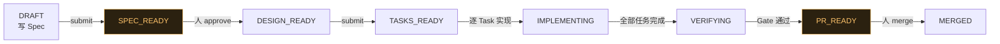

<div align="center">


# 把 SDD 装进仓库

**开发者只说一次需求，Agent 按仓库里的 `next.action` 自动推进。你只在两个地方出现：确认 Spec，合并 PR。**

[](https://github.com/RyanBrainNew/sdd-kit/actions/workflows/tests.yml)


[](https://ryanbrainnew.github.io/sdd-kit/)

[官网](https://ryanbrainnew.github.io/sdd-kit/) | [完整指南](docs/GUIDE.md) | [架构](ARCHITECTURE.md) | [Agent 协议](sdd/agent-contract.md)

</div>

---

SDD Kit 把公司 SDD-L2 的流程做成**仓库自带的默认开发路径**，而不是另一份需要人工执行的规范文档。

- **一个状态机**：阶段、工件校验、Gate 和审计事件只在 `sdd/scripts/sdd.py` 里定义。
- **任何 Agent 都能接入**：Claude Code、Cursor、Kiro 或自研 Agent，只要能执行 shell，就调用同一个 CLI。
- **零初始化**：平台团队 bootstrap 一次，开发者 `git clone` 后直接开始。
- **流程能被强制**：Git Hook 与 CI 校验工件，`approve`、`merge`、`unblock` 强制由人执行。


## 为什么需要它

大多数“AI 开发流程”最后都会变成三样东西：一份没人读的文档、一套每个人配置不同的 IDE 插件、以及一堆无法复查的聊天记录。SDD Kit 把这三件事收回到仓库里：

| 问题 | SDD Kit 的做法 |
|---|---|
| 流程靠 Agent 自觉 | CLI 返回唯一的 `next.action`，`ok=false` 时必须按 `errors` 修复后重试 |
| 每个 IDE 一套规则 | `AGENTS.md` 托管块 + `python -m sdd`，规则与工具解耦 |
| 证据散落在对话里 | Spec、Design、Tasks、Gate 报告、测试命令都随 Git 提交 |
| 人工确认太多 | 只保留 Spec 确认与 PR 合并两个检查点 |

## 它怎么工作



Agent 每次会话先运行 `python -m sdd resume --json`，读取：

```json
{
  "action": "implement_task",
  "task": "T-001",
  "submit_with": "sdd submit-task",
  "human_checkpoint": { "required": false }
}
```

不需要问“现在是什么阶段”，也不需要人手工选择 `DRAFT`、`SPEC_READY`。

## 快速开始

### 1. 平台团队：每个仓库接入一次

```powershell
python bootstrap.py --target "D:\repos\order-api" --project order-api `
  --test-command "python -m pytest -q" --ci gitlab
```

它会复制 `sdd/` 核心、合并 `AGENTS.md` 托管块、写入 manifest、安装 Git Hook 与 CI 模板。已有 `AGENTS.md` 不会被覆盖。

### 2. 开发者：每次会话恢复

```powershell
git clone <repo>
cd <repo>
python -m sdd resume --json
```

Agent 读到 `next.action` 后继续。没有当前需求时，只问一次工作项，然后运行 `sdd start-work`。

### 3. 合并前：跑同一组校验

```powershell
python -m unittest discover -s tests -v
python -m sdd verify-core
python -m sdd verify-agent
python -m sdd check --all --stage ci
```

CI 执行同样的命令。核心被改、托管块漂移或工件缺失都会失败。

## 常用命令

| 命令 | 执行者 | 用途 |
|---|---|---|
| `python -m sdd resume --json` | Agent | 恢复当前 Spec，返回唯一的下一个动作 |
| `python -m sdd start-work --work-item <id> --json` | Agent | 把工作项绑定到新 Spec |
| `python -m sdd submit --artifact <name> --file <path> --json` | Agent | 提交阶段工件并接受校验 |
| `python -m sdd submit-task --task T-xxx --evidence "..." --json` | Agent | 完成一个任务并记录测试证据 |
| `python -m sdd report` | Agent | 生成 PR 正文与 Gate 摘要 |
| `python -m sdd approve --spec <id> --human --evidence "..."` | 人 | 确认 Spec |
| `python -m sdd merge --spec <id> --human --evidence "..."` | 人 | 确认合并 |
| `python -m sdd check --all --stage ci` | CI | 校验全部工件、Gate 与 Git 状态 |

## 仓库结构

```text
sdd/scripts/sdd.py     状态机、工件校验、Gate
sdd/core.py            会话指针与 submit/report 编排
sdd/cli.py             python -m sdd 入口
sdd/agents.py          AGENTS.md 托管块合并
sdd/templates/         六个阶段骨架
sdd/prompts/           Agent 方法层
sdd/context/           多微服务上下文模板
sdd/mcp/               可选 MCP 适配器
bootstrap.py           业务仓库一次性接入
tests/                 单元与集成测试
site/                  GitHub Pages 官网
ci/                    测试与 CI 模板
deploy/                共享 MCP 部署示例
dsh/                   dsh / harness 薄适配约定
```

`sdd/` 核心由平台团队维护；业务仓库只维护 `sdd/config.json`、`sdd/context/` 和 `docs/specs/`。

## 文档

| 文档 | 内容 |
|---|---|
| [官网](https://ryanbrainnew.github.io/sdd-kit/) | 一页看懂定位、链路与命令 |
| [完整指南](docs/GUIDE.md) | 接入、架构、MCP、FAQ 与全部命令细节 |
| [ARCHITECTURE.md](ARCHITECTURE.md) | 设计取舍、模块边界与分阶段落地 |
| [ADOPTION.md](ADOPTION.md) | 从单仓库试点到多仓库推广 |
| [sdd/agent-contract.md](sdd/agent-contract.md) | Agent 自动循环与人类检查点契约 |
| [sdd/README.md](sdd/README.md) | 业务仓库内的执行手册 |
| [sdd/mcp/README.md](sdd/mcp/README.md) | MCP 工具、本地与共享部署 |
| [deploy/README.md](deploy/README.md) | 共享 MCP 的容器部署 |
| [LANDSCAPE.md](LANDSCAPE.md) | 与 aidlc、Trellis、Spec Kitty 等方案的关系 |

## 适合与不适合

**适合**

- 多个业务仓库，需要统一 L2 流程与审计证据
- 团队混用不同 Agent 或 IDE
- 已有 `AGENTS.md`，希望增量接入
- Git 与 CI 已是默认基础设施

**不适合**

- 单人一次性脚本，没有 Spec、Gate 或合并流程
- 没有 Git 或 CI，无法留下可校验证据
- 需要集中式 Web 审批台；当前只有 CLI 与 MCP
- 希望工具替代需求判断或代码评审

## 开发

只使用 Python 标准库；MCP 依赖隔离在 `sdd/mcp/requirements.txt`。

```powershell
$env:PYTHONIOENCODING='utf-8'
python -m unittest discover -s tests -v
python -m sdd verify-core
python -m sdd verify-agent
```

修改受保护文件后，必须更新版本并重新生成 manifest：

```powershell
python -m sdd manifest --write
```

`sdd/manifest.json` 与 `sdd/VERSION` 必须提交，不能加入 `.gitignore`。

## 贡献

1. 先在 Issue 里说明工作项与影响范围。
2. 从 `main` 切分支，保持 diff 聚焦。
3. 修改核心时同步更新测试、README、`sdd/agent-contract.md` 和相关提示词。
4. 提交前运行上面的全部校验命令。
5. 人工动作 `approve`、`merge`、`unblock` 只能由人执行，CI 会拒绝 Agent 代办。

## 许可证

当前仓库**未声明**开源许可证。在添加 `LICENSE` 之前，默认保留所有权利；不要假设可以复制、修改或分发。

---

<div align="center">

**SDD Kit 0.6.1** · 把 SDD 装进仓库

</div>
