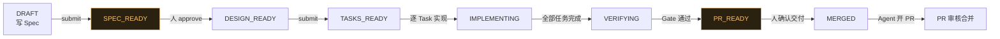

<div align="center">


# 把 SDD 装进仓库

**开发者只说一次需求，Agent 按仓库里的 `next.action` 自动推进。你只在两个地方出现：确认 Spec，确认交付。**

[](https://github.com/RyanBrainNew/sdd-kit/actions/workflows/tests.yml)


[](https://ryanbrainnew.github.io/sdd-kit/)

[官网](https://ryanbrainnew.github.io/sdd-kit/) | [完整指南](docs/GUIDE.md) | [架构](ARCHITECTURE.md) | [Agent 协议](sdd/agent-contract.md) | [路线图](https://github.com/RyanBrainNew/sdd-kit/issues)

</div>

---

SDD Kit 把公司 SDD-L2 的流程做成**仓库自带的默认开发路径**，而不是另一份需要人工执行的规范文档。

- **一个状态机**：阶段、工件校验、Gate 和审计事件只在 `sdd/scripts/sdd.py` 里定义。
- **四套命名工作流**：`l2-standard`、`l2-hotfix`、`l2-strict`，以及 schema 2 的
  `l2-refactor`；Spec 创建时固定版本。
- **任何 Agent 都能接入**：Claude Code、Cursor、Kiro 或自研 Agent，只要能执行 shell，就调用同一个 CLI。
- **零初始化**：平台团队 bootstrap 一次，开发者 `git clone` 后直接开始。
- **流程能被强制**：Git Hook 与 CI 校验工件，`approve`、`merge`、`unblock`、`rewind` 强制由人执行。


## 当前形态（0.8.0）

| 维度 | 当前实现 |
|---|---|
| CLI 入口 | `python -m sdd resume / start-work / submit / submit-task / check` |
| 状态机 | `DRAFT` → `SPEC_READY` → `DESIGN_READY` → `TASKS_READY` → `IMPLEMENTING` → `VERIFYING` → `PR_READY` → `MERGED` |
| 工作流 | `l2-standard` 默认；`l2-hotfix` 用轻量设计并拒绝高风险；`l2-strict` 的 G0–G5 全部人工；`l2-refactor` 使用 schema 2 声明检查组合与上下文 |
| 人工边界 | 正常流程只有 Spec 确认、交付确认两个计划内检查点；交付确认后才创建 PR；`unblock`、`rewind` 是例外动作 |
| 证据链 | Gate 报告、产物 SHA-256、`state.json`、`events.jsonl`、测试证据都随 Git 提交 |
| 可运维 | `board`、`inbox`、`metrics`、`events` 已可用；`rewind` 是人工回退动作 |
| 集成 | MCP 是可选薄适配；同时提供 GitHub Actions 与 GitLab CI 模板 |
| 官方门面 | `site/` 由 GitHub Pages 发布；本 README 只保留首页和导航 |

尚未实现的能力不在本文里冒充“已有”：`sdd view`、`upgrade-workflow`、外部 runner 契约、
审批版本绑定、`change-set` / `impact`、全量 commit 审计与 `trace` 都在下面的路线图中。

## 为什么需要它

大多数“AI 开发流程”最后都会变成三样东西：一份没人读的文档、一套每个人配置不同的 IDE 插件、以及一堆无法复查的聊天记录。SDD Kit 把这三件事收回到仓库里：

| 问题 | SDD Kit 的做法 |
|---|---|
| 流程靠 Agent 自觉 | CLI 返回唯一的 `next.action`，`ok=false` 时必须按 `errors` 修复后重试 |
| 每个 IDE 一套规则 | `AGENTS.md` 托管块 + `python -m sdd`，规则与工具解耦 |
| 证据散落在对话里 | Spec、Design、Tasks、Gate 报告、测试命令都随 Git 提交 |
| 人工确认太多 | 只保留 Spec 确认与交付确认两个检查点 |

## 它怎么工作



Agent 每次会话先运行 `python -m sdd resume --json`，读取 `next.action`、`next.submit_with`
和 `human_checkpoint`。不需要问“现在是什么阶段”，也不需要人手工选择 `DRAFT`、`SPEC_READY`。

| 预设 | 适用场景 | 关键差异 |
|---|---|---|
| `l2-standard` | 默认 L2 需求 | G0 人工；G2 仅高风险人工；其余自动 |
| `l2-hotfix` | 紧急修复，低/中风险 | 轻量设计模板；G2 自动；高风险与 `risk_stop` 标签直接拒绝 |
| `l2-strict` | 安全、迁移、破坏性变更 | G0–G5 全部人工；验证需要独立审查人 |
| `l2-refactor` | 行为保持型改造 | schema 2；裁剪 advisory 检查；上下文纳入 `docs/knowledge/**` |

Spec 创建时会把预设快照写入 `docs/specs/<Spec>/workflow.json`；之后仓库预设升级不会改变旧 Spec。
新增或修改 `sdd/workflows/*.json` 后先用
`python -m sdd workflow validate --file sdd/workflows/<name>.json` 校验。

## 快速开始

### 1. 平台团队：每个仓库接入一次

```powershell
cd D:\repos\order-api
python D:\tools\sdd-kit\bootstrap.py
```

目标默认是当前目录，项目 ID 默认取目录名 `order-api`，所以不需要再传 `--target` 和
`--project`。它会复制 `sdd/` 核心、合并 `AGENTS.md` 托管块、写入 manifest、安装 Git Hook
与 CI 模板；已有 `AGENTS.md` 不会被覆盖。

仓库用 pytest 或需要 CI 模板时再补参数：

```powershell
python D:\tools\sdd-kit\bootstrap.py --test-command "python -m pytest -q" --ci gitlab
```

在 sdd-kit 目录内执行 `python bootstrap.py --target "D:\repos\order-api"` 也等价。

### 2. 开发者：每次会话恢复

```powershell
git clone <repo>
cd <repo>
python -m sdd resume --json
```

Agent 读到 `next.action` 后继续。没有当前需求时，只问一次工作项，然后运行 `sdd start-work`。

### 3. 合并前：跑同一组校验

```powershell
python -m unittest discover -s tests -v
python -m sdd verify-core
python -m sdd verify-agent
python -m sdd check --all --stage ci
```

CI 执行同样的命令。核心被改、托管块漂移或工件缺失都会失败。文本工件哈希按
LF 规范化，历史 CRLF 哈希仍可验证，Windows 与 Linux 工作区不会因行尾差异误报。

## 常用命令

| 命令 | 执行者 | 用途 |
|---|---|---|
| `python -m sdd resume --json` | Agent | 恢复当前 Spec，返回唯一的下一个动作 |
| `python -m sdd start-work --work-item <id> --json` | Agent | 把工作项绑定到新 Spec |
| `python -m sdd start-work ... --workflow l2-hotfix` | 人 | 为紧急修复指定命名工作流 |
| `python -m sdd workflow validate --file <profile>` | 人 / Agent | 校验工作流 profile 并返回 digest |
| `python -m sdd submit --artifact <name> --file <path> --json` | Agent | 提交阶段工件并接受校验 |
| `python -m sdd submit-task --task T-xxx --evidence "..." --json` | Agent | 完成一个任务并记录测试证据 |
| `python -m sdd report` | Agent | 生成 PR 正文与 Gate 摘要 |
| `python -m sdd board` / `inbox` / `metrics` / `events` | 人 / Agent | 查看看板、待办、指标和审计事件 |
| `python -m sdd approve --spec <id> --human --evidence "..."` | 人 | 确认 Spec |
| `python -m sdd merge --spec <id> --human --evidence "..."` | 人 | 确认交付（之后才开 PR） |
| `python -m sdd rewind --spec <id> --to <stage> --reason "..." --human` | 人 | 回退到更早阶段并保留审计 |
| `python -m sdd check --all --stage ci` | CI | 校验全部工件、Gate 与 Git 状态 |

## 仓库结构

```text
AGENTS.md                    # 项目规则 + SDD 托管块
README.md                    # 首页：定位、接入、目录与路线图
ARCHITECTURE.md              # 设计取舍与模块边界
DESIGN-NEXT.md               # 0.9.0 及后续设计
ADOPTION.md                  # 从试点到多仓库推广
LANDSCAPE.md                 # 与 aidlc、Trellis、Spec Kitty 的对照
bootstrap.py                 # 业务仓库一次性接入
docs/
  GUIDE.md                   # 完整接入、架构、人工步骤、FAQ
  GITHUB-ABOUT.md            # 仓库 About 文案、Topics、Homepage
  prd-index.md               # 工作项 → FEAT → Spec 的追溯索引
  assets/site-preview.png    # 官网首屏截图
  specs/<Spec ID>/           # 每个需求的 SDD 工件（见下表）
sdd/
  scripts/sdd.py             # 唯一状态机、工件校验、Gate
  core.py                    # Workspace、会话指针与 submit/report 编排
  cli.py                     # python -m sdd 入口
  templates/                 # 六个阶段骨架
  workflows/                 # l2-standard / l2-hotfix / l2-strict / l2-refactor
  prompts/                   # Agent 方法层
  context/                   # 服务卡、契约、ADR、术语模板
  hooks/                     # pre-commit / commit-msg
  ci/                        # GitHub / GitLab CI 模板
  mcp/                       # 可选 MCP 适配器
  reports/<Spec ID>/         # gate0-report.md ... gate5-report.md
site/                        # GitHub Pages 官网（只发布这个目录）
ci/                          # 本仓库的测试工作流
deploy/                      # 共享 MCP 部署示例
dsh/                         # dsh / harness 薄适配约定
tests/                       # 单元、CLI、站点与集成测试
```

### `docs/` 里生成的那些文件

每个需求的目录固定为 `docs/specs/<Spec ID>/`；下表说明目录内各文件的来源和用途。

| 路径 | 生成方式 | 作用 |
|---|---|---|
| `docs/prd-index.md` | Agent / CLI 更新 | 工作项 → FEAT → Spec 的追溯索引 |
| `docs/specs/<Spec>/spec.md` | Agent 调研后写，`sdd submit` 校验 | 范围、FR/AC、边界与验收条件 |
| `design.md` / `tasks.md` | Agent 写，CLI 校验 | 设计与可执行任务计划 |
| `verification.md` | Agent 或 `sdd verify` | AC 覆盖、命令、退出码和测试证据 |
| `gates.md` | CLI 记录 | G0–G5 的状态、模式、证据和时间 |
| `decisions.md` / `context.md` / `unknowns.md` | Agent 维护 | 关键取舍、调研事实、未决问题 |
| `PR_BODY.md` | `sdd report` | PR 四要素与 Gate 摘要 |
| `workflow.json` | 创建 Spec 时快照 | 固定本次需求使用的工作流版本 |
| `state.json` / `events.jsonl` | 只能由 CLI 写 | 当前状态、审批、产物哈希与 append-only 审计流 |
| `sdd/reports/<Spec>/gateN-report.md` | CLI 记录 | 每个 Gate 的独立报告与产物哈希 |
| `.sdd/runtime/` | 本地运行 | 会话指针与临时运行文件，已 gitignore |

`docs/` 是随代码提交的审计面；`site/` 是可公开发的官网。两者刻意分离，
Pages 工作流只上传 `site/`，不会把 Spec、Gate 报告或业务上下文发布出去。
Gate 报告单独写入 `sdd/reports/<Spec ID>/`，与 `docs/` 下的 Spec 工件分开。

## 路线图与 Issues

| 状态 | Issue | 内容 |
|---|---|---|
| 已交付 | 0.7.0 | `rewind`、`inbox`、`metrics`、事件 v2、产物哈希、审批身份 |
| 已交付 | 0.8.0 | 三套命名工作流、Spec 快照、`l2-strict` 独立审查、Apache-2.0 与官网 |
| 已交付 | 0.9.4 | schema 2 工作流 Profile、`workflow validate`、`l2-refactor` 示范预设 |
| 未开发（0.9.0） | [#1](https://github.com/RyanBrainNew/sdd-kit/issues/1) | 只读单文件 HTML 运行视图 `sdd view` |
| 未开发（0.9.0） | [#2](https://github.com/RyanBrainNew/sdd-kit/issues/2) | 外部 runner 接入契约 `deploy/runner/CONTRACT.md` |
| 未开发（后续） | [#3](https://github.com/RyanBrainNew/sdd-kit/issues/3) | 固定预设升级 `upgrade-workflow` |
| 设计阶段（P0） | [#8](https://github.com/RyanBrainNew/sdd-kit/issues/8) | 治理闭环：审批版本绑定、`change-set` / `impact`、可复验证据、全量 commit 审计与 `trace` |
| 总纲（epic） | [#7](https://github.com/RyanBrainNew/sdd-kit/issues/7) | 轻量、可自定义、全链路可溯源的 SDD-L2 执行内核 |

路线图以 GitHub Issues 为准；未开发项不会出现在命令表中，也不会在站点的“当前形态”里冒充已交付。

## 文档

| 文档 | 内容 |
|---|---|
| [官网](https://ryanbrainnew.github.io/sdd-kit/) | 一页看懂定位、链路、命令与路线图 |
| [完整指南](docs/GUIDE.md) | 接入、架构、MCP、FAQ 与全部命令细节 |
| [ARCHITECTURE.md](ARCHITECTURE.md) | 设计取舍、模块边界与分阶段落地 |
| [CONTEXT-BUNDLE.md](docs/CONTEXT-BUNDLE.md) | `next.context_bundle` 的字段、范围与只读语义 |
| [STANDARD-CONFORMANCE.md](docs/STANDARD-CONFORMANCE.md) | 官方 P0–P5 / G0–G5 的实现、证据、缺口与状态 |
| [DESIGN-NEXT.md](DESIGN-NEXT.md) | 下一阶段设计与待落地能力 |
| [ADOPTION.md](ADOPTION.md) | 从单仓库试点到多仓库推广 |
| [LANDSCAPE.md](LANDSCAPE.md) | 与 aidlc、Trellis、Spec Kitty 等方案的关系 |
| [sdd/agent-contract.md](sdd/agent-contract.md) | Agent 自动循环与人类检查点契约 |
| [sdd/README.md](sdd/README.md) | 业务仓库内的执行手册 |
| [sdd/mcp/README.md](sdd/mcp/README.md) | MCP 工具、本地与共享部署 |
| [deploy/README.md](deploy/README.md) | 共享 MCP 的容器部署 |
| [docs/GITHUB-ABOUT.md](docs/GITHUB-ABOUT.md) | 仓库 About 文案、Topics 与 Homepage |

## 适合与不适合

**适合**

- 多个业务仓库，需要统一 L2 流程与审计证据
- 团队混用不同 Agent 或 IDE
- 已有 `AGENTS.md`，希望增量接入
- Git 与 CI 已是默认基础设施

**不适合**

- 单人一次性脚本，没有 Spec、Gate 或合并流程
- 没有 Git 或 CI，无法留下可校验证据
- 需要集中式 Web 审批台；当前只有 CLI 与 MCP
- 希望工具替代需求判断或代码评审

## 开发

只使用 Python 标准库；MCP 依赖隔离在 `sdd/mcp/requirements.txt`。

```powershell
$env:PYTHONIOENCODING='utf-8'
python -m unittest discover -s tests -v
python -m sdd verify-core
python -m sdd verify-agent
```

修改受保护文件后，必须更新版本并重新生成 manifest：

```powershell
python -m sdd manifest --write
```

`sdd/manifest.json` 与 `sdd/VERSION` 必须提交，不能加入 `.gitignore`。

## 贡献

1. 先在 Issue 里说明工作项与影响范围。
2. 从 `main` 切分支，保持 diff 聚焦。
3. 修改核心时同步更新测试、README、`sdd/agent-contract.md` 和相关提示词。
4. 提交前运行上面的全部校验命令。
5. 人工动作 `approve`、`merge`、`unblock`、`rewind` 只能由人执行，CI 会拒绝 Agent 代办。

## 许可证

本项目采用 [Apache License 2.0](LICENSE)。允许商用、修改和分发；分发时需保留版权与许可声明，
在修改过的文件中标注修改，并保留随附的 `NOTICE`（如有）。

Copyright 2026 RyanBrainNew

---

<div align="center">

**SDD Kit 0.9.3** · 把 SDD 装进仓库

</div>
