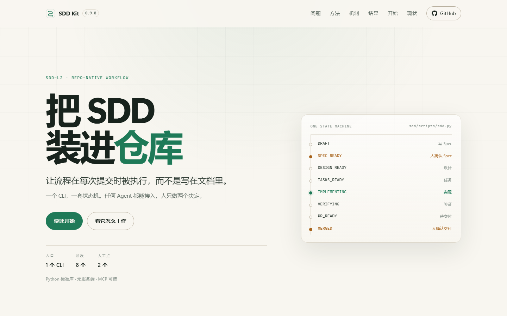
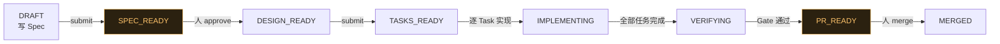

<div align="center">


# 把 SDD 装进仓库

**开发者只说一次需求，Agent 按仓库里的 `next.action` 自动推进。你只在两个地方出现：确认 Spec，合并 PR。**
- 平台团队维护一份 `sdd/` 核心，仓库接入一次，之后开发者 `git clone` 即用；
- 任何能读仓库文件、能执行 shell 的 Agent 都能接入，不绑定 Kiro、Cursor 或某个 IDE；
- 开发者只说一次工作项，Agent 按 `next.action` 自动调研、写工件、推进阶段；
- 正常流程只有两个人类检查点：**Spec 确认**和 **PR 合并**；
- 可选命名工作流预设：`l2-standard`、`l2-hotfix`、`l2-strict`，Spec 创建时固定版本；
- MCP 是可选适配器；没有 MCP，`AGENTS.md + CLI + Git Hook + CI` 也能跑完整流程。

当前版本：`0.8.0`。

[](https://github.com/RyanBrainNew/sdd-kit/actions/workflows/tests.yml)


[](https://ryanbrainnew.github.io/sdd-kit/)

[官网](https://ryanbrainnew.github.io/sdd-kit/) | [完整指南](docs/GUIDE.md) | [架构](ARCHITECTURE.md) | [Agent 协议](sdd/agent-contract.md)

</div>

---

SDD Kit 把公司 SDD-L2 的流程做成**仓库自带的默认开发路径**，而不是另一份需要人工执行的规范文档。

- **一个状态机**：阶段、工件校验、Gate 和审计事件只在 `sdd/scripts/sdd.py` 里定义。
- **任何 Agent 都能接入**：Claude Code、Cursor、Kiro 或自研 Agent，只要能执行 shell，就调用同一个 CLI。
- **零初始化**：平台团队 bootstrap 一次，开发者 `git clone` 后直接开始。
- **流程能被强制**：Git Hook 与 CI 校验工件，`approve`、`merge`、`unblock` 强制由人执行。



## 为什么需要它

大多数“AI 开发流程”最后都会变成三样东西：一份没人读的文档、一套每个人配置不同的 IDE 插件、以及一堆无法复查的聊天记录。SDD Kit 把这三件事收回到仓库里：

| 问题 | SDD Kit 的做法 |
不需要初始化，不需要注册 workflow，不需要安装任何个人工具。
仓库根目录的 `AGENTS.md` 会包含一段 `SDD:MANAGED` 托管块，标题是
“SDD Agent 执行协议”；Agent 读到它后会先执行 `python -m sdd resume --json`，
再按返回的 `next.action` 自动推进，不需要人告诉它当前阶段。

升级也由平台团队做：

```text
sdd-kit 打 tag
  -> 同步 bot 向各业务仓库开 PR
  -> 只更新 sdd/ 核心（保留 config/context/specs）
  -> CI 跑 verify-core / verify-agent / check
  -> CODEOWNERS 审核合并
```

业务仓库的 `sdd/config.json`、`sdd/context/`、`docs/specs/` 归业务团队维护；`sdd/` 其余核心归平台团队维护。

### 2.2 “通用 CLI”是什么？

就是仓库根目录下的：

```powershell
python -m sdd <command>
```

它是一个**只依赖 Python 标准库**的仓库内 CLI，入口是 `sdd/cli.py`，底层状态机是 `sdd/scripts/sdd.py`。它不调用大模型，不绑定 IDE，只做：

- 会话和 Spec 绑定；
- 状态推进与工件校验；
- 自动执行 `submit` / `submit-task`；
- 返回 `next.action` 和人类检查点。

任何 Agent 只要能执行 shell，就能用它；不能执行 shell 的 Agent，至少能读 `AGENTS.md` 和 `sdd/agent-contract.md`，再通过 MCP 或人工执行同样的命令。

### 2.3 MCP 里包含什么？没有 MCP 流程能跑吗？

**能跑。** 没有 MCP 时，完整路径是：

```text
AGENTS.md
  -> python -m sdd resume / start-work
  -> Agent 调研并写工件
  -> python -m sdd submit / submit-task
  -> 人 approve --human
  -> Agent 继续
  -> python -m sdd report
  -> 人 merge --human
  -> CI: verify-core / verify-agent / check
```

MCP 只是把同一套 CLI 能力包装成结构化工具，方便 Agent 调用：

| MCP 工具 | 作用 |
|---|---|
| `sdd_health` / `sdd_list_projects` | 查看 server 和项目 |
| `sdd_session` | 恢复当前会话绑定的需求 |
| `sdd_start_work` | 提交一个工作项，自动建/恢复 Spec |
| `sdd_submit_artifact` | 提交阶段产物，校验后自动推进 |
| `sdd_submit_task` | 自动 start + complete 一个实现任务 |
| `sdd_status` / `sdd_next` / `sdd_check` | 读取状态、下一步、校验结果 |
| `sdd_list_specs` | 列出所有 Spec |
| `sdd_board` | 看所有 Spec 的 Task 状态、进度和下一步（文本/JSON 看板） |
| `sdd_inbox` | 只读列出等待人工处理的事项，不执行任何动作 |
| `sdd_events` | 读取某个 Spec 的 append-only 审计事件流 |
| `sdd_reserve_spec_id` / `sdd_create_spec` | 并行开发时分配 Spec ID、创建 Spec |
| `sdd_verify` / `sdd_report` / `sdd_pr` | 验证、生成 PR 正文、记录 PR |
| `sdd_block` | 记录阻塞 |
| `sdd_read_artifact` / `sdd_context` | 读取工件、服务卡、契约、ADR |

**故意不提供** `approve`、`merge`、`unblock`、`rewind`。这些永远由人执行。

初期建议只用 CLI；等需要统一版本、统一上下文、统一审计入口时，再部署一个共享 MCP server。

### 2.4 已有 `AGENTS.md` 怎么办？以哪个为准？

**不要覆盖。** 只维护一个托管块：

```text
<!-- SDD:MANAGED:START -->
... SDD 入口、自动循环、人类检查点 ...
<!-- SDD:MANAGED:END -->
```

`python -m sdd sync-agent` 只替换这两个标记之间的内容，标记外的项目规则原样保留。

优先级如下：

| 内容 | 以谁为准 |
|---|---|
| 技术栈、目录、构建、测试、代码风格 | 仓库现有 `AGENTS.md` 其他章节 |
| SDD 入口、阶段推进、提交方式、人工检查点 | SDD 托管块 + `sdd/agent-contract.md` |
| 项目配置（spec_root、test_commands 等） | `sdd/config.json` |
| 底层状态机、Gate、校验规则 | `sdd/scripts/sdd.py` |
| 当前需求的范围、AC、设计 | `docs/specs/<Spec ID>/` |

两句话总结：

- **项目事实**听现有 `AGENTS.md`；
- **SDD 流程**听托管块和 `sdd/agent-contract.md`。

如果现有 `AGENTS.md` 里已经有“测试命令”“构建命令”，保留它，不要搬进 `sdd/config.json` 重复维护；`sdd/config.json` 只放 SDD 自己需要的配置。

### 2.5 MCP server 端和 local 端有什么不一样？

| 维度 | 本地 MCP（stdio） | 共享 MCP（HTTP + registry） |
|---|---|---|
| 运行位置 | 开发者电脑 | 公司服务器 |
| 能访问的代码 | 当前 clone | server 能访问的工作区 |
| 能写 `state.json` | 能，写当前分支 | 只能写 server 工作区，不能写同事本地 clone |
| 典型用途 | 本地开发、Agent 自动循环 | 项目目录、上下文、只读查询、Spec ID 预留 |
| 配置 | `--root . --transport stdio` | `--registry sdd-mcp.json --transport streamable-http` |

关键事实：**MCP server 只能操作它所在进程能访问到的文件系统。**

所以共享 MCP 不能“远程修改每个同事电脑上的 clone”。两种现实模式见第 8 节。

### 2.6 产物跟代码走，AI 误改了怎么办？用 submodule 吗？

默认**不用 submodule**，用“vendored core + manifest + CODEOWNERS + 同步 bot”：

| 机制 | 作用 |
|---|---|
| 流程靠 Agent 自觉 | CLI 返回唯一的 `next.action`，`ok=false` 时必须按 `errors` 修复后重试 |
| 每个 IDE 一套规则 | `AGENTS.md` 托管块 + `python -m sdd`，规则与工具解耦 |
| 证据散落在对话里 | Spec、Design、Tasks、Gate 报告、测试命令都随 Git 提交 |
| 人工确认太多 | 只保留 Spec 确认与 PR 合并两个检查点 |

## 它怎么工作



Agent 每次会话先运行 `python -m sdd resume --json`，读取：
### 3.3 状态机

```text
DRAFT
  -> SPEC_READY            （人 approve --human）
  -> DESIGN_READY          （submit design.md）
  -> TASKS_READY           （submit tasks.md）
  -> IMPLEMENTING          （自动开始实现）
  -> VERIFYING             （所有 Task 完成）
  -> PR_READY              （submit verification.md）
  -> MERGED                （人 merge --human）

任意阶段 -> BLOCKED -> 原状态（人 unblock --human）
```

---

## 4. 人到底要做哪几步？

下面把“人”的动作单独列出来。除了这些，其他阶段由 Agent 和 CLI 自动推进。

### 4.1 平台团队：每个仓库一次

| 步骤 | 人做什么 | 命令/产物 |
|---|---|---|
| 1 | 选一个试点仓库 | 建议先选一个小型微服务或前端项目 |
| 2 | 执行 bootstrap | `python bootstrap.py --target ... --project ... --test-command ... --ci ...` |
| 3 | 补项目事实 | 在 `AGENTS.md` 写技术栈、构建、测试命令；在 `sdd/config.json` 配 `test_commands` |
| 4 | 配 CODEOWNERS | `sdd/` 归平台团队 review |
| 5 | 开接入 PR | CI 通过后合并 |

### 4.2 开发者：每个需求一次

| 步骤 | 人做什么 | 说明 |
|---|---|---|
| 1 | 给一个工作项 | 例如“按 srdcloud-553377 做这次需求”，不需要说当前阶段 |
| 2 | 审 Spec | 看 `docs/specs/<Spec ID>/spec.md` 的范围、AC、未决问题 |
| 3 | 执行 Spec 确认 | `python -m sdd approve --spec <Spec ID> --human --evidence "需求已确认"` |
| 4 | 审最终 PR | 看 `PR_BODY.md`、AC 证据、diff、CI |
| 5 | 合并并登记 | `python -m sdd merge --spec <Spec ID> --human --evidence "PR merged"` |

**这就是正常流程的全部人工步骤。**

### 4.3 例外：什么时候人会额外被打断？

| 场景 | 人做什么 |
|---|---|
| Spec 有 `[NEEDS CLARIFICATION]` | 回答一个具体业务问题，Agent 清除标记后继续 |
| 高风险变更命中 `security` / `data_migration` / `destructive_change` / `public_api_break` | 在对应 Gate 加 `--human` 确认 |
| Agent 连续失败 3 次 | 人介入排查；Agent 先 `sdd block` 记录原因 |
| 需要生产数据、密钥、外部系统权限 | 人提供或拒绝，Agent 不得绕过 |

### 4.4 Agent 不需要人做的事

- 不需要人告诉它“现在是什么阶段”；
- 不需要人手工调用 `next`；
- 不需要人逐步签字 Design、Tasks、每个 Task；
- 不需要人手工生成 Gate 报告；
- 不需要人手工拼 PR 正文。

Agent 只消费 `next.action`，产出后用 `next.submit_with` 提交；CLI 重新校验并返回下一步。

---

## 5. 快速接入（平台团队）

### 5.1 一条命令

```powershell
python bootstrap.py --target "D:\repos\order-api" --project order-api `
  --test-command "python -m pytest -q" --ci gitlab
```

参数：

| 参数 | 说明 |
|---|---|
| `--target` | 业务仓库根目录 |
| `--project` | 写入 `sdd/config.json` 的项目 ID |
| `--test-command` | `sdd verify` 执行的测试命令，可重复 |
| `--ci` | `none` / `github` / `gitlab` / `both` |
| `--no-hooks` | 不安装 `.githooks` |
| `--force` | 刷新核心，保留 `config.json`、`context/`、`docs/specs/` |

### 5.2 接入后检查

```powershell
python -m sdd --version
python -m sdd verify-core
python -m sdd verify-agent
python -m sdd check --all --stage ci --check-git
```

如果当前仓库还没有 Spec，`check --all` 会跳过，不会一接入就红。

### 5.3 项目事实写在哪里

| 内容 | 位置 |
|---|---|
| 技术栈、目录、构建、测试、代码风格 | 现有 `AGENTS.md` 其他章节 |
| `test_commands`、`spec_root`、默认工作流、Gate 覆盖 | `sdd/config.json` |
| 服务卡、契约、ADR、术语 | `sdd/context/` |
| 当前需求范围、AC、设计 | `docs/specs/<Spec ID>/` |

0.7.0 新增两个默认关闭、`bootstrap.py` 对新仓库默认开启的配置：

| 配置 | 作用 |
|---|---|
| `require_approver` | CI 要求 `state.json` 中至少有一条带有效审批人的记录；人工命令可加 `--approver` |
| `require_artifact_hash` | Gate 报告必须包含产物哈希；旧报告在升级期只告警 |

0.8.0 新增 `workflow` 配置和三个命名预设；`bootstrap.py` 对新仓库写入
`l2-standard`。需要项目级覆盖单个 Gate 时使用 `gate_overrides`，不要改预设文件。

不要编造项目事实。Agent 无法从仓库确认时，应先检查代码和配置；仍无法确认，再问一个具体问题。

### 5.4 工作流预设

0.8.0 只支持仓库内固定的命名预设，不允许用户画任意 DAG。每个 Spec 在创建时
把预设快照写入 `docs/specs/<Spec>/workflow.json`，之后修改 `sdd/workflows/`
不会改变旧 Spec。

| 预设 | 适用场景 | 关键差异 |
|---|---|---|
| `l2-standard` | 默认 L2 需求 | G0 人工；G2 高风险时人工；其余自动 |
| `l2-hotfix` | 紧急修复，低/中风险 | 仍写 `design.md`，但使用轻量设计模板；G2 自动；高风险和 `risk_stop` 标签直接拒绝 |
| `l2-strict` | 安全、数据迁移、破坏性变更 | G0–G5 全部人工；`verification.md` 必须有独立审查，且 reviewer session 不能等于实现 session |

```powershell
# 默认使用 config.json 的 workflow，当前是 l2-standard
python -m sdd start-work --work-item srdcloud-553377 --title "订单取消"

# 紧急修复
python -m sdd start-work --work-item srdcloud-553377 --title "订单取消" `
  --workflow l2-hotfix --risk medium

# 严格变更
python -m sdd new SPEC-PAY-002 --title "支付数据迁移" `
  --work-item srdcloud-600001 --workflow l2-strict --risk high `
  --risk-label data_migration
```

优先级是：`sdd/config.json.gate_overrides` > 旧版 `config.json.gates`（仅当整份
`gates` 已偏离标准默认）> 预设 `gates` > 代码默认值。旧 Spec 没有 `workflow`
字段时按 `l2-standard@1` 处理。
0.8.0 暂未提供 `upgrade-workflow` 命令；需要换预设时重新建 Spec 或等后续版本。

---

## 6. 一次需求的 CLI 全链路

以下命令都在仓库根目录执行。`--json` 方便 Agent 解析；人看时可以去掉。

### 6.1 开始或恢复

新需求：

```powershell
python -m sdd start-work `
  --work-item srdcloud-553377 `
  --issue-url "https://example.invalid/item/553377" `
  --title "订单取消" `
  --domain ORDER `
  --json
```

恢复当前会话：

```powershell
python -m sdd resume --json
```

`resume` 的查找顺序：

1. `.sdd/runtime/sessions/<session-hash>.json` 中当前会话绑定的 Spec；
2. 当前 Git 分支名里的 `SPEC-XXX-NNN`；
3. 如果仓库只有一个活跃 Spec，直接用；
4. 仍有多个，才问一次要恢复哪个。

所以“一个 Spec 一个分支”是推荐做法。

### 6.2 写 Spec 并提交

Agent 调研后写 `docs/specs/<Spec ID>/spec.md`，然后：

```powershell
python -m sdd submit --spec SPEC-ORDER-001 --artifact spec.md `
  --file docs/specs/SPEC-ORDER-001/spec.md --json
```

返回：

```json
{
  "action": "implement_task",
  "task": "T-001",
  "submit_with": "sdd submit-task",
  "human_checkpoint": { "required": false }
}
```

不需要问“现在是什么阶段”，也不需要人手工选择 `DRAFT`、`SPEC_READY`。

## 快速开始

### 1. 平台团队：每个仓库接入一次

```powershell
python bootstrap.py --target "D:\repos\order-api" --project order-api `
  --test-command "python -m pytest -q" --ci gitlab
```

它会复制 `sdd/` 核心、合并 `AGENTS.md` 托管块、写入 manifest、安装 Git Hook 与 CI 模板。已有 `AGENTS.md` 不会被覆盖。

### 2. 开发者：每次会话恢复

```powershell
git clone <repo>
cd <repo>
python -m sdd resume --json
```

Agent 读到 `next.action` 后继续。没有当前需求时，只问一次工作项，然后运行 `sdd start-work`。

### 3. 合并前：跑同一组校验

```powershell
python -m unittest discover -s tests -v
python -m sdd verify-core
python -m sdd verify-agent
python -m sdd check --all --stage ci
```

CI 执行同样的命令。核心被改、托管块漂移或工件缺失都会失败。

## 常用命令

| 命令 | 执行者 | 用途 |
|---|---|---|
| `python -m sdd resume --json` | Agent | 恢复当前 Spec，返回唯一的下一个动作 |
| `python -m sdd start-work --work-item <id> --json` | Agent | 把工作项绑定到新 Spec |
| `python -m sdd submit --artifact <name> --file <path> --json` | Agent | 提交阶段工件并接受校验 |
| `python -m sdd submit-task --task T-xxx --evidence "..." --json` | Agent | 完成一个任务并记录测试证据 |
| `python -m sdd report` | Agent | 生成 PR 正文与 Gate 摘要 |
| `python -m sdd approve --spec <id> --human --evidence "..."` | 人 | 确认 Spec |
| `python -m sdd merge --spec <id> --human --evidence "..."` | 人 | 确认合并 |
| `python -m sdd check --all --stage ci` | CI | 校验全部工件、Gate 与 Git 状态 |
没有 `--human` 会被拒绝。合并前 CLI 会再跑一次 CI 级校验。

### 6.9 证据绑定与审计

每次记录 Gate 时，CLI 会把绑定产物的 SHA-256 写进 Gate 报告和
`state.json.artifact_hashes`。`check --stage ci` 会重新计算并比对：

- G0/G1 绑定 `spec.md`；
- G2 绑定 `design.md`；
- G3/G4 绑定 `tasks.md` 的任务计划字段（状态和 commit 变化不算篡改）；
- G5 绑定 `verification.md`。

批准后如果文件被修改，CI 会报“已被修改；请重新执行对应 Gate 或 rewind”。

人工命令支持 `--approver "张三 <zhang@example.com>"`；不传时取
`git config user.name` / `user.email`。`--human` 只表示“这是人工动作”，
不提供身份认证；真正的硬控制仍是分支保护、CODEOWNERS 和 PR review。

`events.jsonl` 从 0.7.0 起写入 `schema: 2`，新增 `role`、`session`、
`session_source`、`artifacts`、`approver` 等字段，并记录 `check_failed`
事件。旧事件保持原样，不回写。

### 6.10 待办、回退与指标

```powershell
# 所有等人处理的事项：DRAFT、PR_READY、BLOCKED、人工 Gate、长期无事件
python -m sdd inbox --json
python -m sdd inbox --stale-days 7

# 人工回退到更早阶段；只允许人执行
python -m sdd rewind --spec SPEC-ORDER-001 --to SPEC_READY `
  --reason "验证发现设计遗漏" --human --approver "张三 <zhang@example.com>"

# 只读指标：lead time、阶段耗时、返工、人工介入、Gate 失败、AC 覆盖
python -m sdd metrics --json
python -m sdd metrics --since 2026-11-01 --json
```

`rewind` 的规则：

- 只回到更早阶段，不能去未来；`MERGED` 和 `BLOCKED` 不能直接回退。
- 工件先复制到 `docs/specs/<Spec>/history/<时间戳>/`，原文件保留。
- 被作废的 Gate 报告移到 `sdd/reports/<Spec>/history/<时间戳>/`。
- `gates.md` 追加 `SUPERSEDED`，`state.json.reworks` 和 `events.jsonl` 记录原因与审批人。
- `--to DESIGN_READY` 保留已批准的 `design.md`，只作废 G3–G5；要重写设计，用 `--to SPEC_READY`。

`sdd board` 目前仍是文本/JSON 看板，没有 HTML 面板。单文件 HTML 运行视图
（`sdd view --html`）在 `DESIGN-NEXT.md` 中列为 0.9.0 能力，尚未实现。

---

## 7. `AGENTS.md` 托管块与冲突规则

### 7.1 托管块

## 仓库结构

```text
sdd/scripts/sdd.py     状态机、工件校验、Gate
sdd/core.py            会话指针与 submit/report 编排
sdd/cli.py             python -m sdd 入口
sdd/agents.py          AGENTS.md 托管块合并
sdd/templates/         六个阶段骨架
sdd/prompts/           Agent 方法层
sdd/context/           多微服务上下文模板
sdd/mcp/               可选 MCP 适配器
bootstrap.py           业务仓库一次性接入
tests/                 单元与集成测试
site/                  GitHub Pages 官网
ci/                    测试与 CI 模板
deploy/                共享 MCP 部署示例
dsh/                   dsh / harness 薄适配约定
```

`sdd/` 核心由平台团队维护；业务仓库只维护 `sdd/config.json`、`sdd/context/` 和 `docs/specs/`。

## 文档

| 文档 | 内容 |
|---|---|
| [官网](https://ryanbrainnew.github.io/sdd-kit/) | 一页看懂定位、链路与命令 |
| [完整指南](docs/GUIDE.md) | 接入、架构、MCP、FAQ 与全部命令细节 |
| [ARCHITECTURE.md](ARCHITECTURE.md) | 设计取舍、模块边界与分阶段落地 |
| [ADOPTION.md](ADOPTION.md) | 从单仓库试点到多仓库推广 |
| [sdd/agent-contract.md](sdd/agent-contract.md) | Agent 自动循环与人类检查点契约 |
| [sdd/README.md](sdd/README.md) | 业务仓库内的执行手册 |
| [sdd/mcp/README.md](sdd/mcp/README.md) | MCP 工具、本地与共享部署 |
| [deploy/README.md](deploy/README.md) | 共享 MCP 的容器部署 |
| [LANDSCAPE.md](LANDSCAPE.md) | 与 aidlc、Trellis、Spec Kitty 等方案的关系 |

## 适合与不适合

**适合**

- 多个业务仓库，需要统一 L2 流程与审计证据
- 团队混用不同 Agent 或 IDE
- 已有 `AGENTS.md`，希望增量接入
- Git 与 CI 已是默认基础设施

**不适合**

- 单人一次性脚本，没有 Spec、Gate 或合并流程
- 没有 Git 或 CI，无法留下可校验证据
- 需要集中式 Web 审批台；当前只有 CLI 与 MCP
- 希望工具替代需求判断或代码评审

## 开发

只使用 Python 标准库；MCP 依赖隔离在 `sdd/mcp/requirements.txt`。

```powershell
$env:PYTHONIOENCODING='utf-8'
python -m unittest discover -s tests -v
python -m sdd verify-core
python -m sdd verify-agent
```

修改受保护文件后，必须更新版本并重新生成 manifest：

```powershell
python -m sdd manifest --write
```

`sdd/manifest.json` 与 `sdd/VERSION` 必须提交，不能加入 `.gitignore`。

## 贡献

1. 先在 Issue 里说明工作项与影响范围。
2. 从 `main` 切分支，保持 diff 聚焦。
3. 修改核心时同步更新测试、README、`sdd/agent-contract.md` 和相关提示词。
4. 提交前运行上面的全部校验命令。
5. 人工动作 `approve`、`merge`、`unblock` 只能由人执行，CI 会拒绝 Agent 代办。

## 许可证

当前仓库**未声明**开源许可证。在添加 `LICENSE` 之前，默认保留所有权利；不要假设可以复制、修改或分发。
### 14.8 Agent 想 `approve` / `merge` / `unblock`

拒绝。这些是人工动作，CLI 强制 `--human`，MCP 不暴露。

### 14.9 共享 MCP 能不能直接改我本地 clone？

不能。远端进程访问不到你电脑上的文件。共享 MCP 只做上下文、项目目录、Spec ID 预留和只读查询；写状态请用本地 CLI 或本地 stdio MCP。

---

<div align="center">

**SDD Kit 0.6.1** · 把 SDD 装进仓库

</div>
