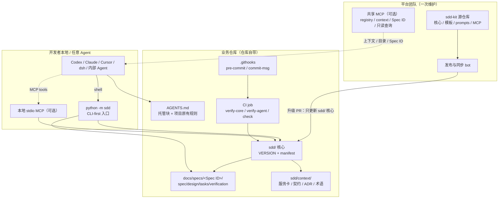
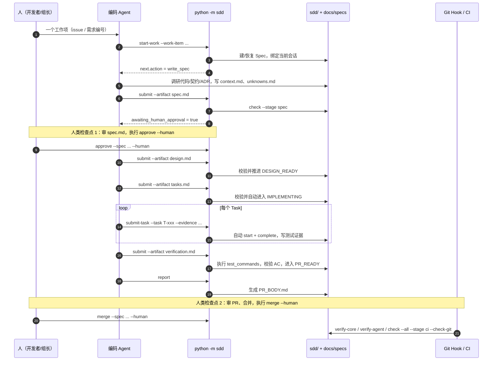

# SDD Kit（CLI-first / 仓库自带 / MCP 可选）

把公司 SDD-L2 要求做成**仓库自带的默认开发路径**：

- 平台团队维护一份 `sdd/` 核心，仓库接入一次，之后开发者 `git clone` 即用；
- 任何能读仓库文件、能执行 shell 的 Agent 都能接入，不绑定 Kiro、Cursor 或某个 IDE；
- 开发者只说一次工作项，Agent 按 `next.action` 自动调研、写工件、推进阶段；
- 正常流程只有两个人类检查点：**Spec 确认**和 **PR 合并**；
- MCP 是可选适配器；没有 MCP，`AGENTS.md + CLI + Git Hook + CI` 也能跑完整流程。

当前版本：`0.5.0`。

---

## 1. 三条硬约束

这套东西不是为了“再做一个 AIDLC”，而是用最低摩擦满足三个约束：

| 约束 | 做法 |
|---|---|
| **所有 Agent/IDE 都能接入** | 规则和状态都在仓库里，统一走 `python -m sdd`，不依赖 IDE 插件 |
| **开发者零初始化** | 平台团队一次性 bootstrap；开发者只 clone，不注册 workflow、不装个人插件 |
| **流程必须能被强制** | Git Hook + CI 校验，不靠 Agent 自觉；人保留 `approve` / `merge` 两个开关 |

对应到公司 SDD 要求，真正要保证的只有五件事：

1. 需求可追溯到工作项和 Spec；
2. 每条 AC 可测试、有执行路径；
3. Spec → Design → Tasks → 实现 → 验证不能跳步；
4. Gate 报告、测试证据、commit trailer、PR 正文都在 Git 里；
5. 人只在需求确认和最终合并两个高价值节点介入。

工具只负责让这五件事自动执行，不把流程复制到每个人的个人配置里。

---

## 2. 先回答几个关键问题

### 2.1 “仓库自带”是怎么个自带法？谁来让它自带？

**平台团队**维护一个 `sdd-kit` 源仓库（就是本目录），业务仓库不直接改核心。

接入时由平台团队执行一次：

```powershell
python bootstrap.py --target "D:\repos\order-api" --project order-api `
  --test-command "python -m pytest -q" --ci gitlab
```

`bootstrap.py` 会做这些事：

1. 把 `sdd/` 核心复制到业务仓库；
2. 保留业务仓库已有的 `sdd/config.json` 项目配置；
3. 把 SDD 托管块合并进 `AGENTS.md`，**不覆盖**原有规则；
4. 写入 `sdd/manifest.json`（核心文件哈希）；
5. 更新 `.gitignore`，忽略 `.sdd/runtime/` 和 Spec ID 分配锁；
6. 安装 `.githooks/` 和 CI 模板。

之后开发者只需要：

```powershell
git clone <repo>
cd <repo>
python -m sdd resume --json
```

不需要初始化，不需要注册 workflow，不需要安装任何个人工具。

升级也由平台团队做：

```text
sdd-kit 打 tag
  -> 同步 bot 向各业务仓库开 PR
  -> 只更新 sdd/ 核心（保留 config/context/specs）
  -> CI 跑 verify-core / verify-agent / check
  -> CODEOWNERS 审核合并
```

业务仓库的 `sdd/config.json`、`sdd/context/`、`docs/specs/` 归业务团队维护；`sdd/` 其余核心归平台团队维护。

### 2.2 “通用 CLI”是什么？

就是仓库根目录下的：

```powershell
python -m sdd <command>
```

它是一个**只依赖 Python 标准库**的仓库内 CLI，入口是 `sdd/cli.py`，底层状态机是 `sdd/scripts/sdd.py`。它不调用大模型，不绑定 IDE，只做：

- 会话和 Spec 绑定；
- 状态推进与工件校验；
- 自动执行 `submit` / `submit-task`；
- 返回 `next.action` 和人类检查点。

任何 Agent 只要能执行 shell，就能用它；不能执行 shell 的 Agent，至少能读 `AGENTS.md` 和 `sdd/agent-contract.md`，再通过 MCP 或人工执行同样的命令。

### 2.3 MCP 里包含什么？没有 MCP 流程能跑吗？

**能跑。** 没有 MCP 时，完整路径是：

```text
AGENTS.md
  -> python -m sdd resume / start-work
  -> Agent 调研并写工件
  -> python -m sdd submit / submit-task
  -> 人 approve --human
  -> Agent 继续
  -> python -m sdd report
  -> 人 merge --human
  -> CI: verify-core / verify-agent / check
```

MCP 只是把同一套 CLI 能力包装成结构化工具，方便 Agent 调用：

| MCP 工具 | 作用 |
|---|---|
| `sdd_health` / `sdd_list_projects` | 查看 server 和项目 |
| `sdd_session` | 恢复当前会话绑定的需求 |
| `sdd_start_work` | 提交一个工作项，自动建/恢复 Spec |
| `sdd_submit_artifact` | 提交阶段产物，校验后自动推进 |
| `sdd_submit_task` | 自动 start + complete 一个实现任务 |
| `sdd_status` / `sdd_next` / `sdd_check` | 读取状态、下一步、校验结果 |
| `sdd_list_specs` | 列出所有 Spec |
| `sdd_board` | 看所有 Spec 的 Task 状态、进度和下一步 |
| `sdd_reserve_spec_id` / `sdd_create_spec` | 并行开发时分配 Spec ID、创建 Spec |
| `sdd_verify` / `sdd_report` / `sdd_pr` | 验证、生成 PR 正文、记录 PR |
| `sdd_block` | 记录阻塞 |
| `sdd_read_artifact` / `sdd_context` | 读取工件、服务卡、契约、ADR |

**故意不提供** `approve`、`merge`、`unblock`。这三个永远由人执行。

初期建议只用 CLI；等需要统一版本、统一上下文、统一审计入口时，再部署一个共享 MCP server。

### 2.4 已有 `AGENTS.md` 怎么办？以哪个为准？

**不要覆盖。** 只维护一个托管块：

```text
<!-- SDD:MANAGED:START -->
... SDD 入口、自动循环、人类检查点 ...
<!-- SDD:MANAGED:END -->
```

`python -m sdd sync-agent` 只替换这两个标记之间的内容，标记外的项目规则原样保留。

优先级如下：

| 内容 | 以谁为准 |
|---|---|
| 技术栈、目录、构建、测试、代码风格 | 仓库现有 `AGENTS.md` 其他章节 |
| SDD 入口、阶段推进、提交方式、人工检查点 | SDD 托管块 + `sdd/agent-contract.md` |
| 项目配置（spec_root、test_commands 等） | `sdd/config.json` |
| 底层状态机、Gate、校验规则 | `sdd/scripts/sdd.py` |
| 当前需求的范围、AC、设计 | `docs/specs/<Spec ID>/` |

两句话总结：

- **项目事实**听现有 `AGENTS.md`；
- **SDD 流程**听托管块和 `sdd/agent-contract.md`。

如果现有 `AGENTS.md` 里已经有“测试命令”“构建命令”，保留它，不要搬进 `sdd/config.json` 重复维护；`sdd/config.json` 只放 SDD 自己需要的配置。

### 2.5 MCP server 端和 local 端有什么不一样？

| 维度 | 本地 MCP（stdio） | 共享 MCP（HTTP + registry） |
|---|---|---|
| 运行位置 | 开发者电脑 | 公司服务器 |
| 能访问的代码 | 当前 clone | server 能访问的工作区 |
| 能写 `state.json` | 能，写当前分支 | 只能写 server 工作区，不能写同事本地 clone |
| 典型用途 | 本地开发、Agent 自动循环 | 项目目录、上下文、只读查询、Spec ID 预留 |
| 配置 | `--root . --transport stdio` | `--registry sdd-mcp.json --transport streamable-http` |

关键事实：**MCP server 只能操作它所在进程能访问到的文件系统。**

所以共享 MCP 不能“远程修改每个同事电脑上的 clone”。两种现实模式见第 8 节。

### 2.6 产物跟代码走，AI 误改了怎么办？用 submodule 吗？

默认**不用 submodule**，用“vendored core + manifest + CODEOWNERS + 同步 bot”：

| 机制 | 作用 |
|---|---|
| `sdd/manifest.json` | 记录受保护文件的 SHA-256 |
| `python -m sdd verify-core` | CI 检查核心是否被修改 |
| `sdd/VERSION` | 版本号，升级时一起变 |
| `CODEOWNERS` | `sdd/` 必须平台团队 review |
| 同步 bot | 平台发版后自动向业务仓库开升级 PR |
| `.gitignore` | 忽略 `.sdd/runtime/`、分配锁等本地产物 |

为什么不用 submodule 作为默认：

- 每个仓库都要多一步 `submodule update`，开发者体验差；
- Agent 容易把 submodule 当成普通目录改；
- Windows、CI、离线环境的 submodule 认证容易出问题；
- 版本 pin 分散在几十个仓库，反而更难统一升级。

如果公司强制要求 submodule，也可以：把 `sdd-core/` 作为 submodule，业务仓库只保留 `sdd/config.json`、`sdd/context/`、`sdd/manifest.json` 和适配入口。但这是备选，不是推荐默认。

---

## 3. 完整链路架构图

### 3.1 组件与职责



### 3.2 一次需求的完整时序



### 3.3 状态机

```text
DRAFT
  -> SPEC_READY            （人 approve --human）
  -> DESIGN_READY          （submit design.md）
  -> TASKS_READY           （submit tasks.md）
  -> IMPLEMENTING          （自动开始实现）
  -> VERIFYING             （所有 Task 完成）
  -> PR_READY              （submit verification.md）
  -> MERGED                （人 merge --human）

任意阶段 -> BLOCKED -> 原状态（人 unblock --human）
```

---

## 4. 人到底要做哪几步？

下面把“人”的动作单独列出来。除了这些，其他阶段由 Agent 和 CLI 自动推进。

### 4.1 平台团队：每个仓库一次

| 步骤 | 人做什么 | 命令/产物 |
|---|---|---|
| 1 | 选一个试点仓库 | 建议先选一个小型微服务或前端项目 |
| 2 | 执行 bootstrap | `python bootstrap.py --target ... --project ... --test-command ... --ci ...` |
| 3 | 补项目事实 | 在 `AGENTS.md` 写技术栈、构建、测试命令；在 `sdd/config.json` 配 `test_commands` |
| 4 | 配 CODEOWNERS | `sdd/` 归平台团队 review |
| 5 | 开接入 PR | CI 通过后合并 |

### 4.2 开发者：每个需求一次

| 步骤 | 人做什么 | 说明 |
|---|---|---|
| 1 | 给一个工作项 | 例如“按 srdcloud-553377 做这次需求”，不需要说当前阶段 |
| 2 | 审 Spec | 看 `docs/specs/<Spec ID>/spec.md` 的范围、AC、未决问题 |
| 3 | 执行 Spec 确认 | `python -m sdd approve --spec <Spec ID> --human --evidence "需求已确认"` |
| 4 | 审最终 PR | 看 `PR_BODY.md`、AC 证据、diff、CI |
| 5 | 合并并登记 | `python -m sdd merge --spec <Spec ID> --human --evidence "PR merged"` |

**这就是正常流程的全部人工步骤。**

### 4.3 例外：什么时候人会额外被打断？

| 场景 | 人做什么 |
|---|---|
| Spec 有 `[NEEDS CLARIFICATION]` | 回答一个具体业务问题，Agent 清除标记后继续 |
| 高风险变更命中 `security` / `data_migration` / `destructive_change` / `public_api_break` | 在对应 Gate 加 `--human` 确认 |
| Agent 连续失败 3 次 | 人介入排查；Agent 先 `sdd block` 记录原因 |
| 需要生产数据、密钥、外部系统权限 | 人提供或拒绝，Agent 不得绕过 |

### 4.4 Agent 不需要人做的事

- 不需要人告诉它“现在是什么阶段”；
- 不需要人手工调用 `next`；
- 不需要人逐步签字 Design、Tasks、每个 Task；
- 不需要人手工生成 Gate 报告；
- 不需要人手工拼 PR 正文。

Agent 只消费 `next.action`，产出后用 `next.submit_with` 提交；CLI 重新校验并返回下一步。

---

## 5. 快速接入（平台团队）

### 5.1 一条命令

```powershell
python bootstrap.py --target "D:\repos\order-api" --project order-api `
  --test-command "python -m pytest -q" --ci gitlab
```

参数：

| 参数 | 说明 |
|---|---|
| `--target` | 业务仓库根目录 |
| `--project` | 写入 `sdd/config.json` 的项目 ID |
| `--test-command` | `sdd verify` 执行的测试命令，可重复 |
| `--ci` | `none` / `github` / `gitlab` / `both` |
| `--no-hooks` | 不安装 `.githooks` |
| `--force` | 刷新核心，保留 `config.json`、`context/`、`docs/specs/` |

### 5.2 接入后检查

```powershell
python -m sdd --version
python -m sdd verify-core
python -m sdd verify-agent
python -m sdd check --all --stage ci --check-git
```

如果当前仓库还没有 Spec，`check --all` 会跳过，不会一接入就红。

### 5.3 项目事实写在哪里

| 内容 | 位置 |
|---|---|
| 技术栈、目录、构建、测试、代码风格 | 现有 `AGENTS.md` 其他章节 |
| `test_commands`、`spec_root`、Gate 策略 | `sdd/config.json` |
| 服务卡、契约、ADR、术语 | `sdd/context/` |
| 当前需求范围、AC、设计 | `docs/specs/<Spec ID>/` |

不要编造项目事实。Agent 无法从仓库确认时，应先检查代码和配置；仍无法确认，再问一个具体问题。

---

## 6. 一次需求的 CLI 全链路

以下命令都在仓库根目录执行。`--json` 方便 Agent 解析；人看时可以去掉。

### 6.1 开始或恢复

新需求：

```powershell
python -m sdd start-work `
  --work-item srdcloud-553377 `
  --issue-url "https://example.invalid/item/553377" `
  --title "订单取消" `
  --domain ORDER `
  --json
```

恢复当前会话：

```powershell
python -m sdd resume --json
```

`resume` 的查找顺序：

1. `.sdd/runtime/sessions/<session-hash>.json` 中当前会话绑定的 Spec；
2. 当前 Git 分支名里的 `SPEC-XXX-NNN`；
3. 如果仓库只有一个活跃 Spec，直接用；
4. 仍有多个，才问一次要恢复哪个。

所以“一个 Spec 一个分支”是推荐做法。

### 6.2 写 Spec 并提交

Agent 调研后写 `docs/specs/<Spec ID>/spec.md`，然后：

```powershell
python -m sdd submit --spec SPEC-ORDER-001 --artifact spec.md `
  --file docs/specs/SPEC-ORDER-001/spec.md --json
```

返回：

```json
{
  "ok": true,
  "awaiting_human_approval": true,
  "human_checkpoint": {
    "required": true,
    "type": "spec_approval",
    "command": "python -m sdd approve --spec SPEC-ORDER-001 --human --evidence \"需求已确认\""
  }
}
```

Agent 到这里必须停。

### 6.3 人确认 Spec

```powershell
python -m sdd approve --spec SPEC-ORDER-001 --human --evidence "需求已确认"
```

没有 `--human` 会被拒绝。这一步同时生成 G0/G1 报告。

### 6.4 自动完成 Design 和 Tasks

```powershell
python -m sdd submit --spec SPEC-ORDER-001 --artifact design.md `
  --file docs/specs/SPEC-ORDER-001/design.md --json

python -m sdd submit --spec SPEC-ORDER-001 --artifact tasks.md `
  --file docs/specs/SPEC-ORDER-001/tasks.md --json
```

提交 `tasks.md` 后自动进入 `IMPLEMENTING`，不需要再手工 `complete`。

### 6.5 逐 Task 实现

每个 Task：

```powershell
python -m sdd submit-task --spec SPEC-ORDER-001 --task T-001 `
  --commit abc1234 `
  --evidence "python -m pytest tests/test_order.py -q: 3 passed" `
  --json
```

`submit-task` 自动完成 `start` + `complete`。Agent 一次只做一个 Task，先写失败测试，再写最小实现。

### 6.6 验证并进入 PR_READY

```powershell
python -m sdd submit --spec SPEC-ORDER-001 --artifact verification.md `
  --file docs/specs/SPEC-ORDER-001/verification.md --json
```

默认会执行 `sdd/config.json` 的 `test_commands` 并追加证据。如果测试必须在别的环境跑，本地跑完后用 `--no-run-commands` 提交，但证据必须真实。

### 6.7 生成 PR 并登记

```powershell
python -m sdd report --spec SPEC-ORDER-001 --json
```

用生成的 `PR_BODY.md` 开 PR，然后：

```powershell
python -m sdd pr --spec SPEC-ORDER-001 --url "https://example.invalid/pr/1"
```

### 6.8 人审 PR 并合并

```powershell
python -m sdd merge --spec SPEC-ORDER-001 --human --evidence "PR #1 已合并"
```

没有 `--human` 会被拒绝。合并前 CLI 会再跑一次 CI 级校验。

---

## 7. `AGENTS.md` 托管块与冲突规则

### 7.1 托管块

`bootstrap.py` 和 `python -m sdd sync-agent` 只维护：

```text
<!-- SDD:MANAGED:START -->
...
<!-- SDD:MANAGED:END -->
```

已有 `AGENTS.md` 时：

- 托管块外内容一字不改；
- 重复执行不会重复追加；
- `python -m sdd verify-agent` 检查托管块是否与 `sdd/agent-block.md` 一致；
- CI 会跑 `verify-agent`，防止有人手改托管块。

### 7.2 冲突时以谁为准

| 冲突点 | 以谁为准 |
|---|---|
| 测试命令 | 现有 `AGENTS.md`；`sdd/config.json` 只放 `test_commands` 给 CLI 执行 |
| 目录结构 | 现有 `AGENTS.md` |
| 代码风格 | 现有 `AGENTS.md` 和相邻代码 |
| 当前处于哪个 SDD 阶段 | `sdd/scripts/sdd.py` 的 `state.json`，Agent 不需要知道状态名 |
| 下一步做什么 | CLI 返回的 `next.action` |
| 人类检查点 | 托管块 + `sdd/agent-contract.md` |
| Spec/Design/Tasks 内容 | `docs/specs/<Spec ID>/` |

### 7.3 为什么不用 `AGENTS.sdd.md`

旧方案在已有 `AGENTS.md` 时生成 `AGENTS.sdd.md`，会导致两个文件并存、Agent 不知道读哪个。现在统一用一个托管块：

- 只有一个入口；
- 原有规则继续生效；
- 升级只替换块内内容；
- 不会产生“以哪个为准”的歧义。

---

## 8. 两种开发模式

### 8.1 模式 B：本地 clone + 本地 CLI/MCP（现在推荐）

```text
开发者电脑
  repo clone
    ├─ AGENTS.md
    ├─ sdd/                     # 仓库自带，跟分支走
    ├─ docs/specs/<id>/         # 当前分支的 Spec 和 state.json
    └─ python -m sdd            # 本地写状态

共享 MCP（可选）
  └─ 上下文 / 项目目录 / Spec ID 预留 / 只读查询
```

工作方式：

1. 每个开发者 `git clone`；
2. 直接 `python -m sdd resume` 或 `start-work`；
3. 状态写进当前工作区；
4. 工件跟代码一起 commit、push、开 PR；
5. CI 跑 `verify-core` / `verify-agent` / `check`；
6. 合并后 Spec 和 `state.json` 一起进主干。

优点：不改代码位置、每个开发者独立工作区、接入成本最低。  
代价：共享 MCP 不能替别人写本地文件，只能做上下文和只读查询。

### 8.2 模式 A：服务端工作区 + 共享 MCP（后期）

```text
服务端
  worktrees/
    order-api/SPEC-ORDER-001/   # 一个 Spec/任务一个 worktree
    order-api/SPEC-ORDER-002/
  shared MCP
    └─ 操作这些 worktree

开发者
  └─ 远程 IDE / Web IDE / Agent
```

工作方式：

1. 仓库放在服务端或共享盘；
2. 每个需求/任务开一个 git worktree；
3. 共享 MCP 按 `project + worktree` 操作；
4. 开发者在远程 IDE 或 Web 终端工作；
5. CI 和自动化 Agent 也在服务端执行。

优点：一个 server、一个版本、一个环境，适合统一治理和 issue 自动开发。  
代价：权限隔离、资源配额、secrets、worktree 生命周期管理都更重。

**共享工作区不等于所有人编辑同一个目录。** 必须一个 Spec/任务一个 worktree，否则 `state.json`、分支和工作区会互相踩。

### 8.3 混合模式

如果既想要“一个 server 统一版本”，又想保留本地开发：

- 共享 MCP 负责：项目目录、上下文、只读查询、Spec ID 预留、审计索引；
- 本地 CLI/MCP 负责：写 `state.json`、创建 Spec、推进阶段；
- 两边通过 Git 分支同步。

这是当前最现实的过渡形态。

---

## 9. 多微服务与历史知识没沉淀，怎么办？

AI 无法自动开发，通常不是模型不会写代码，而是缺少系统事实。`sdd/context/` 用来补这一层：

```text
sdd/context/
  services.yaml              # 服务目录、负责人、依赖、测试/启动命令
  services/*.md              # 每个服务一页卡
  contracts/                 # OpenAPI、protobuf、事件 schema
  adr/                       # 仍然约束代码的 ADR
  glossary.md                # 领域术语
docs/specs/<id>/context.md   # 本需求特有背景
docs/specs/<id>/unknowns.md  # 未决问题
```

Agent 在写 Spec/Design 前先读这些内容，把调研事实写进当前 Spec 的 `context.md`。

最小启动顺序：

1. 先补 3–5 个最常改的服务卡；
2. 再补跨服务契约；
3. 再补仍然有效的 ADR；
4. 最后补术语表。

不要一开始追求“全量知识库”。只记录仍会影响下一次改动的事实，按需增长。

---

## 10. 核心保护与版本管理

### 10.1 受保护文件

`sdd/manifest.json` 记录以下内容的哈希：

```text
sdd/VERSION
sdd/__init__.py
sdd/__main__.py
sdd/agents.py
sdd/cli.py
sdd/core.py
sdd/agent-block.md
sdd/agent-contract.md
sdd/templates/
sdd/prompts/
sdd/ci/
sdd/mcp/
sdd/scripts/
```

CI 执行：

```powershell
python -m sdd verify-core
```

任何受保护文件被改，CI 直接失败。业务仓库要定制，只能改：

```text
sdd/config.json
sdd/context/
docs/specs/
docs/prd-index.md
```

### 10.2 版本升级

1. 平台团队在 `sdd-kit` 改核心；
2. 更新 `sdd/VERSION`；
3. 运行 `python -m sdd manifest --write`；
4. 跑全量测试；
5. 打 tag；
6. 同步 bot 向各仓库开 PR；
7. 业务仓库 CI 通过后合并。

业务仓库不要手工改 `sdd/manifest.json`。如果出现冲突，以平台发布的新 manifest 为准。

### 10.3 CODEOWNERS 示例

```text
# .github/CODEOWNERS
/sdd/                @platform-team
/sdd/config.json     @your-team
/sdd/context/        @your-team
/docs/specs/         @your-team
```

GitLab 用 `CODEOWNERS` 或 Approval Rules 实现同样效果。

---

## 11. CI 做什么

GitHub Actions 模板：

```yaml
- name: Validate SDD artifacts
  env:
    PYTHONPATH: .
  run: |
    python -m sdd verify-core
    python -m sdd verify-agent
    python -m sdd check --all --stage ci --check-git
```

GitLab 模板在 `sdd/ci/gitlab-ci.yml`，同样三步。

`check --all --stage ci --check-git` 会检查：

- Spec 章节、FR/AC 映射、AC 可测试性；
- 是否还有 `TODO`、`{{占位符}}`、`[NEEDS CLARIFICATION]`；
- 每个 AC 是否被 Task 覆盖；
- 每个 Task 是否有测试类和测试命令；
- 测试文件是否带 AC 标记；
- `verification.md` 是否覆盖全部 AC；
- G0–G5 报告是否齐备且没有失败项；
- `PR_BODY.md` 是否包含 MR 四要素；
- 最近提交是否带 `Spec-Id` trailer。

这些检查不替代项目原有 test/build/security scan，原有 CI job 保持不动。

---

## 12. 与 AIDLC / Trellis / Matt skills 的关系

从第一性原理看，它们不在同一层：

| 方案 | 强项 | 缺什么 | 在本方案中的位置 |
|---|---|---|---|
| AIDLC | 强流程、强审计、完整证据链 | 初始化和日常操作重，vibecoding 体验差 | 高风险变更的 strict 模式参考 |
| Trellis | 任务记忆、会话绑定、接近无感 | 公司 Spec/Gate/trailer/CI 需另补 | 体验参考；本方案用会话指针 + 分支回退达到类似效果 |
| Matt skills | TDD、triage、review 等方法好 | 没有仓库状态机、Gate、CI 强制 | Agent 的方法层，嵌进 `sdd/prompts/` |
| 本 kit | 仓库自带、CLI-first、CI 硬校验、两个人工点 | 需要一次性接入和上下文补录 | L2 默认路径 |

结论：

- **Matt skills 不能直接满足 SDD**：它解决“Agent 怎么把活干好”，不解决“公司怎么证明活按流程干了”。
- **Trellis 不能直接满足 SDD**：它解决任务控制和上下文注入，不提供公司要求的工件、Gate 和 CI 校验。
- **AIDLC 能跑出 Trellis 的感觉，但要削掉它最有价值的审计仪式**；对 L2 来说不值得。
- 正确做法是：**Trellis 式的会话/任务控制 + 公司 SDD 的硬门禁 + CLI-first 的零配置接入**。

开源扫描里最接近的同类产品是 **Spec Kitty**。它已经有 `spec -> plan -> tasks -> next ->
review -> accept -> merge`、work package lane、worktree 隔离和 Charter/Doctrine，
控制面设计值得直接借鉴。但它仍需要项目级 `init`，公司的 6 个骨架、G0–G5、
commit trailer、PR 四要素、PRD index 和消费端 CI 校验也不在内建范围；截至
2026-11-14，其 gate 机制仍是 accepted design，当前 gate fault 还会 fail open。
所以它不是“装上就满足 L2”的替代品，详见 `LANDSCAPE.md` 的 Build vs Adopt 一节。

实际对照后，我们吸收了 Spec Kitty 控制面里成本最低、收益最直接的两点：

- `next` 增加稳定的 `step_id / kind / decision_required / question / options /
  prompt_file` 契约，Agent 不必自己猜当前步骤；
- 增加 `python -m sdd board` 和 `sdd_board`，直接看 Spec、Task 状态、进度和下一步。

暂不照搬它按 work package 自动计算 lane、创建 worktree 和执行 review/accept 的完整体系。
那套东西适合多 Agent 并行，但会显著增加 Git 和权限复杂度；等我们的并行 Agent 数量真的上来，
再作为独立适配层引入。

这也是本 kit 的设计：

```text
Matt 的方法
  + 公司 6 个骨架
  + 仓库状态机
  + 会话指针（类似 Trellis）
  + CI 硬校验
  + 两个人类检查点
```

更完整的取舍见 `ARCHITECTURE.md`，开源方案对照见 `LANDSCAPE.md`，推广步骤见 `ADOPTION.md`。

---

## 13. 目录结构

```text
AGENTS.md                     # 项目规则 + SDD 托管块
sdd/
  VERSION                     # 核心版本
  manifest.json               # 受保护文件哈希
  config.json                 # 业务仓库配置
  agent-block.md              # 写入 AGENTS.md 的托管块
  agent-contract.md           # SDD 详细契约
  core.py                     # Workspace 编排 + 会话指针
  cli.py                      # python -m sdd 入口
  scripts/sdd.py              # 唯一状态机
  templates/                  # Spec/Design/Tasks/Verification/Gates
  prompts/                    # Agent 各阶段提示词
  context/                    # 服务卡、契约、ADR、术语
  hooks/                      # pre-commit / commit-msg
  ci/                         # GitHub / GitLab 模板
  mcp/                        # 可选 MCP 适配器
docs/
  prd-index.md
  specs/
    SPEC-ORDER-001/
      spec.md
      design.md
      tasks.md
      verification.md
      gates.md
      decisions.md
      state.json
      PR_BODY.md
sdd/reports/
  SPEC-ORDER-001/
    gate0-report.md
    ...
    gate5-report.md
.sdd/runtime/sessions/        # 本地会话指针，已 gitignore
```

`deploy/` 和 `dsh/` 只留在 `sdd-kit` 源仓库，不复制到业务仓库。

---

## 14. 常见问题

### 14.1 多个活跃 Spec，`resume` 怎么知道是哪个？

按顺序：

1. 当前会话指针；
2. 当前分支名里的 `SPEC-XXX-NNN`；
3. 仓库只有一个活跃 Spec；
4. 以上都没有，才问一次。

推荐“一个 Spec 一个分支”。多人并行时用 `sdd_reserve_spec_id` 原子分配 ID。

### 14.2 `check` 报还有 TODO 或占位符

模板没填完。补完，不要删检查。

### 14.3 有 `[NEEDS CLARIFICATION]`

这是阻塞项。Agent 停下来问一个具体问题；人回答后清除标记，再 `approve`。

### 14.4 Hook 不生效

```powershell
git config core.hooksPath .githooks
```

Windows 下 Hook 由 Git Bash 执行。不要用 `--no-verify` 绕过。

### 14.5 已有 `.gitlab-ci.yml`

不要覆盖。把 `sdd/ci/gitlab-ci.yml` 的 `sdd` job 合并进现有文件，保留原有 stage、image、cache 和测试 job。

### 14.6 `verify-core` 报核心被修改

说明有人改了 `sdd/` 受保护文件。恢复平台发布版本，或由平台团队评审后重新生成 manifest。业务定制请放在 `sdd/config.json`、`sdd/context/`、`docs/specs/`。

### 14.7 Agent 想改 `state.json`

拒绝。状态只能通过 `python -m sdd` 改变。

### 14.8 Agent 想 `approve` / `merge` / `unblock`

拒绝。这三个是人工动作，CLI 强制 `--human`，MCP 不暴露。

### 14.9 共享 MCP 能不能直接改我本地 clone？

不能。远端进程访问不到你电脑上的文件。共享 MCP 只做上下文、项目目录、Spec ID 预留和只读查询；写状态请用本地 CLI 或本地 stdio MCP。

---

## 15. 自测

```powershell
$env:PYTHONIOENCODING='utf-8'
python -m unittest discover -s tests -v
```

只跑 CLI 和 AGENTS 相关：

```powershell
python -m unittest -v tests.test_cli tests.test_agents tests.test_bootstrap
```

HTTP MCP 冒烟测试：

```powershell
python -m sdd.mcp.server --registry sdd-mcp.json `
  --transport streamable-http --host 127.0.0.1 --port 8765 --path /mcp
python sdd/mcp/smoke_client.py http://127.0.0.1:8765/mcp
```

---

## 16. 边界

- 不自动合并 PR；
- 不替人确认需求；
- 不伪造测试结果；
- 不保证 L2 全量认证；未覆盖项见 `ADOPTION.md` / `sdd/README.md`；
- 高风险变更必须停下来找人；
- `sdd verify` 只有在能执行目标仓库测试时才有意义；
- 远端 MCP 不能直接修改开发者本地 clone；
- 历史项目知识仍需人工补录，工具只能降低补录成本。
