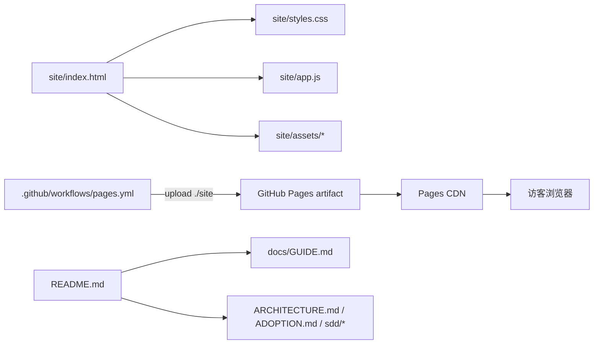

# GitHub Pages 官网与开源 README 设计文档（Design）

## 1. 元数据

| 项 | 内容 |
|---|---|
| Spec ID | SPEC-DEVTOOLS-001 |
| 关联Spec | `docs/specs/SPEC-DEVTOOLS-001/spec.md` |
| 作者 | Agent |
| 创建日期 | 2026-11-19 |
| 状态 | Draft |
| 评审人 | 待确认 |

## 2. 设计目标

- 核心问题：仓库已有完整方法论，但 GitHub 门面仍是内部手册风格；访客无法在首屏判断价值，也没有可分享的官网入口。
- 设计范围：静态站点、Pages 发布工作流、根 README 重写、原 README 内容归档、About 区素材与 homepage 写入。
- 非设计范围：状态机、CLI、MCP、Gate、核心版本、许可证文本、仓库可见性、自定义域名、访问统计。

## 3. 方案概述

- 高层方案：新增只含静态资源的 `site/` 目录，使用原生 HTML/CSS/JS 实现单页官网；GitHub Actions 将 `site/` 作为 Pages 制品上传，避免 `docs/specs/` 被发布。根 README 重写为开源项目首页，原 README 正文原样迁入 `docs/GUIDE.md`，只替换文档标题并补充归档说明与入口。
- 关键决策：
  1. 站点独立目录 + Actions 制品发布，而不是 `docs/` 分支发布。理由是 `docs/` 含 Spec 与内部工件，直接发布会造成信息泄露。
  2. 零构建、零外部依赖。理由是 Pages 环境稳定、断网可读、与仓库“只用标准库”的调性一致。
  3. 视觉采用深色开发者工具风格，单一强调色 + 中性灰阶，用状态流动画作为记忆点，不使用紫蓝渐变、emoji 图标或虚构指标。
  4. README 采用“短首页 + 深文档”结构，长文不删除，迁入 `docs/GUIDE.md` 并在 README 首屏给入口。
- 方案对比：
  - 方案 A（采用）：`site/` + Actions Pages。隔离性好、无需构建、可控。
  - 方案 B：把官网放进 `docs/` 并用 Pages 的 `/docs` 发布。配置最少，但会公开 Spec、Gate 报告和上下文，否决。
  - 方案 C：引入 Vite/Astro 构建。视觉上限更高，但新增 Node 依赖与构建链，违背仓库约束，否决。

## 4. Spec覆盖关系

| FR/AC | 设计章节/模块 | 实现方式 | 验证方式 |
|---|---|---|---|
| FR-001 / AC-001-1 | 站点首屏 | 导航、版本标签、H1、单句定位、主次 CTA 均位于首屏网格 | 1280×800 与 360px 人工走查 |
| FR-001 / AC-001-2 | 站点内容区 | 六个语义化 `<section>`，标题与锚点固定 | 页面结构检查 + 人工走查 |
| FR-001 / AC-001-3 | 响应式布局 | 移动优先，断点 720px/1040px，导航折叠为抽屉 | 360px/768px/1280px 走查 |
| FR-002 / AC-002-1 | 命令复制 | `navigator.clipboard` + `document.execCommand` 兜底，2 秒状态回退 | 浏览器点击验证 |
| FR-002 / AC-002-2 | 渐进增强 | 内容全部在 HTML，动效与复制由 JS 附加；`<noscript>` 隐藏复制按钮 | 禁用 JS 走查 |
| FR-002 / AC-002-3 | 可访问性 | 语义标签、跳转链接、`:focus-visible`、`aria-expanded`、`aria-label` | 键盘走查 + 结构检查 |
| FR-002 / AC-002-4 | 动效降级 | `@media (prefers-reduced-motion: reduce)` 关闭动画与滚动行为 | 浏览器媒体模拟 |
| FR-003 / AC-003-1 | README 头部 | 居中 logo、名称、定位、4 个徽章、两个链接 | 前 40 行人工评审 |
| FR-003 / AC-003-2 | README Quickstart | 平台接入、开发者恢复、最小验证三段命令 | 逐条执行帮助与只读命令 |
| FR-003 / AC-003-3 | README 文档导航 | 表格列出 GUIDE、架构、Agent 协议、接入、MCP、部署 | 链接存在性检查 |
| FR-003 / AC-003-4 | README 许可证 | 明确“当前未声明许可证”，不放许可证徽章 | 文本检查 |
| FR-004 / AC-004-1 | `docs/GUIDE.md` | 原 README 全部章节按原顺序迁入，标题降一级 | 章节清单对照 |
| FR-004 / AC-004-2 | 命令保真 | 迁移使用文件复制，不重写命令文本 | 命令抽样 diff |
| FR-004 / AC-004-3 | 链接检查 | 新 README 与 GUIDE 的相对链接逐项检查 | 本地链接检查脚本 |
| FR-005 / AC-005-1 | Pages 工作流 | 官方 Pages actions，上传 `./site` | YAML 解析 + Actions 运行 |
| FR-005 / AC-005-2 | 默认地址 | 所有资源使用相对路径，兼容 `/sdd-kit/` 子路径 | 部署后 HTTP 200 与资源检查 |
| FR-005 / AC-005-3 | About 素材 | `docs/GITHUB-ABOUT.md` 提供 Description、Topics、Homepage 文案 | 人工评审 |
| FR-005 / AC-005-4 | homepage 写入 | `gh api -X PATCH repos/.../homepage` | `gh repo view` 查询 |

## 5. 系统架构

### 5.1 架构图

### 5.2 模块划分

| 模块/服务 | 职责 | 输入 | 输出 | 依赖 |
|---|---|---|---|---|
| `site/index.html` | 页面语义结构与全部文案 | 产品事实、命令 | 可访问的静态页面 | 无 |
| `site/styles.css` | 设计令牌、布局、动效、响应式 | 视觉方向 | 样式 | 无 |
| `site/app.js` | 导航状态、复制、滚动揭示、移动菜单 | DOM 约定 | 渐进增强交互 | 浏览器 API |
| `site/assets/` | logo、favicon、社交预览图 | 品牌资产 | 图片资源 | 无 |
| `.github/workflows/pages.yml` | 构建与发布 Pages | Git push | 部署制品 | GitHub Actions |
| `README.md` | 开源项目首页 | 产品事实、链接 | Markdown | 无 |
| `docs/GUIDE.md` | 原 README 全文归档 | 旧 README | Markdown | 无 |
| `docs/GITHUB-ABOUT.md` | About 区配置素材 | 定位文案 | Markdown | 无 |

### 5.3 模块间交互

1. 浏览器请求 Pages 默认地址，CDN 返回 `index.html`，再并行加载同目录 CSS、JS 与 SVG。
2. `app.js` 在 `DOMContentLoaded` 后绑定复制按钮、滚动揭示和移动菜单；任一能力缺失时静默降级。
3. 平台团队 push 到 `main` 后，工作流检出代码、上传 `site/`、部署到 `github-pages` 环境。
4. 访客从 GitHub About 的 Homepage 进入站点；站点 CTA 跳回 GitHub 或 README 文档。

## 6. 数据模型

- 实体定义：不涉及
- 数据库变更：不涉及
- 事务边界：不涉及
- 迁移方案：不涉及

## 7. 接口契约

| 方法 | 路径 | 描述 | 归属AC |
|---|---|---|---|
| GET | `/` 与静态资源相对路径 | Pages 返回站点页面与资源 | AC-005-2 |
| PATCH | `repos/{owner}/{repo}` | 写入 `homepage` 字段 | AC-005-4 |

- 请求/响应结构：GitHub REST API 标准结构，请求体仅含 `homepage` 字符串。
- 错误码：Pages 未启用返回 404；权限不足返回 403；工作流失败在 Actions 日志体现。
- 兼容性：仅依赖 GitHub 官方 Pages Actions 与 REST API v3。
- 契约文件：不涉及。

## 8. 认证、授权、幂等与安全

- 认证：Pages 部署使用 GitHub 自动签发的 OIDC token；homepage 写入使用本机已登录的 `gh` 凭据。
- 授权：工作流最小权限 `contents: read`、`pages: write`、`id-token: write`。
- 幂等：Pages 部署可重复执行；PATCH homepage 为覆盖写，重复执行结果一致。
- 敏感数据：站点不包含 Token、内网地址、业务仓库名、Spec 内容；发布目录仅 `site/`。
- 审计：Git 提交历史、Actions 运行记录、仓库审计日志。

## 9. 关键决策ADR

- 引用：无需新增 ADR；决策记录于本文第 3 节与 `decisions.md`。
- 判断依据：本次为文档与静态站点改造，不改变核心架构边界；两个关键取舍（独立站点目录、零构建）已在方案对比中说明。

## 10. 非功能需求设计

- 性能设计：单 HTML + 单 CSS + 少量 JS，无外部字体、无框架、无图片依赖首屏；CSS 内联关键变量，资源同源相对路径。
- 可用性设计：语义化结构、跳转链接、键盘可达、焦点可见、对比度达到 AA；无 JS 可完整阅读。
- 可观测性：以 Actions 部署状态和 Pages HTTP 状态作为唯一运行信号，不引入前端埋点。

## 11. 依赖与风险

| 风险/依赖 | 影响 | 缓解措施 | 负责人 |
|---|---|---|---|
| 仓库当前为私有，Pages 可能无法启用 | About 链接暂时 404 | 交付时明确两种解锁方式；站点文件可本地直接打开；工作流先合入 | 仓库管理员 |
| 旧 README 迁移后出现链接或命令走样 | 团队查阅受阻 | 文件级复制、命令抽样 diff、链接检查 | Agent |
| 重写 README 丢失关键事实 | 新成员误解流程 | 保留 GUIDE 全文，README 只做摘要并链接 | Agent |
| Pages 默认地址包含仓库名，资源写死绝对路径会 404 | 站点样式丢失 | 全部资源相对路径，避免根路径 `/` | Agent |
| 视觉动效影响低端设备或晕动症用户 | 可访问性下降 | 仅 transform/opacity，提供 reduced-motion 关闭 | Agent |

## 12. 回滚方案

- 触发条件：Pages 部署连续失败、README 关键信息缺失、站点出现内部信息泄露。
- 回滚步骤：回退本次提交；Pages 重新部署上一提交；如仅 README 有问题，单独回退 `README.md` 与 `docs/GUIDE.md`。
- 数据恢复：不涉及数据；Git 历史保留全部旧内容。

## 13. 验收标准

- [x] 技术方案覆盖全部适用 FR 和 AC。
- [x] 接口契约已检查格式、引用和项目约束。
- [x] 数据模型、迁移和回滚方案完整或已明确不涉及。
- [x] 认证、授权、幂等、敏感数据和审计方案完整。
- [x] 风险、缓解措施和回滚方案已明确。

## 14. 变更历史

| 日期 | 版本 | 变更内容 | 作者 |
|---|---|---|---|
| 2026-11-19 | 1.0.0 | 初始版本 | Agent |
