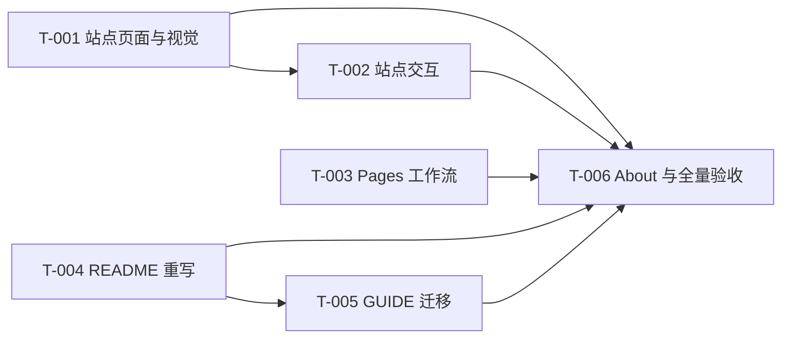

# GitHub Pages 官网与开源 README 任务清单（Tasks）

## 1. 元数据

| 项 | 内容 |
|---|---|
| Spec ID | SPEC-DEVTOOLS-001 |
| 关联Spec | `docs/specs/SPEC-DEVTOOLS-001/spec.md` |
| 关联Design | `docs/specs/SPEC-DEVTOOLS-001/design.md` |
| 作者 | Agent |
| 创建日期 | 2026-11-19 |
| 状态 | Draft |

## 2. 任务清单

| Task ID | 任务描述 | 关联FR/AC | 依赖Task | 并行标识 | 验收标准 | 单元测试类/方法 | 单Task测试命令 | 状态 | Commit SHA |
|---|---|---|---|---|---|---|---|---|---|
| T-001 | 实现官网页面结构、文案与视觉系统（`site/index.html`、`site/styles.css`、`site/assets/`） | FR-001；FR-002；AC-001-1；AC-001-2；AC-001-3；AC-002-2；AC-002-3；AC-002-4 | None | S | 页面含六个内容区与首屏 CTA；360px 无横向滚动规则；仅用设计令牌；支持 reduced-motion；资源全部相对路径 | `tests.test_site.SiteStructureTests#test_required_sections`、`#test_relative_assets`；`tests.test_site.SiteStyleTests#test_reduced_motion`、`#test_no_forbidden_css` | `python -m unittest tests.test_site.SiteStructureTests tests.test_site.SiteStyleTests -v` | Done | — |
| T-002 | 实现站点交互（`site/app.js`）：移动菜单、锚点状态、命令复制、滚动揭示与降级 | FR-002；AC-002-1；AC-002-2；AC-002-4 | T-001 | S | 复制成功与失败都有可见反馈并在 2 秒恢复；无 JS 时正文完整；动效只使用 transform/opacity | `tests.test_site.SiteInteractionTests#test_clipboard_feedback`、`#test_no_js_content`、`#test_aria_hooks` | `python -m unittest tests.test_site.SiteInteractionTests -v` | Done | — |
| T-003 | 新增 GitHub Pages 发布工作流（`.github/workflows/pages.yml`） | FR-005；AC-005-1；AC-005-2 | None | P | 仅上传 `site/`；权限为 contents/pages/id-token；支持 main push 与手动触发 | `tests.test_site.PagesWorkflowTests#test_uploads_site_only`、`#test_permissions`、`#test_triggers` | `python -m unittest tests.test_site.PagesWorkflowTests -v` | Done | — |
| T-004 | 重写根 `README.md` 为开源项目首页结构 | FR-003；AC-003-1；AC-003-2；AC-003-3；AC-003-4 | None | P | 前 40 行含徽章与官网入口；Quickstart 三段命令；文档导航完整；无许可证徽章 | `tests.test_site.ReadmeTests#test_header`、`#test_quickstart`、`#test_doc_nav`、`#test_license_section` | `python -m unittest tests.test_site.ReadmeTests -v` | Done | — |
| T-005 | 将原 README 迁入 `docs/GUIDE.md` 并修正入口与相对链接 | FR-004；AC-004-1；AC-004-2；AC-004-3 | T-004 | S | 原 933 行与全部一级章节保留；命令逐字一致；站内链接全部可解析 | `tests.test_site.GuideTests#test_all_sections`、`#test_commands_preserved`；`tests.test_site.LinkTests#test_relative_links` | `python -m unittest tests.test_site.GuideTests tests.test_site.LinkTests -v` | Done | — |
| T-006 | 新增 `docs/GITHUB-ABOUT.md`，写入仓库 homepage，并执行全量验收 | FR-005；AC-005-3；AC-005-4 | T-001, T-002, T-003, T-004, T-005 | S | About 素材可直接复制；`homepageUrl` 等于 Pages 默认地址；全量测试与 SDD 校验通过 | `tests.test_site.AboutTests#test_about_material`、`#test_homepage_matches_pages` | `python -m unittest discover -s tests -v` | Done | — |

字段规则：

- Task ID 采用 `T-xxx`，在当前 Spec 内唯一。
- 状态仅允许 `Todo`、`In Progress`、`Done`。
- 并行标识仅允许 `P` 或 `S`；依赖为空时必须填写 `None`。
- 一个 Task 必须能够在一次实现会话中独立完成并验证。
- 本会话按用户约束不创建 Git Commit；Commit SHA 保持 `—`，合并由人执行。

## 3. AC—Task—单元测试映射

| AC ID | 覆盖Task | 测试类/方法 | 测试命令/选择器 | 预期结果 | Gate 4实际结果 |
|---|---|---|---|---|---|
| AC-001-1 | T-001 | `SiteStructureTests#test_hero_contract` | `python -m unittest tests.test_site.SiteStructureTests.test_hero_contract -v` | 首屏含 H1、定位句、两个 CTA、版本标签 | 未执行 |
| AC-001-2 | T-001 | `SiteStructureTests#test_required_sections` | `python -m unittest tests.test_site.SiteStructureTests.test_required_sections -v` | 六个内容区锚点齐全 | 未执行 |
| AC-001-3 | T-001 | `SiteStyleTests#test_mobile_rules` | `python -m unittest tests.test_site.SiteStyleTests.test_mobile_rules -v` | 存在移动断点与 `overflow-x: clip`，无 `100vw` | 未执行 |
| AC-002-1 | T-002 | `SiteInteractionTests#test_clipboard_feedback` | `python -m unittest tests.test_site.SiteInteractionTests.test_clipboard_feedback -v` | 复制成功/失败文案与 2 秒复位逻辑存在 | 未执行 |
| AC-002-2 | T-002 | `SiteInteractionTests#test_no_js_content` | `python -m unittest tests.test_site.SiteInteractionTests.test_no_js_content -v` | 正文在 HTML 中，复制按钮默认隐藏 | 未执行 |
| AC-002-3 | T-001；T-002 | `SiteStructureTests#test_accessibility_hooks` | `python -m unittest tests.test_site.SiteStructureTests.test_accessibility_hooks -v` | 跳转链接、焦点样式、aria 属性齐全 | 未执行 |
| AC-002-4 | T-001；T-002 | `SiteStyleTests#test_reduced_motion` | `python -m unittest tests.test_site.SiteStyleTests.test_reduced_motion -v` | 存在 reduced-motion 媒体查询并关闭动画 | 未执行 |
| AC-003-1 | T-004 | `ReadmeTests#test_header` | `python -m unittest tests.test_site.ReadmeTests.test_header -v` | 前 40 行含名称、定位、4 徽章、官网与指南链接 | 未执行 |
| AC-003-2 | T-004 | `ReadmeTests#test_quickstart` | `python -m unittest tests.test_site.ReadmeTests.test_quickstart -v` | 含 bootstrap、resume、verify-core 三段命令 | 未执行 |
| AC-003-3 | T-004；T-005 | `ReadmeTests#test_doc_nav` | `python -m unittest tests.test_site.ReadmeTests.test_doc_nav -v` | 导航覆盖 GUIDE/架构/协议/接入/MCP/部署 | 未执行 |
| AC-003-4 | T-004 | `ReadmeTests#test_license_section` | `python -m unittest tests.test_site.ReadmeTests.test_license_section -v` | 明确未声明许可证且无 MIT/Apache 徽章 | 未执行 |
| AC-004-1 | T-005 | `GuideTests#test_all_sections` | `python -m unittest tests.test_site.GuideTests.test_all_sections -v` | 原 16 个一级章节全部存在 | 未执行 |
| AC-004-2 | T-005 | `GuideTests#test_commands_preserved` | `python -m unittest tests.test_site.GuideTests.test_commands_preserved -v` | 抽样命令逐字一致 | 未执行 |
| AC-004-3 | T-005 | `LinkTests#test_relative_links` | `python -m unittest tests.test_site.LinkTests.test_relative_links -v` | 所有相对链接目标存在 | 未执行 |
| AC-005-1 | T-003 | `PagesWorkflowTests#test_uploads_site_only` | `python -m unittest tests.test_site.PagesWorkflowTests.test_uploads_site_only -v` | 上传路径为 `./site`，无 docs | 未执行 |
| AC-005-2 | T-003 | `PagesWorkflowTests#test_relative_site_assets` | `python -m unittest tests.test_site.PagesWorkflowTests.test_relative_site_assets -v` | 资源引用不以 `/` 开头 | 未执行 |
| AC-005-3 | T-006 | `AboutTests#test_about_material` | `python -m unittest tests.test_site.AboutTests.test_about_material -v` | Description/Topics/Homepage 三项齐全 | 未执行 |
| AC-005-4 | T-006 | `AboutTests#test_homepage_matches_pages` | `python -m unittest tests.test_site.AboutTests.test_homepage_matches_pages -v` | API 返回的 homepage 等于默认 Pages 地址 | 未执行 |

映射规则：

- 必须覆盖 `spec.md` 中的全部适用 AC，不得增加不存在的 AC。
- 每条 AC 至少关联一个 Task 和一个具体测试类/方法。
- 同一测试覆盖多个 AC 时必须逐条登记。
- Gate 4 只有在测试真实存在、已执行且通过时，才能标记为“通过”。

## 4. 依赖图



## 5. 实施与提交顺序

```text
选择一个 Todo Task
→ 状态改为 In Progress
→ 实现内容与对应测试
→ 执行该 Task 的测试
→ 测试通过后状态改为 Done
→ 记录验证证据（本会话不创建 Git Commit）
→ 继续下一个 Task
```

全部 Task 完成后执行全量单元测试、逐 AC 验证和 Gate 5。

## 6. 全量单元测试记录

| 测试命令 | 退出码 | 执行数 | 通过数 | 失败数 | 跳过数 | 结果 |
|---|---:|---:|---:|---:|---:|---|
| `python -m unittest discover -s tests -v` | 0 | 74 | 72 | 0 | 2 | 通过 |

## 7. 自检清单（评审辅助，不作Gate依据）

- [x] Spec ID 及 Spec/Design 引用有效且一致。
- [x] Task ID 唯一，字段完整，状态值和并行标识合法。
- [x] 每个 Task 可独立实现、独立测试并对应一次可验证交付。
- [x] 全部 FR/AC 均已映射到 Task，不存在孤儿 AC。
- [x] 每条 AC 均已映射到具体测试类/方法和可执行命令。
- [x] 所有依赖 Task 真实存在，依赖图无环，并行标识无冲突。

## 8. 变更历史

| 日期 | 版本 | 变更内容 | 作者 |
|---|---|---|---|
| 2026-11-19 | 1.0.0 | 初始版本 | Agent |
