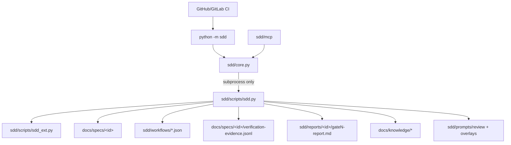

# 轻量、可自定义、全链路可溯源的 SDD-L2 执行内核设计文档（Design）

## 1. 元数据

| 项 | 内容 |
|---|---|
| Spec ID | SPEC-DEVTOOLS-002 |
| 关联Spec | `docs/specs/SPEC-DEVTOOLS-002/spec.md` |
| 作者 | SDD Agent |
| 创建日期 | 2026-11-23 |
| 状态 | Draft |
| 评审人 | 仓库维护者 |

## 2. 设计目标

- 核心问题：当前内核已经能约束阶段顺序，但“需求追溯是否完整、Agent 是否只拿到必要上下文、测试是否真的执行、自定义流程是否可验证、例外是否可审计、缺陷是否回流”仍主要依赖文档自觉。
- 设计范围：FEAT 追溯、G0/G1 独立检查、`context_bundle`、可复验证据、Profile v2、Gate 检查注册表、`warn/waiver`、Review overlay、最小知识索引、Fix Pattern 和质量指标。
- 非设计范围：服务端、数据库、可视化 DAG、全量 Ontology、自动业务裁决、Agent 自动审批。
- 设计原则：状态机只保留一份；新增能力优先做成纯函数、声明式数据和可枚举检查；所有新增能力在缺少数据时返回空结构或明确阻断，不静默猜测。

## 3. 方案概述

- 高层方案：
  1. `sdd/scripts/sdd.py` 继续独占阶段迁移、Gate 编排、人工动作和 CLI 命令。
  2. 新增 `sdd/scripts/sdd_ext.py`，只放无状态纯函数和常量：检查注册表、Profile v2 校验、证据/豁免/Review 解析、知识索引与 Fix Pattern 读取、指标聚合。该模块不执行 `transition`，不保存状态。
  3. `build_next_action` 在返回 `next` 时按当前 Task 生成 `context_bundle`；`core.Workspace` 仍只通过子进程读取 `next`，不复制上下文选择规则。
  4. `sdd verify` 将每条命令证据追加到当前 Spec 的 `verification-evidence.jsonl`；G5 读取证据文件，不接受只在 Markdown 中写 PASS。
  5. Profile v2 使用 `schema: 2`；schema 1 快照保持只读兼容。新 Profile 可声明检查项组合、人工检查点、Review 风险阈值、上下文 include/exclude 和风险标签。
  6. Gate 结果统一由检查注册表生成 `pass/warn/block/waived`；错误文本仍保留给现有调用方，但 JSON 和 Gate 报告同时输出稳定检查 ID。
  7. 人工豁免写入 `state.json.waivers` 和审计事件；安全红线检查 ID 在注册表中标记为不可豁免。
  8. Review 采用“通用契约 + overlay”；overlay 只提供审查规则和 finding 模板，不参与状态迁移。
  9. 知识索引与 Fix Pattern 使用仓库内 Markdown；`context_bundle` 按 FEAT/FR/AC、允许路径和技术栈选择内容。
- 关键决策：
  - 不把 Profile 做成通用脚本或 DAG。有限模型才可校验、可快照、可审计。
  - 不把证据放到集中数据库。JSONL + Git + 产物哈希足以完成单仓库审计，且符合轻量目标。
  - 不为旧 Spec 回填新必填项。旧快照和旧状态按原规则运行，新规则只对新建或重新进入对应 Gate 的 Spec 生效。
  - 不把检查结果简单降级为字符串。字符串继续用于兼容，结构化检查 ID 用于治理。
- 方案对比：
  - 方案 A（采用）：单状态机 + 纯函数扩展模块 + 仓库内声明式数据。改动可控、无部署、容易审计。
  - 方案 B：拆成独立工作流服务。可集中管理，但引入服务端和数据库，违反轻量目标。
  - 方案 C：把 v7 全部模板和技能搬入仓库。覆盖更广，但上下文成本和维护成本过高，且会削弱“简单”。

## 4. Spec覆盖关系

| FR/AC | 设计章节/模块 | 实现方式 | 验证方式 |
|---|---|---|---|
| FR-001 / AC-001-1 | 标准符合性文档、检查注册表 | 为 P0–P5/G0–G5 建表，状态限定为四种 | 文档结构测试 + 人工评审 |
| FR-001 / AC-001-2 | 标准符合性文档、指标 | 核心优势表含指标、目标、采集和结果 | 文档内容测试 |
| FR-001 / AC-001-3 | 检查注册表、Gate 报告 | 每项官方 Gate 绑定内部 Gate 和证据 | 注册表完整性测试 |
| FR-001 / AC-001-4 | 标准符合性文档 | 每项“已自动/已人工”附 CLI、测试或人工证据 | 链接与证据抽查 |
| FR-002 / AC-002-1 | Spec 元数据、PRD 索引 | `FEAT ID` 双向一致校验 | 单元测试 |
| FR-002 / AC-002-2 | G0 检查 | 重复 FEAT、多当前 Spec、工作项错配阻断 | 单元测试 |
| FR-002 / AC-002-3 | G1/G3 检查 | 孤儿 FR、孤儿 AC、任务断链分别报告 | 单元测试 |
| FR-002 / AC-002-4 | Gate 报告 | G0/G1 独立检查组和稳定 ID | 报告快照测试 |
| FR-002 / AC-002-5 | PRD 索引解析 | 澄清标记按工作项/FEAT 报告 | 单元测试 |
| FR-003 / AC-003-1 | `build_context_bundle` | 输出任务、需求、设计、契约、约束、Pattern、范围、排除 | schema 单测 |
| FR-003 / AC-003-2 | 设计章节索引 | AC 去重并关联设计覆盖行和任务映射行 | 单元测试 |
| FR-003 / AC-003-3 | 空上下文 | 无任务时返回空数组和缺口说明 | 单元测试 |
| FR-003 / AC-003-4 | `resume` 只读 | 仅读取状态与工件，不写 state/events/Git | 调用前后哈希测试 |
| FR-003 / AC-003-5 | Agent 协议、context rules | 超范围时要求停止并请求扩大范围 | 提示词与上下文测试 |
| FR-004 / AC-004-1 | `sdd verify`、证据 JSONL | 记录命令、目录、时间、退出码、耗时、输出摘要、哈希 | 单元测试 |
| FR-004 / AC-004-2 | G4/G5 | 代码变更无成功命令时不得 PASS | 单元测试 |
| FR-004 / AC-004-3 | 测试定位器 | 解析 Task 测试引用并查找类/方法 | 单元测试 |
| FR-004 / AC-004-4 | AC 测试扫描器 | 只扫描测试函数块，并要求断言或测试名关联 | 单元测试 |
| FR-004 / AC-004-5 | G5 证据校验 | 非零、超时、未执行均不能写入 PASS | 单元测试 |
| FR-004 / AC-004-6 | 文档/配置豁免 | 显式豁免并在报告、inbox、指标留痕 | 单元测试 |
| FR-005 / AC-005-1 | Profile v2 加载 | 声明字段进入解析后的运行时 Profile | 单元测试 |
| FR-005 / AC-005-2 | Profile 校验器 | 未知字段、阶段、检查 ID、人工动作精确报错 | 单元测试 |
| FR-005 / AC-005-3 | `l2-refactor` Profile | 仅数据文件定义行为保持型改造流程 | 启动 Spec 测试 |
| FR-005 / AC-005-4 | 快照与 digest | 旧 Spec 固定 `workflow.json` | 兼容性测试 |
| FR-005 / AC-005-5 | 安全必需检查 | 校验不可移除检查 ID | 单元测试 |
| FR-006 / AC-006-1 | 检查注册表 | 每项含 Gate、触发、级别、豁免、证据、角色 | 注册表测试 |
| FR-006 / AC-006-2 | `check`、`inbox` | 建议项输出 `warn` 且不阻断 | 单元测试 |
| FR-006 / AC-006-3 | `run_checks`、`complete` | 强制项 `block` 并阻止迁移 | 单元测试 |
| FR-006 / AC-006-4 | `sdd waive` | 人类命令写 state 与审计事件，MCP 不暴露 | CLI + MCP 测试 |
| FR-006 / AC-006-5 | 豁免到期 | 读取时比较到期时间，过期恢复阻断 | 单元测试 |
| FR-006 / AC-006-6 | 安全红线 | 注册表 `waivable=false` 拒绝豁免 | 单元测试 |
| FR-006 / AC-006-7 | 指标 | 按检查 ID 聚合通过、告警、阻断、豁免 | 单元测试 |
| FR-007 / AC-007-1 | Review 入口、overlay | 按风险与技术栈选择通用契约和 overlay | 上下文测试 |
| FR-007 / AC-007-2 | Review finding parser | 校验九个字段和阻断状态 | 单元测试 |
| FR-007 / AC-007-3 | G4/G5 review 检查 | medium/high 缺证据或存在阻断 finding 时失败 | 单元测试 |
| FR-007 / AC-007-4 | Review 结论校验 | 无问题时必须明确写“未发现可执行问题” | 单元测试 |
| FR-007 / AC-007-5 | 三类 overlay 文档 | Python、Java/Spring、前端各有入口和条件 | 文档测试 |
| FR-007 / AC-007-6 | Review 边界 | overlay 不含 `transition` 或审批命令 | 静态扫描测试 |
| FR-008 / AC-008-1 | 知识索引 | 五类记录和稳定 ID | 文档结构测试 |
| FR-008 / AC-008-2 | 知识记录 parser | 校验来源、版本、范围、Owner、状态、链接 | 单元测试 |
| FR-008 / AC-008-3 | 候选规则 | 无来源只能为候选 | 单元测试 |
| FR-008 / AC-008-4 | 冲突检查 | 未解决冲突阻断相关任务上下文 | 单元测试 |
| FR-008 / AC-008-5 | Spec/Design 引用 | 用知识 ID 引用并检查链接 | 人工评审 + 链接检查 |
| FR-009 / AC-009-1 | Fix Pattern 文档 | 八字段 + CHK 关联 | 文档测试 |
| FR-009 / AC-009-2 | `context_bundle` | 按路径和范围匹配 Pattern | 单元测试 |
| FR-009 / AC-009-3 | FP-001 闭环 | 真实缺陷映射 Pattern、CHK、回归测试 | 文档 + 测试证据 |
| FR-009 / AC-009-4 | Pattern 状态 | 未验证 Pattern 只作参考 | 单元测试 |
| FR-009 / AC-009-5 | 指标扩展 | 豁免率、逃逸缺陷、重开率、一次通过率 | 单元测试 |
| FR-010 / AC-010-1 | 旧快照兼容 | schema 1 快照继续解释 | 兼容性测试 |
| FR-010 / AC-010-2 | 事件与哈希 | 迁移记录 actor/time/evidence/hash | 单元测试 |
| FR-010 / AC-010-3 | JSON 兼容 | 只新增字段，不改旧字段语义 | CLI 回归测试 |
| FR-010 / AC-010-4 | 版本、manifest、文档 | 发布时统一更新 | 发布命令测试 |
| FR-010 / AC-010-5 | 全量验证 | 单元、core、agent、CI 全部通过 | 全量命令 |
| FR-010 / AC-010-6 | 自动循环快照 | 每阶段仍单动作、单提交动作 | 快照与人工评审 |

## 5. 系统架构

### 5.1 架构图

### 5.2 模块划分

| 模块/服务 | 职责 | 输入 | 输出 | 依赖 |
|---|---|---|---|---|
| `sdd/scripts/sdd.py` | 唯一状态机、Gate 编排、CLI、人工动作 | 状态、工件、Profile、证据 | 新状态、Gate 报告、事件 | `sdd_ext`、标准库 |
| `sdd/scripts/sdd_ext.py` | 纯函数 schema、注册表、解析、指标 | JSON/Markdown 文本 | 校验结果、结构化记录 | 标准库 |
| `sdd/core.py` | 会话指针与高层动作 | 调用参数 | 子进程结果、稳定 JSON | `sdd.py` 子进程 |
| `sdd/cli.py` | 用户入口与人类动作标志 | CLI 参数 | JSON/文本 | `core.py` |
| `sdd/mcp/` | 可选薄适配器 | MCP 请求 | 现有工具结果 | `core.py` |
| `sdd/workflows/` | 声明式 Profile | JSON | 冻结快照 | 无 |
| `sdd/prompts/review/` | 通用 Review 契约与 overlay | 技术栈、风险 | finding 模板 | 无状态 |
| `docs/knowledge/` | 最小知识与 Fix Pattern | Markdown | 可引用 ID | 无 |

### 5.3 模块间交互

1. `python -m sdd resume` 调用 `core.Workspace.session`，后者通过子进程调用 `sdd.py next`。
2. `sdd.py build_next_action` 解析当前 Task、Spec、Design 和 Profile，生成 `context_bundle`。
3. `check` 运行现有文档校验，再由 `sdd_ext` 将错误映射为稳定检查 ID，过滤有效豁免后输出 `pass/warn/block/waived`。
4. `verify` 只在 `VERIFYING` 运行，将证据追加到 JSONL；`complete` 的 G5 读取 JSONL 和测试文件。
5. `waive` 只从双层 CLI 暴露，拒绝 Agent 调用；MCP 工具清单不增加该动作。
6. Review overlay 由 Agent 按 `context_bundle.review_overlays` 读取，finding 写入 `verification.md` 的结构化块或 `review-findings.json`。

## 6. 数据模型

- 实体定义：
  - `FEATRecord`：feat_id、work_item、prd_ref、prd_version、spec_id、clarifications。
  - `Profile`：schema、name、version、stages、artifacts、gates、required_gates、gate_checks、human_checkpoints、design_mode、review_required、risk_stop、context_rules。
  - `CheckDefinition`：id、gate、title、trigger、level、waivable、evidence、owner。
  - `CheckResult`：id、result、detail、waived、waiver_id。
  - `EvidenceRecord`：schema、spec、task、command、cwd、started_at、finished_at、exit_code、duration_ms、output_sha256、output_excerpt。
  - `Waiver`：id、check_id、spec、scope、reason、approver、created_at、expires_at、evidence。
  - `ReviewFinding`：id、location、evidence、impact、recommendation、authority、severity、verification、blocking。
  - `KnowledgeRecord`：id、type、statement、source、version、scope、owner、status、links。
  - `FixPattern`：id、symptom、root_cause、trigger、fix、checks、scope、owner、status。
- 数据库变更：不涉及；不新增服务或数据库。
- 事务边界：单个 CLI 命令内完成文件写入；状态保存采用临时文件替换，证据采用追加写。
- 迁移方案：Profile schema 1 继续读取；新 Spec 使用 schema 2。旧 Spec 无 FEAT 时只在新 Gate 或新 Spec 上要求，保持旧快照稳定。

## 7. 接口契约

| 方法 | 路径 | 描述 | 归属AC |
|---|---|---|---|
| CLI | `next --json` / `resume --json` | 返回 `context_bundle` | AC-003-1–AC-003-5 |
| CLI | `check --stage ... --json` | 返回 `errors`、`checks`、`summary` | AC-006-1–AC-006-3 |
| CLI | `verify` | 追加 JSONL 证据 | AC-004-1–AC-004-5 |
| CLI | `workflow validate --file` | 校验 Profile v2 | AC-005-2 |
| CLI | `waive --human` | 记录人工豁免 | AC-006-4–AC-006-6 |
| JSONL | `verification-evidence.jsonl` | 一行一条命令证据 | AC-004-1 |
| JSON | `review-findings.json` | Review finding 数组 | AC-007-2 |

- 请求/响应结构：所有新增 JSON 字段保持稳定类型；空集合使用 `[]`，缺失对象使用 `null` 或明确空对象。
- 错误码：沿用退出码 0/1/2；校验错误在 `errors` 中返回，结构化检查在 `checks` 中返回。
- 兼容性：不删除既有字段，不改变既有字段含义；新增字段对旧调用方可选。
- 契约文件：`docs/specs/SPEC-DEVTOOLS-002/api/` 当前不需要 HTTP 契约；CLI 契约由测试固定。

## 8. 认证、授权、幂等与安全

- 认证：沿用仓库本地身份和 Git 配置；不新增账号体系。
- 授权：`approve`、`merge`、`unblock`、`rewind`、`waive` 必须 `--human`；MCP 不暴露这些动作。
- 幂等：`resume` 只读；`verify` 追加证据；重复 `waive` 生成新的审计记录但只取有效记录；重复 `check` 不改变业务状态。
- 敏感数据：`context_bundle` 只读取当前 Spec 和允许的仓库文件，不输出其他 Spec 正文；Review/证据输出不包含 Token。
- 审计：状态迁移、检查失败、人工 Gate、豁免、证据执行和 Review 结论均写入事件或专用工件。
- 防伪：证据 JSONL 使用输出摘要和 sha256；Gate 报告绑定工件哈希；安全红线不可豁免。

## 9. 关键决策ADR

- 引用：`docs/specs/SPEC-DEVTOOLS-002/adrs/ADR-002-extension-boundary.md`
- 判断依据：把纯 schema/解析放入 `sdd_ext.py` 可以降低 `sdd.py` 的复杂度，同时保持唯一状态机边界；把检查注册表放在核心代码而非用户可编辑 JSON，避免用户通过改注册表绕过安全红线；Profile 只控制“选择哪些已注册检查”，不能定义任意执行脚本。

## 10. 非功能需求设计

- 性能设计：`context_bundle` 只读取当前 Spec、`sdd/context` 索引和适用的知识/Pattern；不扫描全部历史 Spec。证据文件采用追加写，避免重写大文件。
- 可用性设计：Profile 校验错误包含字段路径、非法值和候选；检查结果包含 ID 和修复提示；空上下文返回结构化空值。
- 可观测性：Gate 报告、`events.jsonl`、`verification-evidence.jsonl` 和 `metrics --json` 共同提供阶段、检查、证据和质量趋势。
- 轻量设计：核心只使用标准库；MCP 依赖仍在独立 requirements；不新增服务端。

## 11. 依赖与风险

| 风险/依赖 | 影响 | 缓解措施 | 负责人 |
|---|---|---|---|
| 旧 Spec 没有 FEAT、证据文件和 schema 2 快照 | 全量 CI 可能因新规则失败 | 只对新 Spec/新 Gate 强制；旧快照按 schema 1 解释；增加兼容测试 | 平台维护者 |
| 测试名解析依赖任务表格式 | 合法但不同写法可能被误判 | 支持 `Module.Class#method`、`Class#method` 和方法名三种形式，错误提示给出可接受格式 | 平台维护者 |
| 证据 JSONL 被手工伪造 | G5 以假证据通过 | 记录输出 sha256、时间、退出码和命令；CI 可用真实执行覆盖；对异常事件标记 | 平台维护者 |
| Review overlay 过多导致上下文膨胀 | Agent 注意力下降 | 只加载与文件扩展名/任务范围匹配的 overlay；默认一个通用契约 | 质量负责人 |
| 知识索引与 Pattern 过期 | 误用历史规则 | 记录版本、Owner、状态和适用范围；未验证 Pattern 只作参考 | 业务 Owner |
| 自定义 Profile 过度复杂 | 使用者配置错误 | 有限 schema、显式校验、`l2-refactor` 示范、错误定位到字段 | 工作流设计者 |

## 12. 回滚方案

- 触发条件：新 Profile 无法加载、旧 Spec CI 失败、证据校验导致正常流程大面积阻断、豁免或 Review 逻辑出现安全缺陷。
- 回滚步骤：回退 `sdd/scripts/sdd.py`、`sdd/scripts/sdd_ext.py`、Profile 文件和模板提交；保留新增文档作为设计记录；旧 Spec 的快照不需要迁移。
- 数据恢复：证据 JSONL 和事件只追加，回滚不删除历史；状态文件由 Git 恢复；若需恢复到旧阶段，使用人类 `rewind`。
- 版本处理：回滚时同步恢复 `sdd/VERSION` 和 manifest，确保 `verify-core` 与发布版本一致。

## 13. 验收标准

- [x] 技术方案覆盖全部适用 FR 和 AC。
- [x] 接口契约已检查格式、引用和项目约束。
- [x] 数据模型、迁移和回滚方案完整或已明确不涉及。
- [x] 认证、授权、幂等、敏感数据和审计方案完整。
- [x] 风险、缓解措施和回滚方案已明确。

## 14. 变更历史

| 日期 | 版本 | 变更内容 | 作者 |
|---|---|---|---|
| 2026-11-23 | 1.0.0 | 初始版本，确定单状态机 + 纯函数扩展、证据 JSONL、Profile v2 和 Review/知识边界 | SDD Agent |
