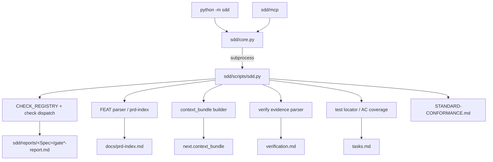

# SDD-L2 执行内核 P0 设计文档（Design）

## 1. 元数据

| 项 | 内容 |
|---|---|
| Spec ID | SPEC-DEVTOOLS-002 |
| 关联Spec | `docs/specs/SPEC-DEVTOOLS-002/spec.md` |
| 作者 | SDD Agent |
| 创建日期 | 2026-11-20 |
| 状态 | Draft |
| 评审人 | 平台维护者 |

## 2. 设计目标

- 核心问题：现有状态机已经把“流程不可跳过”做出来了，但 G0 没有真正检查 PRD/FEAT，`resume` 不返回最小上下文，G4/G5 仍可能被文档文本和裸 AC 标签蒙混过关。
- 设计范围：在 `sdd/scripts/sdd.py` 内补齐检查项注册表、FEAT 结构化追溯、`context_bundle`、可复验证据与测试定位；同步模板、文档、测试、版本和 manifest。
- 非设计范围：不新增状态、不改变阶段图、不实现 P1 的 warn/waiver、Profile v2、Review overlay，也不实现 P2 的知识索引和 Fix Pattern 闭环。

## 3. 方案概述

- 高层方案：保留唯一状态机，在 `sdd/scripts/sdd.py` 内增加五个可复用能力，并让 `sdd/core.py`、`sdd/cli.py`、MCP 只透传结果。
  1. **检查项注册表**：用代码内常量声明稳定的 `G0-01`…`G5-xx`，每个 Gate 通过 dispatch 执行检查项，Gate 报告按注册表输出 ID、级别、结果和证据。
  2. **FEAT 结构化索引**：Spec 元数据增加 `FEAT ID`；`docs/prd-index.md` 增加 `FEAT 映射` 表，按 FR 一行记录 FR 与 AC；检查器解析表格而不是做全文包含。
  3. **最小上下文包**：在 `build_next_action()` 内按当前状态生成只读 `context_bundle`，不写 `state.json`，不新增必填文档。
  4. **可复验证据**：`sdd verify` 写结构化命令块；G5 解析退出码和输出摘要；G4/G5 校验测试名可定位、AC 覆盖来自真实测试函数。
  5. **兼容层**：只对新建或未合并 Spec 启用新强制规则；已 `MERGED` 的历史 Spec 走 legacy 分支，报告中显式标注。
- 关键决策：
  1. 注册表放在 `sdd/scripts/sdd.py` 而不是 JSON：它属于状态机规则，必须与代码同版本、同 manifest；新增 JSON 会制造第二个规则源。
  2. `context_bundle` 按需计算、不落盘：避免会话缓存漂移，也满足 `resume` 只读要求。
  3. 证据只认 `sdd verify` 的结构化块：格式单一、可解析、可复跑；手写 PASS 不构成证据。
  4. legacy 以 `state == MERGED` 且缺少 FEAT/新证据标记识别：只保护历史交付，不提供新 Spec 的逃生门。
- 方案对比：
  - 方案 A（采用）：状态机内注册表 + 文档内结构化索引，零新增运行时文件、零第三方依赖。
  - 方案 B：独立 `checks.json` + 通用 DSL。可配置性更强，但会把规则拆成两份，且 P1 才需要，P0 不采用。
  - 方案 C：把 `context_bundle` 持久化到 `.sdd/runtime`。读取更快，但会引入缓存失效和状态漂移，不采用。

## 4. Spec覆盖关系

| FR/AC | 设计章节/模块 | 实现方式 | 验证方式 |
|---|---|---|---|
| FR-001 / AC-001-1 | 5.1 标准符合性文档 | 新增 `docs/STANDARD-CONFORMANCE.md`，P0–P5 与 G0–G5 各一行，含实现、证据、缺口、状态 | 文档解析测试 + 人工评审 |
| FR-001 / AC-001-2 | 5.1 标准符合性文档 | 固定 6 个阶段 + 6 个 Gate 的表格行，状态枚举固定 | `tests/test_standard_conformance.py` |
| FR-001 / AC-001-3 | 5.2 检查项注册表 | 文档引用的检查 ID 与 `CHECK_REGISTRY` 对齐 | 注册表交叉校验测试 |
| FR-002 / AC-002-1 | 5.3 FEAT 追踪 | `spec.md` 元数据 `FEAT ID`；`ensure_prd_index` 分配 FEAT；检查器比对 | 单元测试构造元数据与索引 |
| FR-002 / AC-002-2 | 5.3 FEAT 追踪 | G0-04 检查 FEAT 存在与一致，错误定位到字段 | 单元测试 + G0 报告断言 |
| FR-002 / AC-002-3 | 5.3 FEAT 追踪 | 解析全部扁平行，检测 FEAT 重复 | 双 Spec 夹具测试 |
| FR-002 / AC-002-4 | 5.3 FEAT 追踪 | `FEAT 映射` 表按 FR 记录 AC，取并集与 Spec 的 FR/AC 对比 | 孤儿 FR/AC 夹具测试 |
| FR-002 / AC-002-5 | 5.3 FEAT 追踪 | 校验 source/updated、澄清标记、表格可解析 | 结构化索引测试 |
| FR-002 / AC-002-6 | 5.3 FEAT 追踪 | 只读结构化表；正文出现不算登记 | 正文误写夹具测试 |
| FR-002 / AC-002-7 | 5.3.3 legacy 分支 | MERGED 且无 FEAT 时跳过严格映射并记录 note | 历史 Spec 夹具测试 |
| FR-002 / AC-002-8 | 5.3.3 legacy 分支 | 非 MERGED 必须带 FEAT，无 legacy 逃生门 | 新 Spec 缺 FEAT 测试 |
| FR-003 / AC-003-1 | 5.2 检查项注册表 | `write_gate_report` 输出检查 ID、级别、结果、证据 | 报告表格解析测试 |
| FR-003 / AC-003-2 | 5.2.2 G0/G1 分闸 | `command_approve` 分别调用 `run_gate_items("G0")` 与 `("G1")` | 两份报告夹具测试 |
| FR-003 / AC-003-3 | 5.2.3 阻断语义 | 任一 required 项失败，总体 `FAILED`，不调用 `transition` | 失败流测试 |
| FR-003 / AC-003-4 | 5.2.1 注册表结构 | `validate_check_registry()` 校验 ID 唯一、Gate 合法、字段齐备 | 注册表自检测试 |
| FR-004 / AC-004-1 | 5.4 上下文包 | `build_context_bundle()` 返回九字段；Task 步骤填 task/frs/acs 等 | `next --json` 快照测试 |
| FR-004 / AC-004-2 | 5.4 上下文包 | 非 Task 步骤返回 `task=null` 与空数组 | 各阶段 `next` 测试 |
| FR-004 / AC-004-3 | 5.4.3 只读与兼容 | 只读磁盘；不改 `state.json`/`events.jsonl`；保留原 next 字段 | 字节对比测试 |
| FR-004 / AC-004-4 | 5.4.2 范围派生 | 从 design 影响范围与 Task 字段派生；空数组表示未知 | 范围缺失测试 |
| FR-004 / AC-004-5 | 5.4.1 schema | 文档化字段与类型；固定字段集合快照 | schema 快照测试 |
| FR-005 / AC-005-1 | 5.5 可复验证据 | `config.test_commands` 为空且无成功块时返回 manual/unverified 错误 | 空命令测试 |
| FR-005 / AC-005-2 | 5.5.1 证据格式 | `command_verify` 写 Command/CWD/Exit/Output/Head/Plan-Hash | 证据块解析测试 |
| FR-005 / AC-005-3 | 5.5.2 G5 校验 | 无 exit=0 块时阻断，即使文档写 PASS | 伪 PASS 测试 |
| FR-005 / AC-005-4 | 5.6 测试定位 | `locate_task_test()` 解析模块/类/方法并检查文件定义 | 不存在测试名测试 |
| FR-005 / AC-005-5 | 5.6.2 AC 覆盖 | 只统计 `def test_*` 函数体内的 AC 标签 | 裸标签测试 |
| FR-005 / AC-005-6 | 5.7 独立 review | 中高风险或 risk_stop 命中时要求结构化 review | 缺 review 测试 |
| FR-005 / AC-005-7 | 5.8 低风险兼容 | l2-standard 低风险不新增人工检查点或命令 | 全流程回归测试 |
| FR-005 / AC-005-8 | 5.5.2 G5 校验 | 任一 exit 非 0 即阻断 | 失败命令测试 |
| FR-005 / AC-005-9 | 5.8 低风险兼容 | MERGED 历史 Spec 跳过新证据/覆盖规则 | 历史 Spec 回归 |
| FR-005 / AC-005-10 | 5.8 低风险兼容 | 非 MERGED 必须满足新规则，legacy 只认 MERGED | 新 Spec 绕过测试 |

## 5. 系统架构

### 5.1 架构图



### 5.2 模块划分

| 模块/服务 | 职责 | 输入 | 输出 | 依赖 |
|---|---|---|---|---|
| `sdd/scripts/sdd.py` | 唯一状态机；注册表、FEAT、上下文包、证据与测试定位 | Spec 目录、config、CLI 参数 | state/events/Gate 报告/next JSON | Python 标准库 |
| `sdd/core.py` | 会话指针与 CLI 编排 | CLI 参数 | 结构化 JSON | `sdd.py` 子进程 |
| `sdd/cli.py` | `python -m sdd` 命令表 | argv | 进程退出码与 JSON | `core.py` |
| `docs/prd-index.md` | 工作项、FEAT、Spec、FR/AC 映射 | 人工/Agent 维护 | 结构化表格 | Git |
| `docs/STANDARD-CONFORMANCE.md` | 官方阶段/Gate 对照 | 注册表与实现事实 | 对人可读的映射表 | Git |
| `tests/` | 回归与夹具 | 核心代码 | 测试结果 | 标准库 `unittest` |

### 5.3 模块间交互

1. `command_approve` 构造 Gate 上下文，分别执行 G0 与 G1 的注册项；两份报告独立写入，再统一决定是否 `transition`。
2. `command_complete` 在 G2–G5 转换点执行对应注册项；G4 额外检查当前 Task 的测试名，G5 额外检查命令证据。
3. `build_next_action` 在返回前调用 `build_context_bundle`，只读磁盘并返回纯数据。
4. `command_verify` 执行命令并把结构化证据追加到 `verification.md`；`check_verification` 与 Gate 5 复用同一解析器。
5. 所有新检查同时被 `check` 调用，保证 `submit` 与 CI 看到同一套规则。

## 6. 数据模型

- 实体定义：
  - **检查项**：`id`、`gate`、`name`、`level`、`trigger`、`waivable`、`evidence`、`owner`。`id` 全局唯一，形如 `G0-01`。
  - **FEAT 行**：`work_item`、`feat`、`spec`、`fr`、`acs`。FEAT 与 Spec 一对一；FR/AC 与 Spec 正文一致。
  - **上下文包**：见 7.1；不落盘。
  - **命令证据**：`command`、`cwd`、`exit`、`output`、`head`、`plan_hash`、`at`。
  - **测试覆盖**：`test_file`、`test_name`、`acs`，由测试函数体静态解析得到。
- 数据库变更：不涉及。
- 事务边界：所有状态更新仍由 `save_state` 单点写入；新检查只读，不引入事务。
- 迁移方案：不迁移历史 Spec；新建 Spec 自动使用新规则；`docs/prd-index.md` 只追加 `FEAT 映射` 表，不重写已有行。

## 7. 接口契约

### 7.1 `next.context_bundle`

```json
{
  "task": {"id": "T-001", "description": "...", "status": "Todo"},
  "frs": ["FR-001"],
  "acs": ["AC-001-1"],
  "design_sections": [{"heading": "3. 方案概述", "reason": "覆盖 AC-001-1"}],
  "contracts": ["sdd/context/contracts/example.yaml"],
  "project_constraints": [{"path": "AGENTS.md", "scope": "."}],
  "fix_patterns": [{"id": "FP-001", "path": "docs/knowledge/patterns/FP-001.md"}],
  "allowed_paths": ["sdd/scripts/sdd.py"],
  "exclude": ["docs/prd.md", "docs/specs/*（其他 Spec）", ".sdd/runtime/**", "历史聊天"]
}
```

- 空结构：`task` 为 `null`，八个数组字段均为 `[]`。
- `allowed_paths` 为空数组表示“范围未知”，不等于“全仓库可改”。
- 非 Task 步骤返回空结构；`next.action`、`step_id`、`artifact`、`submit_with` 保持不变。

### 7.2 Gate 报告

| 检查 ID | 检查项 | 级别 | 结果 | 证据 |
|---|---|---|---|---|
| G0-04 | FEAT 已登记且唯一 | required | pass/block | `FEAT-002 ↔ SPEC-DEVTOOLS-002` |

- 总体结果仍写 `PASS` 或 `FAILED`；失败项结果写 `block`，便于审计与后续 warn 扩展。
- 同一 Spec 的 G0/G1 报告必须同时存在，即使同一次 `approve` 执行。

### 7.3 PRD 索引

```markdown
## FEAT 映射

| FEAT | 工作项 ID | Spec ID | FR | AC |
| --- | --- | --- | --- | --- |
| FEAT-002 | SDD-EPIC-007 | SPEC-DEVTOOLS-002 | FR-001 | AC-001-1, AC-001-2, AC-001-3 |
```

- 一行一个 FR；同一 FEAT 的多行按 FR 聚合。
- 解析器只认表格单元格；正文中的 ID 不构成登记。

### 7.4 命令证据

```markdown
- Command: `python -m unittest discover -s tests -v`
- CWD: `C:/repo`
- Exit: `0`
- Head: `abc1234`
- Plan-Hash: `sha256:...`
- At: `2026-11-20T18:00:00+08:00`
```

- 错误码：CLI 校验失败仍返回退出码 1（`check`）或 2（`SddError`）；JSON `ok=false` 且 `errors` 可定位。
- 兼容性：旧 Gate 报告保持可读；旧 verification 文本在 MERGED Spec 上不重验。
- 契约文件：不新增网络契约。

## 8. 认证、授权、幂等与安全

- 认证：不涉及；本地 CLI 不声称能证明操作者身份。
- 授权：`approve`、`merge`、`unblock`、`rewind` 仍强制 `--human`；P0 不新增人工动作，MCP 不暴露。
- 幂等：检查器只读；重复 `check` 不改变状态；`verify` 追加证据但不改结论，重复执行会追加多条可审计记录。
- 敏感数据：`context_bundle` 默认排除其他 Spec、全量 PRD、`.sdd/runtime` 和历史聊天；契约文件只读白名单目录。
- 审计：Gate 报告保留检查 ID、结果、证据和产物哈希；`verification.md` 保留命令、目录、退出码与输出摘要。

## 9. 关键决策ADR

- 引用：`docs/specs/SPEC-DEVTOOLS-002/adrs/`；本设计不新增独立 ADR，决策记录如下。
- 判断依据：

| 决策 | 选择 | 备选 | 理由 |
|---|---|---|---|
| 注册表位置 | `sdd/scripts/sdd.py` 常量 + dispatch | 独立 JSON/DSL | 保持唯一规则源，P1 再扩展 |
| legacy 判定 | `state == MERGED` 且缺 FEAT/新证据标记 | 所有 Spec 一律强制 | 避免历史 Gate 哈希与结论漂移 |
| 上下文包生成 | 每次按需计算 | 持久化缓存 | 只读、无副作用、无缓存失效 |
| 证据格式 | `sdd verify` 结构化块 | 自由文本/表格 | 可解析、可复跑、可绑定计划哈希 |
| AC 覆盖 | 测试函数体内的 AC | 全文件标签并集 | 阻止裸标签冒充覆盖 |

## 10. 非功能需求设计

- 性能设计：`context_bundle` 只读当前 Spec 目录、`sdd/context/` 和少量 `AGENTS.md`；不扫描全仓库、不执行命令。
- 可用性设计：新增检查失败时给出字段级错误；legacy 分支显式标注，避免“看起来通过但规则没跑”。
- 可观测性：Gate 报告检查 ID、`metrics` 的现有事件字段、`events.jsonl` 的 `check_failed` 继续可用；P0 不新增指标。

## 11. 依赖与风险

| 风险/依赖 | 影响 | 缓解措施 | 负责人 |
|---|---|---|---|
| 新 G0 规则误伤历史 Spec | CI 对已合并 Spec 失败 | MERGED legacy 分支 + 回归测试 | 平台维护者 |
| 测试名定位误判动态测试 | G4 误阻断 | 支持模块/类/方法多种写法；错误列出原始引用；测试夹具覆盖 | 平台维护者 |
| 证据解析格式漂移 | G5 误判 | 单一写入方 `command_verify`；解析器与写入方共用常量；往返测试 | 平台维护者 |
| `allowed_paths` 派生不可靠 | 上下文范围为空 | 返回空数组 + 提示，不扩大范围；文档说明派生来源 | Spec 负责人 |
| 现有测试夹具与旧格式冲突 | 回归失败 | 同步更新 `tests/test_sdd.py`、`tests/test_cli.py`、`tests/test_mcp_service.py` | 平台维护者 |
| 核心改动未更新 manifest | `verify-core` 失败 | 升 `sdd/VERSION` 并运行 `python -m sdd manifest --write` | 平台维护者 |

## 12. 回滚方案

- 触发条件：新检查导致 l2-standard 低风险流程无法完成，或 `resume` 出现不可恢复错误。
- 回滚步骤：回退本次发布提交；恢复上一版 `sdd/VERSION` 与 `sdd/manifest.json`；保留新增文档但不参与校验。
- 数据恢复：不涉及数据迁移；`state.json`、`events.jsonl` 和 Gate 报告均为追加式，不需要回写。
- 兼容说明：回滚后历史 Spec 仍按原报告校验；新建 Spec 回到旧规则。

## 13. 验收标准

- [x] 技术方案覆盖全部适用 FR 和 AC。
- [x] 接口契约已检查格式、引用和项目约束。
- [x] 数据模型、迁移和回滚方案完整或已明确不涉及。
- [x] 认证、授权、幂等、敏感数据和审计方案完整。
- [x] 风险、缓解措施和回滚方案已明确。

## 14. 变更历史

| 日期 | 版本 | 变更内容 | 作者 |
|---|---|---|---|
| 2026-11-20 | 1.0.0 | 初始版本 | SDD Agent |
