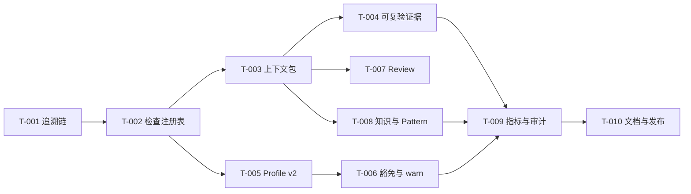

# 轻量、可自定义、全链路可溯源的 SDD-L2 执行内核任务清单（Tasks）

## 1. 元数据

| 项 | 内容 |
|---|---|
| Spec ID | SPEC-DEVTOOLS-002 |
| 关联Spec | `docs/specs/SPEC-DEVTOOLS-002/spec.md` |
| 关联Design | `docs/specs/SPEC-DEVTOOLS-002/design.md` |
| 作者 | SDD Agent |
| 创建日期 | 2026-11-23 |
| 状态 | Draft |

## 2. 任务清单

| Task ID | 任务描述 | 关联FR/AC | 依赖Task | 并行标识 | 验收标准 | 单元测试类/方法 | 单Task测试命令 | 状态 | Commit SHA |
|---|---|---|---|---|---|---|---|---|---|
| T-001 | 实现 FEAT 元数据、PRD 结构化追溯、G0/G1 独立检查项和稳定报告 | FR-001；FR-002；AC-001-3；AC-002-1；AC-002-2；AC-002-3；AC-002-4；AC-002-5 | None | S | Spec 缺少/错配 FEAT、重复 FEAT、孤儿 FR/AC 均阻断；G0/G1 分开输出检查 ID | `tests.test_evolution.TraceabilityTests#test_feat_and_prd_chain`、`#test_orphans_and_duplicate_feat`、`#test_g0_g1_separate` | `python -m unittest tests.test_evolution.TraceabilityTests -v` | Done | — |
| T-002 | 建立 Gate 检查注册表并让 `check`/Gate 报告输出 `pass/warn/block` 与稳定 ID | FR-001；FR-006；AC-001-1；AC-001-2；AC-001-4；AC-006-1；AC-006-3 | T-001 | S | 注册表字段完整；强制项失败阻断；报告与 JSON 含检查 ID | `tests.test_evolution.GateRegistryTests#test_registry_and_gate_output`、`#test_block_cannot_complete` | `python -m unittest tests.test_evolution.GateRegistryTests -v` | Done | — |
| T-003 | 实现 `context_bundle`、知识/契约/Pattern 选择、允许范围与排除列表 | FR-003；FR-008；FR-009；AC-003-1；AC-003-2；AC-003-3；AC-003-4；AC-003-5；AC-008-4；AC-009-2；AC-009-4 | T-002 | S | `resume --json` 返回稳定 schema；空上下文安全；只读无副作用；适用 Pattern 自动带入 | `tests.test_evolution.ContextBundleTests#test_context_bundle_schema`、`#test_context_empty_and_readonly`、`#test_context_scope_guard`、`#test_context_patterns` | `python -m unittest tests.test_evolution.ContextBundleTests -v` | Done | — |
| T-004 | 实现可复验命令证据、测试定位、AC 块扫描和 G4/G5 阻断 | FR-004；AC-004-1；AC-004-2；AC-004-3；AC-004-4；AC-004-5 | T-003 | S | `verify` 写 JSONL；无成功命令、测试不存在、伪造标签都不能 PASS | `tests.test_evolution.EvidenceTests#test_verify_records_and_g5_blocks`、`#test_fake_test_and_ac_tag` | `python -m unittest tests.test_evolution.EvidenceTests -v` | Done | — |
| T-005 | 实现 Profile v2 校验、`l2-refactor` 示例和旧快照兼容 | FR-005；FR-010；AC-005-1；AC-005-2；AC-005-3；AC-005-4；AC-005-5；AC-010-1；AC-010-3 | T-002 | S | 合法 Profile 生效；未知字段/阶段/检查 ID 报字段路径；旧快照不漂移 | `tests.test_evolution.ProfileTests#test_profile_v2_and_refactor`、`#test_profile_errors_and_snapshot` | `python -m unittest tests.test_evolution.ProfileTests -v` | Done | — |
| T-006 | 实现 `warn`、人工豁免、到期重校验、inbox 与安全红线 | FR-006；FR-004；AC-004-6；AC-006-2；AC-006-4；AC-006-5；AC-006-6 | T-005 | S | warn 不阻断但可见；豁免有人审/范围/到期；过期恢复阻断；安全红线不可豁免 | `tests.test_evolution.WaiverTests#test_warn_and_waiver_lifecycle`、`#test_security_redline` | `python -m unittest tests.test_evolution.WaiverTests -v` | Done | — |
| T-007 | 实现通用 Review 契约、三类 overlay、finding 校验和 medium/high 强制审查 | FR-007；AC-007-1；AC-007-2；AC-007-3；AC-007-4；AC-007-5；AC-007-6 | T-003 | S | Review 按需加载；finding 九字段完整；阻断 finding 阻止 G4/G5 | `tests.test_evolution.ReviewTests#test_review_findings_and_overlays`、`#test_review_required` | `python -m unittest tests.test_evolution.ReviewTests -v` | Done | — |
| T-008 | 实现最小知识索引、Fix Pattern 文档与真实闭环示例 | FR-008；FR-009；AC-008-1；AC-008-2；AC-008-3；AC-008-5；AC-009-1；AC-009-3 | T-003 | S | 索引五类、字段完整；无来源只能候选；FP-001/CHK-001 可回放 | `tests.test_evolution.KnowledgeTests#test_knowledge_index_and_pattern`、`#test_conflict_blocks` | `python -m unittest tests.test_evolution.KnowledgeTests -v` | Done | — |
| T-009 | 扩展 metrics、审计事件和质量回流指标 | FR-006；FR-009；FR-010；AC-006-7；AC-009-5；AC-010-2 | T-004, T-006, T-008 | S | 指标含豁免率/逃逸缺陷/重开率/一次通过率；迁移事件可回放 | `tests.test_evolution.MetricsTests#test_metrics_and_audit` | `python -m unittest tests.test_evolution.MetricsTests -v` | Done | — |
| T-010 | 完成标准符合性文档、模板/提示词/README/Agent 协议、版本与 manifest，执行全量验收 | FR-001；FR-010；AC-001-1；AC-001-2；AC-001-4；AC-010-4；AC-010-5；AC-010-6 | T-009 | S | 文档回答官方 Gate 状态；每阶段单动作；全量命令通过；版本和 manifest 一致 | `tests.test_evolution.DocsReleaseTests#test_standard_and_core_advantage_docs`、`#test_agent_loop_and_version` | `python -m unittest tests.test_evolution.DocsReleaseTests -v` | Done | — |

字段规则：

- Task ID 采用 `T-xxx`，在当前 Spec 内唯一。
- 状态仅允许 `Todo`、`In Progress`、`Done`。
- 并行标识仅允许 `P` 或 `S`；本 Spec 核心文件高度共享，因此全部按串行管理。
- 每个 Task 是一次可独立实现、测试和提交证据的纵向切片。
- 本会话不创建 Git Commit；Commit SHA 保持 `—`，合并由人执行。

## 3. AC—Task—单元测试映射

| AC ID | 覆盖Task | 测试类/方法 | 测试命令/选择器 | 预期结果 | Gate 4实际结果 |
|---|---|---|---|---|---|
| AC-001-1 | T-002；T-010 | `GateRegistryTests#test_registry_and_gate_output`；`DocsReleaseTests#test_standard_and_core_advantage_docs` | 对应类命令 | 官方 Gate 有四种状态和证据映射 | 未执行 |
| AC-001-2 | T-002；T-010 | `GateRegistryTests#test_registry_and_gate_output`；`DocsReleaseTests#test_standard_and_core_advantage_docs` | 对应类命令 | 核心优势指标、目标、采集方式齐全 | 未执行 |
| AC-001-3 | T-001；T-002 | `TraceabilityTests#test_g0_g1_separate`；`GateRegistryTests#test_registry_and_gate_output` | 对应类命令 | 每个官方 Gate 映射到报告条目 | 未执行 |
| AC-001-4 | T-002；T-010 | `GateRegistryTests#test_registry_and_gate_output`；`DocsReleaseTests#test_standard_and_core_advantage_docs` | 对应类命令 | “已自动/已人工”均有可定位证据 | 未执行 |
| AC-002-1 | T-001 | `TraceabilityTests#test_feat_and_prd_chain` | `python -m unittest tests.test_evolution.TraceabilityTests.test_feat_and_prd_chain -v` | 缺 FEAT 或错配阻断 | 未执行 |
| AC-002-2 | T-001 | `TraceabilityTests#test_orphans_and_duplicate_feat` | `python -m unittest tests.test_evolution.TraceabilityTests.test_orphans_and_duplicate_feat -v` | 重复 FEAT/多当前 Spec/工作项错配阻断 | 未执行 |
| AC-002-3 | T-001 | `TraceabilityTests#test_orphans_and_duplicate_feat` | 同类命令 | 孤儿 FR/AC 和任务断链阻断 | 未执行 |
| AC-002-4 | T-001 | `TraceabilityTests#test_g0_g1_separate` | 同类命令 | G0/G1 独立检查 ID 与证据 | 未执行 |
| AC-002-5 | T-001 | `TraceabilityTests#test_feat_and_prd_chain` | 同类命令 | 澄清标记非零时阻断并报告定位 | 未执行 |
| AC-003-1 | T-003 | `ContextBundleTests#test_context_bundle_schema` | `python -m unittest tests.test_evolution.ContextBundleTests.test_context_bundle_schema -v` | 上下文包含八类必需字段 | 未执行 |
| AC-003-2 | T-003 | `ContextBundleTests#test_context_bundle_schema` | 同类命令 | AC 去重并关联设计与任务 | 未执行 |
| AC-003-3 | T-003 | `ContextBundleTests#test_context_empty_and_readonly` | 同类命令 | 无任务时返回空结构且成功 | 未执行 |
| AC-003-4 | T-003 | `ContextBundleTests#test_context_empty_and_readonly` | 同类命令 | 重复调用不改变 state/events/Git | 未执行 |
| AC-003-5 | T-003 | `ContextBundleTests#test_context_scope_guard` | 同类命令 | 超范围时要求停止并扩大范围 | 未执行 |
| AC-004-1 | T-004 | `EvidenceTests#test_verify_records_and_g5_blocks` | `python -m unittest tests.test_evolution.EvidenceTests.test_verify_records_and_g5_blocks -v` | JSONL 证据字段完整 | 未执行 |
| AC-004-2 | T-004 | `EvidenceTests#test_verify_records_and_g5_blocks` | 同类命令 | 代码变更无成功命令时阻断 | 未执行 |
| AC-004-3 | T-004 | `EvidenceTests#test_fake_test_and_ac_tag` | 同类命令 | 不存在的测试名被识别 | 未执行 |
| AC-004-4 | T-004 | `EvidenceTests#test_fake_test_and_ac_tag` | 同类命令 | 只有注释/空测试的标签不算覆盖 | 未执行 |
| AC-004-5 | T-004 | `EvidenceTests#test_verify_records_and_g5_blocks` | 同类命令 | 非零/未执行不能 PASS | 未执行 |
| AC-004-6 | T-006 | `WaiverTests#test_warn_and_waiver_lifecycle` | `python -m unittest tests.test_evolution.WaiverTests.test_warn_and_waiver_lifecycle -v` | 文档变更豁免可见且带范围 | 未执行 |
| AC-005-1 | T-005 | `ProfileTests#test_profile_v2_and_refactor` | `python -m unittest tests.test_evolution.ProfileTests.test_profile_v2_and_refactor -v` | Profile 声明生效 | 未执行 |
| AC-005-2 | T-005 | `ProfileTests#test_profile_errors_and_snapshot` | 同类命令 | 非法字段/阶段/检查 ID 精确报错 | 未执行 |
| AC-005-3 | T-005 | `ProfileTests#test_profile_v2_and_refactor` | 同类命令 | `l2-refactor` 不改核心即可运行 | 未执行 |
| AC-005-4 | T-005 | `ProfileTests#test_profile_errors_and_snapshot` | 同类命令 | 旧 Spec 快照不随预设变化 | 未执行 |
| AC-005-5 | T-005 | `ProfileTests#test_profile_errors_and_snapshot` | 同类命令 | 移除安全必需检查被拒绝 | 未执行 |
| AC-006-1 | T-002 | `GateRegistryTests#test_registry_and_gate_output` | `python -m unittest tests.test_evolution.GateRegistryTests.test_registry_and_gate_output -v` | 注册表字段完整并输出 | 未执行 |
| AC-006-2 | T-006 | `WaiverTests#test_warn_and_waiver_lifecycle` | `python -m unittest tests.test_evolution.WaiverTests.test_warn_and_waiver_lifecycle -v` | warn 不阻断但 inbox 可见 | 未执行 |
| AC-006-3 | T-002 | `GateRegistryTests#test_block_cannot_complete` | `python -m unittest tests.test_evolution.GateRegistryTests.test_block_cannot_complete -v` | block 阻止 complete | 未执行 |
| AC-006-4 | T-006 | `WaiverTests#test_warn_and_waiver_lifecycle` | 同类命令 | 豁免字段完整且 MCP 不暴露 | 未执行 |
| AC-006-5 | T-006 | `WaiverTests#test_warn_and_waiver_lifecycle` | 同类命令 | 过期豁免失效并重新阻断 | 未执行 |
| AC-006-6 | T-006 | `WaiverTests#test_security_redline` | 同类命令 | 安全红线拒绝豁免 | 未执行 |
| AC-006-7 | T-009 | `MetricsTests#test_metrics_and_audit` | `python -m unittest tests.test_evolution.MetricsTests.test_metrics_and_audit -v` | 按检查 ID 输出统计 | 未执行 |
| AC-007-1 | T-007 | `ReviewTests#test_review_findings_and_overlays` | `python -m unittest tests.test_evolution.ReviewTests.test_review_findings_and_overlays -v` | 按风险/技术栈选择 overlay | 未执行 |
| AC-007-2 | T-007 | `ReviewTests#test_review_findings_and_overlays` | 同类命令 | finding 九字段校验 | 未执行 |
| AC-007-3 | T-007 | `ReviewTests#test_review_required` | 同类命令 | medium/high 强制 Review 并阻断 | 未执行 |
| AC-007-4 | T-007 | `ReviewTests#test_review_required` | 同类命令 | 无 finding 时明确声明 | 未执行 |
| AC-007-5 | T-007 | `ReviewTests#test_review_findings_and_overlays` | 同类命令 | 三类 overlay 结构齐全 | 未执行 |
| AC-007-6 | T-007 | `ReviewTests#test_review_findings_and_overlays` | 同类命令 | overlay 不含状态机或审批命令 | 未执行 |
| AC-008-1 | T-008 | `KnowledgeTests#test_knowledge_index_and_pattern` | `python -m unittest tests.test_evolution.KnowledgeTests.test_knowledge_index_and_pattern -v` | 五类记录和稳定 ID 存在 | 未执行 |
| AC-008-2 | T-008 | `KnowledgeTests#test_knowledge_index_and_pattern` | 同类命令 | 知识字段完整 | 未执行 |
| AC-008-3 | T-008 | `KnowledgeTests#test_knowledge_index_and_pattern` | 同类命令 | 无来源记录只能是候选 | 未执行 |
| AC-008-4 | T-008 | `KnowledgeTests#test_conflict_blocks` | 同类命令 | 未解决冲突阻断相关任务 | 未执行 |
| AC-008-5 | T-008 | `KnowledgeTests#test_knowledge_index_and_pattern` | 同类命令 | Spec/Design 用 ID 引用知识 | 未执行 |
| AC-009-1 | T-008 | `KnowledgeTests#test_knowledge_index_and_pattern` | `python -m unittest tests.test_evolution.KnowledgeTests -v` | FP 八字段并关联 CHK | 未执行 |
| AC-009-2 | T-003 | `ContextBundleTests#test_context_patterns` | `python -m unittest tests.test_evolution.ContextBundleTests.test_context_patterns -v` | 适用 Pattern 自动带入 | 未执行 |
| AC-009-3 | T-008 | `KnowledgeTests#test_knowledge_index_and_pattern` | 同类命令 | FP-001/CHK-001 闭环可回放 | 未执行 |
| AC-009-4 | T-003 | `ContextBundleTests#test_context_patterns` | 同类命令 | 未验证 Pattern 只作参考 | 未执行 |
| AC-009-5 | T-009 | `MetricsTests#test_metrics_and_audit` | `python -m unittest tests.test_evolution.MetricsTests.test_metrics_and_audit -v` | 四类回流指标有口径和值 | 未执行 |
| AC-010-1 | T-005 | `ProfileTests#test_profile_errors_and_snapshot` | `python -m unittest tests.test_evolution.ProfileTests.test_profile_errors_and_snapshot -v` | 旧快照继续运行 | 未执行 |
| AC-010-2 | T-009 | `MetricsTests#test_metrics_and_audit` | `python -m unittest tests.test_evolution.MetricsTests.test_metrics_and_audit -v` | 迁移事件字段可回放 | 未执行 |
| AC-010-3 | T-005 | `ProfileTests#test_profile_v2_and_refactor` | 同类命令 | 旧 JSON 字段兼容 | 未执行 |
| AC-010-4 | T-010 | `DocsReleaseTests#test_agent_loop_and_version` | `python -m unittest tests.test_evolution.DocsReleaseTests.test_agent_loop_and_version -v` | 版本、manifest、文档一致 | 未执行 |
| AC-010-5 | T-010 | `DocsReleaseTests#test_agent_loop_and_version` | 同类命令 | 全量验证命令全部通过 | 未执行 |
| AC-010-6 | T-010 | `DocsReleaseTests#test_agent_loop_and_version` | 同类命令 | 正常阶段仍单动作/单提交命令 | 未执行 |

说明：上表的“Gate 4实际结果”保留任务拆解时的计划字段；本 Spec 的实测结果统一记录在
`verification.md` 的 AC 覆盖表中，最终全量回归为 138 项、136 通过、2 跳过。

映射规则：

- 必须覆盖 `spec.md` 中的全部 AC，不得增加不存在的 AC。
- 每条 AC 至少关联一个 Task 和一个具体测试类/方法。
- 同一测试覆盖多个 AC 时逐条登记。
- Gate 4 只有在测试真实存在、已执行且通过时才能标记通过。

## 4. 依赖图



## 5. 实施与提交顺序

```text
T-001 追溯链
→ T-002 检查注册表
→ T-003 上下文包
→ T-004 可复验证据
→ T-005 Profile v2
→ T-006 豁免与 warn
→ T-007 Review
→ T-008 知识与 Pattern
→ T-009 指标与审计
→ T-010 文档、版本、manifest 与全量验收
```

每个 Task 完成时：

1. 先写失败测试；
2. 实现最小改动；
3. 运行单 Task 测试；
4. 运行相邻回归测试；
5. 使用 `sdd submit-task` 记录证据。

## 6. 全量单元测试记录

| 测试命令 | 退出码 | 执行数 | 通过数 | 失败数 | 跳过数 | 结果 |
|---|---:|---:|---:|---:|---:|---|
| `python -m unittest discover -s tests -v` | 0 | 138 | 136 | 0 | 2 | 通过；跳过项为未安装可选 MCP SDK 的两个用例 |
| `python -m sdd verify-core` | 0 | — | — | — | — | 通过 |
| `python -m sdd verify-agent` | 0 | — | — | — | — | 通过 |

## 7. 自检清单（评审辅助，不作Gate依据）

- [x] Spec ID 及 Spec/Design 引用有效且一致。
- [x] Task ID 唯一，字段完整，状态值和并行标识合法。
- [x] 每个 Task 可独立实现、独立测试并对应一次可验证交付。
- [x] 全部 FR/AC 均已映射到 Task，不存在孤儿 AC。
- [x] 每条 AC 均已映射到具体测试类/方法和可执行命令。
- [x] 所有依赖 Task 真实存在，依赖图无环，并行管理无冲突。

## 8. 变更历史

| 日期 | 版本 | 变更内容 | 作者 |
|---|---|---|---|
| 2026-11-23 | 1.0.0 | 初始版本，按 P0/P1/P2 和兼容性拆为 10 个串行任务 | SDD Agent |
