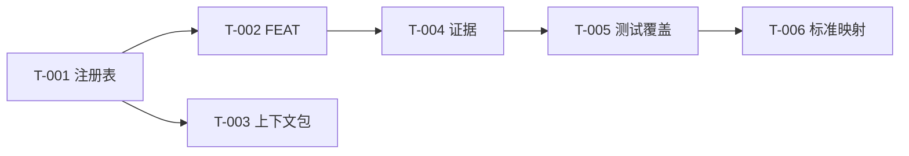

# SDD-L2 执行内核 P0 任务清单（Tasks）

## 1. 元数据

| 项 | 内容 |
|---|---|
| Spec ID | SPEC-DEVTOOLS-002 |
| 关联Spec | `docs/specs/SPEC-DEVTOOLS-002/spec.md` |
| 关联Design | `docs/specs/SPEC-DEVTOOLS-002/design.md` |
| 作者 | SDD Agent |
| 创建日期 | 2026-11-20 |
| 状态 | Draft |

## 2. 任务清单

| Task ID | 任务描述 | 关联FR/AC | 依赖Task | 并行标识 | 验收标准 | 单元测试类/方法 | 单Task测试命令 | 状态 | Commit SHA |
|---|---|---|---|---|---|---|---|---|---|
| T-001 | 在状态机内建立检查项注册表，并让 G0/G1 报告输出稳定检查 ID、级别、结果和证据 | FR-003；AC-003-1；AC-003-2；AC-003-3；AC-003-4 | None | S | 注册表 ID 全局唯一；G0/G1 即使同次执行也各写一份报告；required 失败时总体 FAILED 且不推进 | `tests.test_sdd.CheckRegistryTests#test_registry_ids_are_unique`、`#test_gate_reports_include_stable_ids`、`#test_required_item_failure_blocks` | `python -m unittest tests.test_sdd.CheckRegistryTests -v` | Done | 73fc60d |
| T-002 | 打通 FEAT 追溯链：Spec 元数据、PRD 索引结构化映射、G0-04/G0-05 检查与 MERGED legacy 分支 | FR-002；AC-002-1；AC-002-2；AC-002-3；AC-002-4；AC-002-5；AC-002-6；AC-002-7；AC-002-8 | T-001 | S | FEAT 缺失/重复/不一致/孤儿 FR/AC/正文误写均阻断；MERGED 历史 Spec 走 legacy 并显式标注 | `tests.test_sdd.FeatTraceTests#test_feat_metadata_must_match_index`、`#test_duplicate_feat_is_blocked`、`#test_orphan_fr_ac_is_blocked`、`#test_body_only_feat_is_not_registered`、`#test_merged_legacy_spec_skips_feat_mapping` | `python -m unittest tests.test_sdd.FeatTraceTests -v` | Done | acb5181 |
| T-003 | 在 `next` 中生成最小 `context_bundle`，覆盖 Task、FR/AC、Design 章节、契约、约束、模式、范围与排除列表 | FR-004；AC-004-1；AC-004-2；AC-004-3；AC-004-4；AC-004-5 | T-001 | S | Task 步骤返回九字段；非 Task 步骤返回空结构；只读且不改变原 next 字段 | `tests.test_sdd.ContextBundleTests#test_task_step_returns_all_fields`、`#test_non_task_step_returns_empty_bundle`、`#test_bundle_is_read_only`、`#test_allowed_paths_from_design_impact`、`#test_bundle_excludes_other_specs` | `python -m unittest tests.test_sdd.ContextBundleTests -v` | Done | f5a1bcc |
| T-004 | 让 G5 只接受真实命令证据：结构化证据块、退出码校验、空 test_commands 阻断、MERGED legacy 兼容 | FR-005；AC-005-1；AC-005-2；AC-005-3；AC-005-8；AC-005-9；AC-005-10 | T-002 | S | 无 exit=0 证据或存在非 0 退出码时阻断；文档 PASS 不能放行；MERGED 历史 Spec 不重验 | `tests.test_sdd.EvidenceTests#test_empty_commands_block_pr_ready`、`#test_success_evidence_passes`、`#test_nonzero_exit_blocks`、`#test_pass_without_evidence_blocks`、`#test_merged_spec_skips_new_evidence_rules`、`#test_unmerged_spec_cannot_use_legacy_escape` | `python -m unittest tests.test_sdd.EvidenceTests -v` | Done | e0bbda0 |
| T-005 | 校验 Task 测试名可定位、AC 覆盖来自真实测试函数，并对中高风险补齐结构化独立 review 证据 | FR-005；AC-005-4；AC-005-5；AC-005-6；AC-005-7 | T-004 | S | 不存在测试名阻断；裸 AC 标签不算覆盖；中高风险缺 review 阻断；低风险流程不新增人工检查点 | `tests.test_sdd.TestCoverageTests#test_task_test_name_must_exist`、`#test_bare_ac_tag_does_not_count`、`#test_medium_risk_requires_review`、`#test_low_risk_flow_unchanged` | `python -m unittest tests.test_sdd.TestCoverageTests -v` | Done | 8e6d2ad |
| T-006 | 交付标准符合性映射，并同步 README、agent-contract、提示词、版本与 manifest | FR-001；AC-001-1；AC-001-2；AC-001-3 | T-005 | S | 12 个官方条目齐备；状态枚举合法；引用的检查 ID 全部存在；回归命令通过 | `tests.test_standard_conformance.StandardConformanceTests#test_all_entries_present`、`#test_status_values_allowed`、`#test_check_ids_exist` | `python -m unittest tests.test_standard_conformance -v` | Done | 89da3c8 |

字段规则：

- Task ID 采用 `T-xxx`，在当前 Spec 内唯一。
- 状态仅允许 `Todo`、`In Progress`、`Done`。
- 并行标识仅允许 `P` 或 `S`；依赖为空时必须填写 `None`。
- 一个 Task 能够在一个实现会话中独立完成并验证。
- 一个 Task 对应一个最终本地代码 Commit；创建 Commit 后回填真实 Commit SHA。

## 3. AC—Task—单元测试映射

| AC ID | 覆盖Task | 测试类/方法 | 测试命令/选择器 | 预期结果 | Gate 4实际结果 |
|---|---|---|---|---|---|
| AC-001-1 | T-006 | `StandardConformanceTests#test_all_entries_present` | `python -m unittest tests.test_standard_conformance.StandardConformanceTests.test_all_entries_present -v` | 文档包含全部条目与四要素 | 未执行 |
| AC-001-2 | T-006 | `StandardConformanceTests#test_all_entries_present` | `python -m unittest tests.test_standard_conformance.StandardConformanceTests.test_all_entries_present -v` | 6 阶段 + 6 Gate 无重复 | 未执行 |
| AC-001-3 | T-006 | `StandardConformanceTests#test_check_ids_exist` | `python -m unittest tests.test_standard_conformance.StandardConformanceTests.test_check_ids_exist -v` | 引用的检查 ID 全部命中注册表 | 未执行 |
| AC-002-1 | T-002 | `FeatTraceTests#test_feat_metadata_must_match_index` | `python -m unittest tests.test_sdd.FeatTraceTests.test_feat_metadata_must_match_index -v` | FEAT 与索引一致时通过 | 未执行 |
| AC-002-2 | T-002 | `FeatTraceTests#test_feat_metadata_must_match_index` | `python -m unittest tests.test_sdd.FeatTraceTests.test_feat_metadata_must_match_index -v` | 缺失/不一致时阻断并定位字段 | 未执行 |
| AC-002-3 | T-002 | `FeatTraceTests#test_duplicate_feat_is_blocked` | `python -m unittest tests.test_sdd.FeatTraceTests.test_duplicate_feat_is_blocked -v` | 重复 FEAT 被阻断 | 未执行 |
| AC-002-4 | T-002 | `FeatTraceTests#test_orphan_fr_ac_is_blocked` | `python -m unittest tests.test_sdd.FeatTraceTests.test_orphan_fr_ac_is_blocked -v` | 孤儿 FR/AC 被列出并阻断 | 未执行 |
| AC-002-5 | T-002 | `FeatTraceTests#test_body_only_feat_is_not_registered` | `python -m unittest tests.test_sdd.FeatTraceTests.test_body_only_feat_is_not_registered -v` | 索引元数据/表格问题被阻断 | 未执行 |
| AC-002-6 | T-002 | `FeatTraceTests#test_body_only_feat_is_not_registered` | `python -m unittest tests.test_sdd.FeatTraceTests.test_body_only_feat_is_not_registered -v` | 正文出现不算登记 | 未执行 |
| AC-002-7 | T-002 | `FeatTraceTests#test_merged_legacy_spec_skips_feat_mapping` | `python -m unittest tests.test_sdd.FeatTraceTests.test_merged_legacy_spec_skips_feat_mapping -v` | MERGED 历史 Spec 以 legacy 通过 | 未执行 |
| AC-002-8 | T-002 | `FeatTraceTests#test_feat_metadata_must_match_index` | `python -m unittest tests.test_sdd.FeatTraceTests.test_feat_metadata_must_match_index -v` | 非 MERGED 缺 FEAT 被阻断 | 未执行 |
| AC-003-1 | T-001 | `CheckRegistryTests#test_gate_reports_include_stable_ids` | `python -m unittest tests.test_sdd.CheckRegistryTests.test_gate_reports_include_stable_ids -v` | 报告含 ID/级别/结果/证据 | 未执行 |
| AC-003-2 | T-001 | `CheckRegistryTests#test_gate_reports_include_stable_ids` | `python -m unittest tests.test_sdd.CheckRegistryTests.test_gate_reports_include_stable_ids -v` | G0/G1 两份报告独立存在 | 未执行 |
| AC-003-3 | T-001 | `CheckRegistryTests#test_required_item_failure_blocks` | `python -m unittest tests.test_sdd.CheckRegistryTests.test_required_item_failure_blocks -v` | required 失败时 FAILED 且不推进 | 未执行 |
| AC-003-4 | T-001 | `CheckRegistryTests#test_registry_ids_are_unique` | `python -m unittest tests.test_sdd.CheckRegistryTests.test_registry_ids_are_unique -v` | 注册表自检通过 | 未执行 |
| AC-004-1 | T-003 | `ContextBundleTests#test_task_step_returns_all_fields` | `python -m unittest tests.test_sdd.ContextBundleTests.test_task_step_returns_all_fields -v` | Task 步骤返回九字段 | 未执行 |
| AC-004-2 | T-003 | `ContextBundleTests#test_non_task_step_returns_empty_bundle` | `python -m unittest tests.test_sdd.ContextBundleTests.test_non_task_step_returns_empty_bundle -v` | 非 Task 步骤返回空结构 | 未执行 |
| AC-004-3 | T-003 | `ContextBundleTests#test_bundle_is_read_only` | `python -m unittest tests.test_sdd.ContextBundleTests.test_bundle_is_read_only -v` | state/events 字节不变 | 未执行 |
| AC-004-4 | T-003 | `ContextBundleTests#test_allowed_paths_from_design_impact` | `python -m unittest tests.test_sdd.ContextBundleTests.test_allowed_paths_from_design_impact -v` | 范围派生或空数组提示 | 未执行 |
| AC-004-5 | T-003 | `ContextBundleTests#test_bundle_excludes_other_specs` | `python -m unittest tests.test_sdd.ContextBundleTests.test_bundle_excludes_other_specs -v` | schema 固定且排除其他 Spec | 未执行 |
| AC-005-1 | T-004 | `EvidenceTests#test_empty_commands_block_pr_ready` | `python -m unittest tests.test_sdd.EvidenceTests.test_empty_commands_block_pr_ready -v` | 空 test_commands 阻断 | 未执行 |
| AC-005-2 | T-004 | `EvidenceTests#test_success_evidence_passes` | `python -m unittest tests.test_sdd.EvidenceTests.test_success_evidence_passes -v` | 证据含命令/目录/退出码/输出/哈希 | 未执行 |
| AC-005-3 | T-004 | `EvidenceTests#test_pass_without_evidence_blocks` | `python -m unittest tests.test_sdd.EvidenceTests.test_pass_without_evidence_blocks -v` | 伪 PASS 被阻断 | 未执行 |
| AC-005-4 | T-005 | `TestCoverageTests#test_task_test_name_must_exist` | `python -m unittest tests.test_sdd.TestCoverageTests.test_task_test_name_must_exist -v` | 不存在测试名被阻断 | 未执行 |
| AC-005-5 | T-005 | `TestCoverageTests#test_bare_ac_tag_does_not_count` | `python -m unittest tests.test_sdd.TestCoverageTests.test_bare_ac_tag_does_not_count -v` | 裸 AC 标签不算覆盖 | 未执行 |
| AC-005-6 | T-005 | `TestCoverageTests#test_medium_risk_requires_review` | `python -m unittest tests.test_sdd.TestCoverageTests.test_medium_risk_requires_review -v` | 中风险缺 review 阻断 | 未执行 |
| AC-005-7 | T-005 | `TestCoverageTests#test_low_risk_flow_unchanged` | `python -m unittest tests.test_sdd.TestCoverageTests.test_low_risk_flow_unchanged -v` | 低风险不增加人工检查点 | 未执行 |
| AC-005-8 | T-004 | `EvidenceTests#test_nonzero_exit_blocks` | `python -m unittest tests.test_sdd.EvidenceTests.test_nonzero_exit_blocks -v` | 非 0 退出码阻断 | 未执行 |
| AC-005-9 | T-004 | `EvidenceTests#test_merged_spec_skips_new_evidence_rules` | `python -m unittest tests.test_sdd.EvidenceTests.test_merged_spec_skips_new_evidence_rules -v` | MERGED 历史 Spec 不重验 | 未执行 |
| AC-005-10 | T-004 | `EvidenceTests#test_unmerged_spec_cannot_use_legacy_escape` | `python -m unittest tests.test_sdd.EvidenceTests.test_unmerged_spec_cannot_use_legacy_escape -v` | 非 MERGED 不能绕过 | 未执行 |

映射规则：

- 必须覆盖 `spec.md` 中的全部适用 AC，不得增加不存在的 AC。
- 每条 AC 至少关联一个 Task 和一个具体测试类/方法。
- 同一测试覆盖多个 AC 时必须逐条登记。
- Gate 4 只有在测试真实存在、已执行且通过时，才能标记为“通过”。

## 4. 依赖图



## 5. 实施与提交顺序

```text
选择一个 Todo Task
→ 状态改为 In Progress
→ 实现代码和单元测试
→ 执行该 Task 的单元测试
→ 测试通过后状态改为 Done
→ 创建本地 Task Commit 并回填 SHA
→ 继续下一个 Task
```

全部 Task 完成后执行全量单元测试、逐 AC 验证和 Gate 5。

## 6. 全量单元测试记录

| 测试命令 | 退出码 | 执行数 | 通过数 | 失败数 | 跳过数 | 结果 |
|---|---:|---:|---:|---:|---:|---|
| `python -m unittest discover -s tests -v` | 执行后记录 | 执行后记录 | 执行后记录 | 执行后记录 | 执行后记录 | 未执行 |

## 7. 自检清单（评审辅助，不作Gate依据）

- [x] Spec ID 及 Spec/Design 引用有效且一致。
- [x] Task ID 唯一，字段完整，状态值和并行标识合法。
- [x] 每个 Task 可独立实现、独立单测并对应一个本地 Commit。
- [x] 全部 FR/AC 均已映射到 Task，不存在孤儿 AC。
- [x] 每条 AC 均已映射到具体测试类/方法和可执行命令。
- [x] 所有依赖 Task 真实存在，依赖图无环，并行标识无冲突。

## 8. 变更历史

| 日期 | 版本 | 变更内容 | 作者 |
|---|---|---|---|
| 2026-11-20 | 1.0.0 | 初始版本 | SDD Agent |
