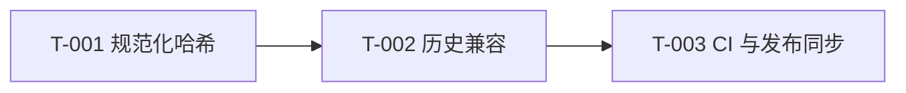

# 工件哈希 CRLF/LF 规范化与 SDD CI 门禁对齐任务清单（Tasks）

## 1. 元数据

| 项 | 内容 |
|---|---|
| Spec ID | SPEC-REQ-001 |
| 关联Spec | `docs/specs/SPEC-REQ-001/spec.md` |
| 关联Design | `docs/specs/SPEC-REQ-001/design.md` |
| 作者 | SDD Agent |
| 创建日期 | 2026-11-23 |
| 状态 | Draft |

## 2. 任务清单

| Task ID | 任务描述 | 关联FR/AC | 依赖Task | 并行标识 | 验收标准 | 单元测试类/方法 | 单Task测试命令 | 状态 | Commit SHA |
|---|---|---|---|---|---|---|---|---|---|
| T-001 | 在唯一状态机中增加文本工件 LF 规范化哈希，并让 Gate 记录使用稳定摘要 | FR-001；AC-001-1；AC-001-2；AC-001-3 | None | S | 同一文本 CRLF/LF 哈希一致；行尾变化不报修改；正文变化仍阻断 | `tests.test_sdd.ArtifactHashTests#test_text_hash_is_line_ending_stable`、`#test_check_ignores_line_ending_only_change`、`#test_check_rejects_text_change` | `python -m unittest tests.test_sdd.ArtifactHashTests -v` | Done | 8475868 |
| T-002 | 增加历史 CRLF 哈希候选兼容，并确保新 Gate 记录写入 LF 哈希 | FR-002；AC-002-1；AC-002-2；AC-002-3 | T-001 | S | 历史 CRLF 哈希在 LF 工作区通过；正文变化仍失败；新记录使用 LF 哈希 | `tests.test_sdd.ArtifactHashTests#test_check_accepts_legacy_crlf_hash`、`#test_check_rejects_content_change_with_legacy_hash`、`#test_new_gate_hash_uses_lf` | `python -m unittest tests.test_sdd.ArtifactHashTests -v` | Done | e7da481 |
| T-003 | 让 GitHub Actions 执行 SDD 三项门禁，并同步 README、agent-contract、版本和 manifest | FR-003；AC-003-1；AC-003-2；AC-003-3 | T-002 | S | CI 同时包含三项命令且失败即失败；干净 LF 工作区三项门禁通过；文档与版本同步 | `tests.test_ci_contract.CiWorkflowTests#test_ci_workflow_runs_sdd_checks` | `python -m unittest tests.test_ci_contract -v` | Done | 17badc6 |

字段规则：

- Task ID 采用 `T-xxx`，在当前 Spec 内唯一。
- 状态仅允许 `Todo`、`In Progress`、`Done`。
- 并行标识仅允许 `P` 或 `S`；依赖为空时必须填写 `None`。
- 一个 Task 必须能够在一次实现会话中独立完成并验证。
- 一个 Task 必须对应一个最终本地代码 Commit；创建 Commit 后回填真实 Commit SHA。

## 3. AC—Task—单元测试映射

| AC ID | 覆盖Task | 测试类/方法 | 测试命令/选择器 | 预期结果 | Gate 4实际结果 |
|---|---|---|---|---|---|
| AC-001-1 | T-001 | `ArtifactHashTests#test_text_hash_is_line_ending_stable` | `python -m unittest tests.test_sdd.ArtifactHashTests.test_text_hash_is_line_ending_stable -v` | CRLF/LF 同一文本哈希相同 | 未执行 |
| AC-001-2 | T-001 | `ArtifactHashTests#test_check_ignores_line_ending_only_change` | `python -m unittest tests.test_sdd.ArtifactHashTests.test_check_ignores_line_ending_only_change -v` | 行尾变化不报“工件已被修改” | 未执行 |
| AC-001-3 | T-001 | `ArtifactHashTests#test_check_rejects_text_change` | `python -m unittest tests.test_sdd.ArtifactHashTests.test_check_rejects_text_change -v` | 正文变化仍被阻断 | 未执行 |
| AC-002-1 | T-002 | `ArtifactHashTests#test_check_accepts_legacy_crlf_hash` | `python -m unittest tests.test_sdd.ArtifactHashTests.test_check_accepts_legacy_crlf_hash -v` | 历史 CRLF 哈希在 LF 文件上通过 | 未执行 |
| AC-002-2 | T-002 | `ArtifactHashTests#test_check_rejects_content_change_with_legacy_hash` | `python -m unittest tests.test_sdd.ArtifactHashTests.test_check_rejects_content_change_with_legacy_hash -v` | 正文变化仍不通过 | 未执行 |
| AC-002-3 | T-002 | `ArtifactHashTests#test_new_gate_hash_uses_lf` | `python -m unittest tests.test_sdd.ArtifactHashTests.test_new_gate_hash_uses_lf -v` | 新 Gate 记录使用 LF 哈希 | 未执行 |
| AC-003-1 | T-003 | `CiWorkflowTests#test_ci_workflow_runs_sdd_checks` | `python -m unittest tests.test_ci_contract.CiWorkflowTests.test_ci_workflow_runs_sdd_checks -v` | 工作流包含三项 SDD 命令 | 未执行 |
| AC-003-2 | T-003 | `CiWorkflowTests#test_ci_workflow_runs_sdd_checks` | `python -m unittest tests.test_ci_contract.CiWorkflowTests.test_ci_workflow_runs_sdd_checks -v` | 门禁步骤未设置 continue-on-error | 未执行 |
| AC-003-3 | T-003 | `CiWorkflowTests#test_ci_workflow_runs_sdd_checks` | `python -m unittest tests.test_ci_contract.CiWorkflowTests.test_ci_workflow_runs_sdd_checks -v` | 干净 LF 工作区三项门禁通过 | 未执行 |

映射规则：

- 必须覆盖 `spec.md` 中的全部适用 AC，不得增加不存在的 AC。
- 每条 AC 至少关联一个 Task 和一个具体测试类/方法。
- 同一测试覆盖多个 AC 时必须逐条登记。
- Gate 4 只有在测试真实存在、已执行且通过时，才能标记为“通过”。

## 4. 依赖图



## 5. 实施与提交顺序

```text
选择一个 Todo Task
→ 状态改为 In Progress
→ 实现代码和单元测试
→ 执行该 Task 的单元测试
→ 测试通过后状态改为 Done
→ 创建本地 Task Commit 并回填 SHA
→ 继续下一个 Task
```

全部 Task 完成后执行全量单元测试、逐 AC 验证和 Gate 5。

## 6. 全量单元测试记录

| 测试命令 | 退出码 | 执行数 | 通过数 | 失败数 | 跳过数 | 结果 |
|---|---:|---:|---:|---:|---:|---|
| `python -m unittest discover -s tests -v` | 未执行 | 未执行 | 未执行 | 未执行 | 未执行 | 未执行 |

## 7. 自检清单（评审辅助，不作Gate依据）

- [x] Spec ID 及 Spec/Design 引用有效且一致。
- [x] Task ID 唯一，字段完整，状态值和并行标识合法。
- [x] 每个 Task 可独立实现、独立单测并对应一个本地 Commit。
- [x] 全部 FR/AC 均已映射到 Task，不存在孤儿 AC。
- [x] 每条 AC 均已映射到具体测试类/方法和可执行命令。
- [x] 所有依赖 Task 真实存在，依赖图无环，并行标识无冲突。

## 8. 变更历史

| 日期 | 版本 | 变更内容 | 作者 |
|---|---|---|---|
| 2026-11-23 | 1.0.0 | 初始版本 | SDD Agent |
