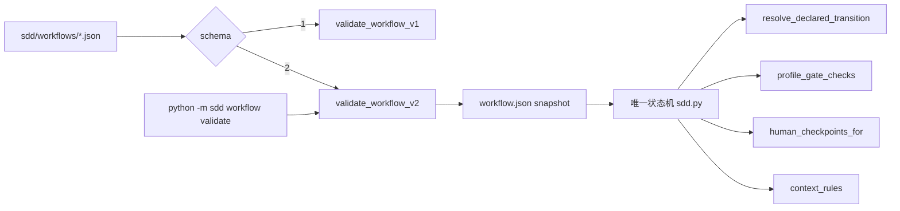

# 工作流 Profile v2：可声明扩展与 workflow validate设计文档（Design）

## 1. 元数据

| 项 | 内容 |
|---|---|
| Spec ID | SPEC-REQ-002 |
| 关联Spec | `docs/specs/SPEC-REQ-002/spec.md` |
| 作者 | SDD Agent |
| 创建日期 | 2026-11-23 |
| 状态 | Draft |
| 评审人 | sdd-kit 平台维护者 |

## 2. 设计目标

- 核心问题：schema 1 把阶段序列和 `required_gates` 锁死在核心里，未知字段被
  静默忽略，也没有 profile 校验命令；新增流程必须改核心代码。
- 设计范围：schema 2 声明模型、严格字段校验、阶段子序列推进、Gate 检查选择、
  人工检查点、风险标签合并、上下文规则、`workflow validate`、`l2-refactor`、
  兼容性测试、文档、版本和 manifest。
- 非设计范围：任意 DAG/脚本、产物重命名、`upgrade-workflow`、warn/waiver、
  Review overlay、知识索引、BAR/Fix Pattern、服务端或第三方依赖。

## 3. 方案概述

- 高层方案：在唯一状态机内把 profile 校验拆成 v1 与 v2 两条路径；
  `validate_workflow_preset` 按 `schema` 分派。v1 保持现有逻辑不变，v2 增加
  严格字段白名单、阶段子序列、检查项选择、人工检查点、风险标签和上下文规则。
  运行时仍由 `sdd/scripts/sdd.py` 解释 profile，profile 只提供数据。
- 关键决策：
  1. 保留现有三个 schema 1 预设，不修改其内容；新能力只用新增 schema 2 profile
     验证，避免旧 Spec 的 digest 和快照语义漂移。
  2. `stages` 必须是规范阶段的严格递增子序列，首 `DRAFT`、尾 `MERGED`。
     状态迁移统一经过 `resolve_declared_transition()`：目标阶段未声明时，前进到
     下一个已声明阶段；被跳过阶段的强制 Gate 必须折叠到下一个已声明阶段。
  3. `gate_checks` 只能裁剪 advisory 检查；每个 Gate 的 required 检查必须全部
     保留，否则 profile 校验失败。
  4. `human_checkpoints` 必须包含 `approve_spec` 与 `confirm_delivery`；
     `complete_gate` 只能绑定 `gates` 中策略为 `human` 的 Gate。
  5. `risk_stop` 与 `config.risk_stop` 取并集，只扩大停止范围，不能缩小。
  6. `context_rules` 只能裁剪或补充仓库内相对路径；拒绝绝对路径、`..`、
     其他 Spec 目录和仓库外文件。
  7. `workflow validate` 只读 profile，不写 `state.json`，成功时返回规范化 digest。
- 方案对比：
  - 把所有预设升级为 schema 2：会让旧 Spec 的仓库预设 digest 变化，增加迁移风险，放弃。
  - 用 Python 文件作为 profile：会引入可执行配置和供应链风险，放弃。
  - JSON schema 2 + 严格白名单 + 有限子序列：可审计、可校验、diff 小，采用。

## 4. Spec覆盖关系

| FR/AC | 设计章节/模块 | 实现方式 | 验证方式 |
|---|---|---|---|
| FR-001 / AC-001-1 | schema 分派与 v2 校验 | `validate_workflow_v2` 校验全部字段并返回 digest | 合法全字段 profile 单测 |
| FR-001 / AC-001-2 | 严格字段白名单 | 递归 `walk_unknown_keys`，错误带 JSON 路径 | 未知顶层/嵌套字段单测 |
| FR-001 / AC-001-3 | v1 兼容路径 | `validate_workflow_v1` 保持原逻辑；旧快照按 schema 1 校验 | 旧 Spec `check --all` 回归 |
| FR-002 / AC-002-1 | 阶段子序列推进 | `resolve_declared_transition` 跳到下一个已声明阶段 | 省略 `DESIGN_READY` 的流程单测 |
| FR-002 / AC-002-2 | 强制 Gate/检查点保护 | 校验 required Gate 与 approve/merge 绑定 | 冲突 profile 负向单测 |
| FR-002 / AC-002-3 | 阶段序列校验 | 索引递增、首尾固定、重复/逆序报错 | 非法 `stages` 单测 |
| FR-003 / AC-003-1 | gate_checks | `profile_gate_checks` 过滤 advisory；required 必须保留 | 省略 advisory/required 单测 |
| FR-003 / AC-003-2 | human_checkpoints | `human_checkpoints_for` 驱动 `resume` 检查点 | 额外 human gate 单测 |
| FR-003 / AC-003-3 | risk_stop/context_rules | 风险标签并集；相对 glob 过滤与越界拒绝 | 风险与上下文规则单测 |
| FR-004 / AC-004-1 | workflow validate CLI | `sdd/cli.py` 子命令输出 JSON 与退出码 0 | CLI 合法文件单测 |
| FR-004 / AC-004-2 | 错误处理 | 文件缺失/JSON 解析失败返回非 0，不写状态 | CLI 负向单测 |
| FR-005 / AC-005-1 | l2-refactor 预设 | schema 2、完整 8 阶段、裁剪 G0-07、上下文规则 | 创建 Spec 到 PR_READY 单测 |
| FR-005 / AC-005-2 | 旧 Spec 稳定性 | 旧快照不重新校验仓库预设；digest 不变 | `SPEC-DEVTOOLS-002`/`SPEC-REQ-001` 回归 |
| FR-005 / AC-005-3 | CI 集成 | `check --all --stage ci --check-git` 覆盖新老 Spec | 本地 LF 工作区 + GitHub Actions |

## 5. 系统架构

### 5.1 架构图

### 5.2 模块划分

| 模块/服务 | 职责 | 输入 | 输出 | 依赖 |
|---|---|---|---|---|
| `sdd/scripts/sdd.py` | schema 分派、v2 校验、阶段推进、Gate/检查点/风险/上下文解释 | profile、state、工件 | 校验错误、状态迁移、Gate 结果、context_bundle | Python 标准库 |
| `sdd/cli.py` | 暴露 `workflow validate` 子命令 | `--file`、`--json` | 结构化结果与退出码 | `sdd/scripts/sdd.py` |
| `sdd/workflows/l2-refactor.json` | 行为保持型改造的示范 profile | 无 | schema 2 profile | 无 |
| `tests/` | schema v2、负向校验、阶段跳过、兼容性和 CLI 测试 | 临时仓库 | 测试结果 | `unittest` |
| 文档 | 说明 schema 2、校验命令和自定义边界 | 无 | README/GUIDE/agent-contract | 无 |

### 5.3 模块间交互

1. `start-work` 调用 `load_workflow_preset`，校验后写快照并记录 name/version/digest。
2. 每次状态迁移先经 `resolve_declared_transition(workflow, target)`，再由
   `transition()` 写入历史；被跳过阶段不进入历史。
3. `run_gate_checks(gate, ctx, workflow)` 按 `gate_checks` 过滤检查项；
   required 检查缺失在 profile 校验阶段就被拒绝。
4. `build_next_action` 和 `Workspace._human_checkpoint` 读取 `human_checkpoints`，
   返回与 profile 一致的检查点命令。
5. `build_context_bundle` 应用 `context_rules` 的 include/exclude，并继续使用
   现有 `CONTEXT_EXCLUDES`。

## 6. 数据模型

- 实体定义：Profile 为 JSON 对象，`schema` 为 1 或 2；v2 字段见 spec 第 8 节。
- 规范化：`workflow_digest` 继续对排序后的 JSON 计算 SHA-256，不新增字段。
- 数据库变更：不涉及。
- 事务边界：profile 校验和快照写入在 `start-work` 单次调用内完成；失败不落盘。
- 迁移方案：不迁移 schema 1；新增 schema 2 profile 时单独升 version。

## 7. 接口契约

| 方法 | 路径 | 描述 | 归属AC |
|---|---|---|---|
| CLI | `python -m sdd workflow validate --file <profile>` | 校验单个 profile 并输出结果 | AC-004-1；AC-004-2 |
| CLI | `python -m sdd start-work --workflow <name>` | 选择、校验并快照 profile | AC-005-1 |
| CLI | `python -m sdd resume --json` | 返回受 profile 约束的检查点与上下文 | AC-003-2；AC-003-3 |

- 请求/响应结构：`workflow validate --json` 输出
  `{"ok": bool, "name": str, "version": int, "digest": str, "errors": [{"path": str, "message": str}]}`。
- 错误码：合法返回 0；文件错误、JSON 错误、字段错误统一返回 1。
- 兼容性：`schema: 1` 的 profile 和快照行为不变；v2 只新增能力。
- 契约文件：`sdd/workflows/*.json`。

## 8. 认证、授权、幂等与安全

- 认证：不涉及。
- 授权：profile 不能移除 `approve`/`merge` 人工动作；`complete_gate` 只能绑定
  `human` Gate，CLI 继续强制 `--human`。
- 幂等：同一 profile 重复校验得到相同 digest；重复 `start-work` 不覆盖已有 Spec。
- 敏感数据：只读取仓库内 JSON 和文本文件，不执行 profile 内容。
- 审计：快照、digest、version 记录在 Spec 目录与 `state.json`，Gate 报告继续
  绑定产物哈希。

## 9. 关键决策ADR

- 引用：无需新增 ADR。
- 判断依据：决策集中在第 3 节，影响面限于 profile 校验与解释，不改变状态机、
  数据模型或人工动作边界。

## 10. 非功能需求设计

- 性能设计：单次校验只读一个 JSON 文件；上下文规则命中文件数上限 50、
  单文件上限 200 KB，避免 `resume` 变慢。
- 可用性设计：错误信息带 JSON 路径；未知字段、非法阶段和非法检查 ID 都可直接定位。
- 可观测性：`workflow validate --json` 输出 digest；`state.workflow` 保留
  name/version/digest，便于审计与回放。

## 11. 依赖与风险

| 风险/依赖 | 影响 | 缓解措施 | 负责人 |
|---|---|---|---|
| v2 分派破坏 v1 行为 | 旧 Spec 校验失败 | v1 逻辑原样保留；旧 Spec 全量回归 | sdd-kit 平台维护者 |
| 阶段跳过导致 Gate 丢失 | 合规缺口 | 校验 required Gate 折叠规则；负向测试 | sdd-kit 平台维护者 |
| profile 关闭 required 检查 | 绕过强制检查 | 校验 required 子集；拒绝非法 profile | sdd-kit 平台维护者 |
| context 规则越界 | 读取其他 Spec 或仓库外文件 | 相对路径校验、排除规则、负向测试 | sdd-kit 平台维护者 |
| 旧快照 digest 漂移 | 审计不可复验 | 现有三预设保持 schema 1 不变 | sdd-kit 平台维护者 |

## 12. 回滚方案

- 触发条件：v2 校验或阶段推进导致旧 Spec 失败，或新 profile 无法创建 Spec。
- 回滚步骤：回退本次核心、CLI、profile 和文档提交；恢复上一版本 manifest。
- 数据恢复：schema 1 快照不受影响；已创建的 v2 Spec 可保留快照，按旧版本代码只读审计。

## 13. 验收标准

- [x] 技术方案覆盖全部适用 FR 和 AC。
- [x] 接口契约已检查格式、引用和项目约束。
- [x] 数据模型、迁移和回滚方案完整或已明确不涉及。
- [x] 认证、授权、幂等、敏感数据和审计方案完整。
- [x] 风险、缓解措施和回滚方案已明确。

## 14. 变更历史

| 日期 | 版本 | 变更内容 | 作者 |
|---|---|---|---|
| 2026-11-23 | 1.0.0 | 初始版本 | SDD Agent |
