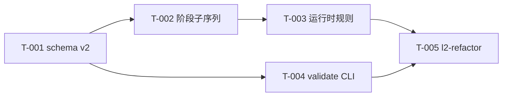

# 工作流 Profile v2：可声明扩展与 workflow validate任务清单（Tasks）

## 1. 元数据

| 项 | 内容 |
|---|---|
| Spec ID | SPEC-REQ-002 |
| 关联Spec | `docs/specs/SPEC-REQ-002/spec.md` |
| 关联Design | `docs/specs/SPEC-REQ-002/design.md` |
| 作者 | SDD Agent |
| 创建日期 | 2026-11-23 |
| 状态 | Draft |

## 2. 任务清单

| Task ID | 任务描述 | 关联FR/AC | 依赖Task | 并行标识 | 验收标准 | 单元测试类/方法 | 单Task测试命令 | 状态 | Commit SHA |
|---|---|---|---|---|---|---|---|---|---|
| T-001 | 增加 schema 2 校验、严格字段白名单和 workflow validate 核心入口 | FR-001；AC-001-1；AC-001-2；AC-001-3 | None | S | 合法 v2 profile 通过；未知字段带路径报错；schema 1 行为不变 | `WorkflowProfileTests#test_valid_v2_profile` | `python -m unittest tests.test_sdd.WorkflowProfileTests -v` | Done | 44f461e |
| T-002 | 实现阶段子序列校验与安全跳过，保留强制 Gate 和人工检查点 | FR-002；AC-002-1；AC-002-2；AC-002-3 | T-001 | S | 省略阶段可推进；跳过强制 Gate/检查点被拒绝；非法顺序报错 | `WorkflowStageTests#test_skip_design_stage` | `python -m unittest tests.test_sdd.WorkflowStageTests -v` | Done | 1b439eb |
| T-003 | 让 gate_checks、human_checkpoints、risk_stop、context_rules 在运行时生效 | FR-003；AC-003-1；AC-003-2；AC-003-3 | T-002 | S | advisory 可裁剪、required 不可裁剪；额外检查点可见；风险与上下文规则生效 | `WorkflowRuntimeTests#test_gate_checks_filter_advisory` | `python -m unittest tests.test_sdd.WorkflowRuntimeTests -v` | Done | 86dcafb |
| T-004 | 新增 `workflow validate` CLI，输出结构化结果与字段错误 | FR-004；AC-004-1；AC-004-2 | T-001 | S | 合法 profile 返回 0 和 digest；坏文件返回非 0 且不写状态 | `WorkflowCliTests#test_workflow_validate_json` | `python -m unittest tests.test_cli.WorkflowCliTests -v` | Done | 2d8dafb |
| T-005 | 新增 l2-refactor 示范 profile，并同步文档、版本、manifest 与兼容测试 | FR-005；AC-005-1；AC-005-2；AC-005-3 | T-003,T-004 | S | l2-refactor 可创建 Spec 到 PR_READY；旧 Spec 不漂移；CI 全绿 | `WorkflowProfileTests#test_l2_refactor_flow` | `python -m unittest tests.test_sdd.WorkflowProfileTests -v` | Done | 5de101d |

字段规则：

- Task ID 采用 `T-xxx`，在当前 Spec 内唯一。
- 状态仅允许 `Todo`、`In Progress`、`Done`。
- 并行标识仅允许 `P` 或 `S`；依赖为空时必须填写 `None`。
- 一个 Task 必须能够在一次实现会话中独立完成并验证。
- 一个 Task 必须对应一个最终本地代码 Commit；创建 Commit 后回填真实 Commit SHA。

## 3. AC—Task—单元测试映射

| AC ID | 覆盖Task | 测试类/方法 | 测试命令/选择器 | 预期结果 | Gate 4实际结果 |
|---|---|---|---|---|---|
| AC-001-1 | T-001 | `WorkflowProfileTests#test_valid_v2_profile` | `python -m unittest tests.test_sdd.WorkflowProfileTests.test_valid_v2_profile -v` | 合法 v2 profile 返回 ok 和 digest | 未执行 |
| AC-001-2 | T-001 | `WorkflowProfileTests#test_unknown_fields_report_paths` | `python -m unittest tests.test_sdd.WorkflowProfileTests.test_unknown_fields_report_paths -v` | 未知字段错误包含 JSON 路径 | 未执行 |
| AC-001-3 | T-001 | `WorkflowProfileTests#test_schema1_snapshot_unchanged` | `python -m unittest tests.test_sdd.WorkflowProfileTests.test_schema1_snapshot_unchanged -v` | schema 1 快照仍通过且 digest 不变 | 未执行 |
| AC-002-1 | T-002 | `WorkflowStageTests#test_skip_design_stage` | `python -m unittest tests.test_sdd.WorkflowStageTests.test_skip_design_stage -v` | 省略 DESIGN_READY 时直接进入下一已声明阶段 | 未执行 |
| AC-002-2 | T-002 | `WorkflowStageTests#test_gate_or_checkpoint_conflict_rejected` | `python -m unittest tests.test_sdd.WorkflowStageTests.test_gate_or_checkpoint_conflict_rejected -v` | 跳过强制 Gate 或 approve/merge 被拒绝 | 未执行 |
| AC-002-3 | T-002 | `WorkflowStageTests#test_invalid_stage_order_rejected` | `python -m unittest tests.test_sdd.WorkflowStageTests.test_invalid_stage_order_rejected -v` | 重复/逆序/缺首尾阶段报错 | 未执行 |
| AC-003-1 | T-003 | `WorkflowRuntimeTests#test_gate_checks_filter_advisory` | `python -m unittest tests.test_sdd.WorkflowRuntimeTests.test_gate_checks_filter_advisory -v` | advisory 可裁剪，required 缺失被拒绝 | 未执行 |
| AC-003-2 | T-003 | `WorkflowRuntimeTests#test_extra_human_checkpoint` | `python -m unittest tests.test_sdd.WorkflowRuntimeTests.test_extra_human_checkpoint -v` | 到达额外 human Gate 时返回检查点 | 未执行 |
| AC-003-3 | T-003 | `WorkflowRuntimeTests#test_risk_and_context_rules` | `python -m unittest tests.test_sdd.WorkflowRuntimeTests.test_risk_and_context_rules -v` | 风险标签合并、上下文裁剪且不越界 | 未执行 |
| AC-004-1 | T-004 | `WorkflowCliTests#test_workflow_validate_json` | `python -m unittest tests.test_cli.WorkflowCliTests.test_workflow_validate_json -v` | 合法 profile 返回 0、name/version/digest | 未执行 |
| AC-004-2 | T-004 | `WorkflowCliTests#test_workflow_validate_errors` | `python -m unittest tests.test_cli.WorkflowCliTests.test_workflow_validate_errors -v` | 缺失或非 JSON 文件返回非 0 | 未执行 |
| AC-005-1 | T-005 | `WorkflowProfileTests#test_l2_refactor_flow` | `python -m unittest tests.test_sdd.WorkflowProfileTests.test_l2_refactor_flow -v` | l2-refactor Spec 快照正确并可到 PR_READY | 未执行 |
| AC-005-2 | T-005 | `WorkflowProfileTests#test_old_specs_stay_stable` | `python -m unittest tests.test_sdd.WorkflowProfileTests.test_old_specs_stay_stable -v` | 旧 Spec 快照和 Gate 结果不变 | 未执行 |
| AC-005-3 | T-005 | `CiWorkflowTests#test_ci_workflow_runs_sdd_checks` | `python -m unittest tests.test_ci_contract.CiWorkflowTests.test_ci_workflow_runs_sdd_checks -v` | LF 工作区三项门禁通过，CI 全绿 | 未执行 |

映射规则：

- 必须覆盖 `spec.md` 中的全部适用 AC，不得增加不存在的 AC。
- 每条 AC 至少关联一个 Task 和一个具体测试类/方法。
- 同一测试覆盖多个 AC 时必须逐条登记。
- Gate 4 只有在测试真实存在、已执行且通过时，才能标记为“通过”。

## 4. 依赖图



## 5. 实施与提交顺序

```text
选择一个 Todo Task
→ 状态改为 In Progress
→ 实现代码和单元测试
→ 执行该 Task 的单元测试
→ 测试通过后状态改为 Done
→ 创建本地 Task Commit 并回填 SHA
→ 继续下一个 Task
```

全部 Task 完成后执行全量单元测试、逐 AC 验证和 Gate 5。

## 6. 全量单元测试记录

| 测试命令 | 退出码 | 执行数 | 通过数 | 失败数 | 跳过数 | 结果 |
|---|---:|---:|---:|---:|---:|---|
| `python -m unittest discover -s tests -v` | 待执行 | 待执行 | 待执行 | 待执行 | 待执行 | 未执行 |

## 7. 自检清单（评审辅助，不作Gate依据）

- [x] Spec ID 及 Spec/Design 引用有效且一致。
- [x] Task ID 唯一，字段完整，状态值和并行标识合法。
- [x] 每个 Task 可独立实现、独立单测并对应一个本地 Commit。
- [x] 全部 FR/AC 均已映射到 Task，不存在孤儿 AC。
- [x] 每条 AC 均已映射到具体测试类/方法和可执行命令。
- [x] 所有依赖 Task 真实存在，依赖图无环，并行标识无冲突。

## 8. 变更历史

| 日期 | 版本 | 变更内容 | 作者 |
|---|---|---|---|
| 2026-11-23 | 1.0.0 | 初始版本 | SDD Agent |
