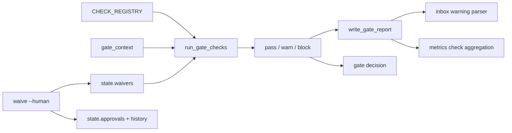

# Gate 检查项分级、人工豁免与按 ID 度量设计文档（Design）

## 1. 元数据

| 项 | 内容 |
|---|---|
| Spec ID | SPEC-REQ-003 |
| 关联Spec | `docs/specs/SPEC-REQ-003/spec.md` |
| 作者 | SDD Agent |
| 创建日期 | 2026-11-23 |
| 状态 | Draft |
| 评审人 | sdd-kit 平台维护者 |

## 2. 设计目标

- 核心问题：当前注册表只覆盖 G0/G1，检查结果只有 pass/block，G2–G5 仍由
  手工检查驱动；建议项无法告警，人工例外没有结构化记录，报告和 metrics
  也不能按检查 ID 追溯。
- 设计范围：扩展全 Gate 注册表；统一 pass/warn/block 判定；让 G2–G5 使用
  稳定检查 ID；新增人类豁免、范围与到期校验；扩展 Gate 报告、inbox、metrics；
  保持旧报告、旧 Spec、profile v2 和现有 CLI 行为兼容。
- 非设计范围：Review overlay、知识索引、BAR/Fix Pattern、服务端审批台、
  任意 DAG、跨 Spec 豁免、历史报告迁移和外部依赖。

## 3. 方案概述

- 高层方案：在 `sdd/scripts/sdd.py` 内把“检查定义、执行、结果分级、豁免判定、
  报告渲染、指标解析”收口为一条链路。注册表新增 `redline` 与允许触发方式；
  G2–G5 的现有校验函数转为注册检查；所有 Gate 都通过 `run_gate_checks()`
  得到结构化行。required 失败默认 `block`，advisory 失败默认 `warn`；
  redline 无条件 `block`；有效豁免只把指定 required 行降为 `warn`。
- 关键决策：
  1. 保留既有 G0/G1 ID 与检查含义，只补充字段；新增 G2–G5 使用同 Gate
     内稳定编号，避免历史报告失效。
  2. `redline` 是独立布尔字段，不依赖 `waivable` 推测；`waivable=true` 且
     `redline=true` 注册表校验直接失败。首批将 G5 可复验证据设为证据链红线。
  3. 豁免绑定 `check_id + gate + Spec + Gate 产物哈希 + expires_at`；
     产物变化或到期即失效，不提供 Spec 级豁免。
  4. Gate 总体结果仍是 `PASS/FAILED`：只有 block 使结果 `FAILED`；
     warn 保留在报告和指标中，避免改变 `gate_report_status()` 的历史语义。
  5. `metrics` 和 `inbox` 读取当前每个 Gate 的最新 Markdown 报告，兼容
     旧五列表格；不补写历史报告，不新增数据库。
  6. `waive` 是 CLI 人工动作，强制 `--human`；MCP 不新增工具，也不复制
     Gate 或状态规则。
- 方案对比：
  - 把 warn 写成 Gate 失败并靠人工忽略：仍会阻断流转，违反验收，放弃。
  - 用新的 `waivers.json` 独立存储：增加工件和哈希同步复杂度；复用
    `state.json.waivers` 并由 CLI 写入更符合唯一状态机，采用。
  - 为豁免做 Spec 级开关：范围过大且容易绕过多项检查，放弃。
  - 只在报告文本中记录豁免：无法自动判断到期和产物变化，放弃。

## 4. Spec覆盖关系

| FR/AC | 设计章节/模块 | 实现方式 | 验证方式 |
|---|---|---|---|
| FR-001 / AC-001-1 | 注册表与校验 | G0–G5 注册项、`redline`、`CHECK_TRIGGERS`、唯一 ID 校验 | 注册表单测断言全 Gate 覆盖 |
| FR-001 / AC-001-2 | 注册表与校验 | 逐字段校验重复 ID、Gate、level、trigger、redline | 非法注册表负向单测 |
| FR-001 / AC-001-3 | 兼容性 | 保留 G0-01…G1-04，原报告解析器保持兼容 | 旧 Spec `check --all` 回归 |
| FR-002 / AC-002-1 | 结果分级 | `classify_check_result()` required 无豁免返回 block | G0/G2 失败单测 |
| FR-002 / AC-002-2 | 结果分级与报告 | advisory 失败返回 warn；Gate 只在 block 时 FAILED | advisory 注入单测 |
| FR-002 / AC-002-3 | 红线策略 | redline 优先返回 block，忽略 waiver | redline 负向单测 |
| FR-002 / AC-002-4 | Gate 报告 | 检查表显示 ID/级别/结果/证据/豁免，问题区区分 BLOCK/WARN | 报告渲染单测 |
| FR-003 / AC-003-1 | `waive` CLI | 人类动作写入 `state.waivers` 和审批记录 | CLI 成功路径单测 |
| FR-003 / AC-003-2 | 豁免判定 | 有效豁免把 required 失败降为 warn 并标记 waived | G4-02 豁免单测 |
| FR-003 / AC-003-3 | 范围与到期 | `artifact_scope` 比对哈希；`expires_at` 到期失效 | 改产物/过期单测 |
| FR-003 / AC-003-4 | `waive` 边界 | 拒绝不可豁免、redline、无 `--human`、缺证据、过期时间 | CLI 负向单测 |
| FR-004 / AC-004-1 | inbox | 解析 Gate 报告 WARN，附加到 item 或生成低优先级告警项 | inbox 单测 |
| FR-004 / AC-004-2 | metrics | 按检查 ID 汇总 pass/warn/block/waived 与比率 | metrics 单测 |
| FR-004 / AC-004-3 | 旧报告解析 | 五列表格和旧 PASS/BLOCK 值容错 | 旧报告 fixture 单测 |
| FR-005 / AC-005-1 | CLI/MCP 边界 | 仅 CLI 注册 `waive`；MCP 工具清单无该动作 | CLI help + MCP 工具单测 |
| FR-005 / AC-005-2 | 发布与验证 | 版本、manifest、文档同步；全量门禁 | 全量测试与 CI |

## 5. 系统架构

### 5.1 架构图

### 5.2 模块划分

| 模块/服务 | 职责 | 输入 | 输出 | 依赖 |
|---|---|---|---|---|
| `sdd/scripts/sdd.py` 注册表 | 定义 G0–G5 检查元数据并校验 | 静态注册表 | 合法检查定义 | Python 标准库 |
| `sdd/scripts/sdd.py` 检查执行 | 运行检查、应用级别/红线/豁免策略 | Gate、上下文、state | 结构化检查行 | 注册表、工件读取 |
| `sdd/scripts/sdd.py` 报告 | 渲染 Gate 报告、告警、豁免和产物哈希 | 检查行、errors、evidence | Markdown 报告、gates.md | 文件系统 |
| `sdd/scripts/sdd.py` inbox/metrics | 解析最新报告并聚合 | Gate 报告、state | 告警列表、检查统计 | 报告解析器 |
| `sdd/cli.py` | 暴露 `waive` 人工动作和结构化输出 | CLI 参数 | state 记录、JSON/文本结果 | 核心脚本 |
| `sdd/mcp/` | 保持薄适配，不新增人工动作 | MCP 工具调用 | 既有工具结果 | 核心 CLI |
| `tests/` | 分级、豁免、兼容、CLI/MCP 边界回归 | 临时仓库和报告 | unittest 结果 | `unittest` |

### 5.3 模块间交互

1. `command_approve()`、`command_complete()` 和 `run_checks()` 构造 Gate 上下文，
   调用 `run_gate_checks(gate, ctx, workflow)`。
2. `run_gate_checks()` 只选择注册项，计算原始 errors，再由
   `classify_check_result()` 应用 advisory/redline/waiver 规则。
3. `record_gate()` 将结构化行写入报告，`gate_rows_errors()` 只收集 block，
   `gate_rows_warnings()` 收集 warn；状态推进只检查 block。
4. `waive` 命令校验检查是否允许豁免，保存 Gate 产物作用域和未来到期时间，
   之后所有 Gate 重跑都会重新匹配该记录。
5. `inbox` 和 `metrics` 复用统一报告解析器读取最新 Gate 报告，不执行状态迁移。

## 6. 数据模型

- 注册项新增 `redline: bool`；`trigger` 只允许
  `doc_pr/code_pr/local/ci/pipeline`。
- 检查行：`id`、`name`、`level`、`trigger`、`waivable`、`redline`、`owner`、
  `result`、`detail`、`errors`、可选 `waiver`。
- `state.waivers[]`：

| 字段 | 类型 | 说明 |
|---|---|---|
| `check_id` | string | 被豁免的稳定检查 ID |
| `gate` | string | 从注册表派生，不接受调用方伪造 |
| `scope` | string | 人类填写的适用范围说明 |
| `artifacts` | object[] | 记录时的 Gate 产物 path/sha256/bytes |
| `reason` | string | 豁免原因 |
| `approver` | string | 人类审批人 |
| `at` | string | 记录时间 |
| `expires_at` | string | 未来 ISO 到期时间 |
| `evidence` | string | 证据或补偿措施 |

- `state.approvals[]` 增加 `action=waiver` 记录；`history` 记录同一次人工动作，
  保证 `metrics.human_interventions` 可统计。
- 数据库变更、事务边界：不涉及；单次 CLI 调用内完成 state 写入。
- 迁移方案：不迁移历史报告；旧报告缺列时由解析器按五列处理。

## 7. 接口契约

| 方法 | 路径 | 描述 | 归属AC |
|---|---|---|---|
| CLI | `python -m sdd waive --spec <spec> --check <id> --scope <text> --reason <text> --expires <iso> --evidence <text> --human [--approver <id>] [--json]` | 记录人工豁免 | AC-003-1；AC-003-4 |
| CLI | `python -m sdd inbox --json` | 返回 `items[].warnings[]` 或 `review_warning` 项 | AC-004-1 |
| CLI | `python -m sdd metrics --json` | 返回 `specs[].checks` 与 `aggregate.checks` | AC-004-2 |

- 请求/响应结构：`waive --json` 返回
  `{"ok": true, "kind": "waiver", "spec": "...", "check": "...", "gate": "...", "expires_at": "...", "waiver": {...}}`。
- 错误码：人工动作缺 `--human`、不可豁免、redline、非法到期时间返回非 0；
  文件或 JSON 错误沿用现有 CLI 错误码。
- 兼容性：原有命令参数不变；Gate 报告新增“豁免”列，旧五列仍可读。
- 契约文件：不涉及外部网络契约；内部字段由本 Design 固定。

## 8. 认证、授权、幂等与安全

- 认证：不涉及。
- 授权：`waive` 强制 `--human`；MCP 不注册该工具；Agent 不能代替审批。
- 幂等：同一检查、同一产物哈希、同一到期时间重复 `waive` 只更新时间记录，
  不改变检查结果；重复 `check` 不写状态。
- 敏感数据：仅读取仓库内 state、工件和报告；不执行外部代码。
- 审计：waiver 记录审批人、范围、原因、到期时间和证据；Gate 报告、事件日志
  和产物哈希共同支持回放。

## 9. 关键决策ADR

- 引用：无需新增 ADR。
- 判断依据：方案不改变状态机阶段和人工检查点数量，只扩展现有 Gate 结果模型；
  关键取舍已在本 Design 第 3 节记录。

## 10. 非功能需求设计

- 性能设计：注册表是内存常量；报告解析只读取当前 Spec 的至多 6 份 Markdown；
  不新增网络或子进程开销。
- 可用性设计：不可豁免、红线、过期、产物变化分别给出可操作错误；旧报告不报错。
- 可观测性：报告保留每项检查的 ID、级别、结果、证据和 waiver；metrics 暴露
  通过率、告警率、阻断率和豁免率。

## 11. 依赖与风险

| 风险/依赖 | 影响 | 缓解措施 | 负责人 |
|---|---|---|---|
| 注册表扩展到 G2–G5 改变既有 Gate 行为 | 旧 Spec 可能新增失败 | 保留原检查逻辑与 ID；旧 Spec 全量回归；warn 不阻断 | sdd-kit 平台维护者 |
| 豁免范围实现错误 | 可能绕过不该绕过的检查 | 只匹配指定检查 ID + Gate + Spec + 产物哈希；redline 双保险 | sdd-kit 平台维护者 |
| 报告表格变更破坏解析 | inbox/metrics 无法读取 | 解析器兼容五列/六列和旧结果值 | sdd-kit 平台维护者 |
| `waive` 被 Agent 调用 | 人工边界失效 | CLI `--human`；MCP 不注册；负向测试 | sdd-kit 平台维护者 |
| 期限与时钟差异 | 豁免过早或过晚失效 | 统一 `parse_timestamp()` 和本地时区比较 | sdd-kit 平台维护者 |

## 12. 回滚方案

- 触发条件：G2–G5 注册检查导致旧 Spec 失败，或报告解析影响 CI。
- 回滚步骤：回退本 Spec 的核心、CLI、测试、文档和 manifest 提交；恢复上一个小版本。
- 数据恢复：`state.waivers` 是新增可选字段，旧代码忽略即可；历史报告不迁移，
  不需要数据修复。

## 13. 验收标准

- [x] 技术方案覆盖全部适用 FR 和 AC。
- [x] 接口契约已检查格式、引用和项目约束。
- [x] 数据模型、迁移和回滚方案完整或已明确不涉及。
- [x] 认证、授权、幂等、敏感数据和审计方案完整。
- [x] 风险、缓解措施和回滚方案已明确。

## 14. 变更历史

| 日期 | 版本 | 变更内容 | 作者 |
|---|---|---|---|
| 2026-11-23 | 1.0.0 | 初始版本 | SDD Agent |
