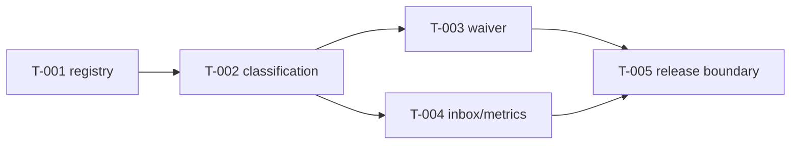

# Gate 检查项分级、人工豁免与按 ID 度量任务清单（Tasks）

## 1. 元数据

| 项 | 内容 |
|---|---|
| Spec ID | SPEC-REQ-003 |
| 关联Spec | `docs/specs/SPEC-REQ-003/spec.md` |
| 关联Design | `docs/specs/SPEC-REQ-003/design.md` |
| 作者 | SDD Agent |
| 创建日期 | 2026-11-23 |
| 状态 | Draft |

## 2. 任务清单

| Task ID | 任务描述 | 关联FR/AC | 依赖Task | 并行标识 | 验收标准 | 单元测试类/方法 | 单Task测试命令 | 状态 | Commit SHA |
|---|---|---|---|---|---|---|---|---|---|
| T-001 | 扩展 G0–G5 检查项注册表，增加 redline、触发方式和严格元数据校验 | FR-001；AC-001-1；AC-001-2；AC-001-3 | None | S | G0–G5 均有稳定检查；非法元数据定位报错；旧 ID 不变 | `GateRegistryTests#test_registry_covers_all_gates` | `python -m unittest tests.test_sdd.GateRegistryTests -v` | Done | 54747da |
| T-002 | 实现 pass/warn/block、红线优先和 Gate 报告分级渲染 | FR-002；AC-002-1；AC-002-2；AC-002-3；AC-002-4 | T-001 | S | required 阻断、advisory 告警、redline 不可降级，报告可区分 | `GateClassificationTests#test_required_failure_blocks` | `python -m unittest tests.test_sdd.GateClassificationTests -v` | Done | 45445d3 |
| T-003 | 新增人类 `waive`，绑定检查、产物哈希与到期时间并自动重校验 | FR-003；AC-003-1；AC-003-2；AC-003-3；AC-003-4 | T-002 | S | 豁免可审计；有效豁免降为 warn；过期/产物变化恢复 block；非法调用拒绝 | `GateWaiverTests#test_waive_records_scope_and_approver` | `python -m unittest tests.test_sdd.GateWaiverTests -v` | Done | 7ce0599 |
| T-004 | 让 inbox 展示 Gate 告警，并让 metrics 按检查 ID 聚合结果 | FR-004；AC-004-1；AC-004-2；AC-004-3 | T-002 | S | inbox 可见 warn；metrics 输出次数与比率；旧报告可解析 | `GateInboxMetricsTests#test_inbox_surfaces_gate_warnings` | `python -m unittest tests.test_sdd.GateInboxMetricsTests -v` | Done | f3e5b20 |
| T-005 | 同步 CLI/MCP 边界、文档、版本、manifest 和发布兼容验证 | FR-005；AC-005-1；AC-005-2 | T-003,T-004 | S | waive 仅 CLI 且要求 human；全量测试、verify 和 CI 契约通过 | `GateBoundaryTests#test_waive_is_cli_only_human_action` | `python -m unittest tests.test_sdd.GateBoundaryTests tests.test_ci_contract.CiWorkflowTests -v` | Done | de3aec9 |

字段规则：

- Task ID 采用 `T-xxx`，在当前 Spec 内唯一。
- 状态仅允许 `Todo`、`In Progress`、`Done`。
- 并行标识仅允许 `P` 或 `S`；依赖为空时必须填写 `None`。
- 一个 Task 必须能够在一次实现会话中独立完成并验证。
- 一个 Task 必须对应一个最终本地代码 Commit；创建 Commit 后回填真实 Commit SHA。

## 3. AC—Task—单元测试映射

| AC ID | 覆盖Task | 测试类/方法 | 测试命令/选择器 | 预期结果 | Gate 4实际结果 |
|---|---|---|---|---|---|
| AC-001-1 | T-001 | `GateRegistryTests#test_registry_covers_all_gates` | `python -m unittest tests.test_sdd.GateRegistryTests.test_registry_covers_all_gates -v` | G0–G5 均有合法注册检查 | 未执行 |
| AC-001-2 | T-001 | `GateRegistryTests#test_invalid_registry_metadata_rejected` | `python -m unittest tests.test_sdd.GateRegistryTests.test_invalid_registry_metadata_rejected -v` | 非法字段返回路径化错误 | 未执行 |
| AC-001-3 | T-001 | `GateRegistryTests#test_legacy_ids_and_reports_supported` | `python -m unittest tests.test_sdd.GateRegistryTests.test_legacy_ids_and_reports_supported -v` | 旧 ID 与旧报告仍可解析 | 未执行 |
| AC-002-1 | T-002 | `GateClassificationTests#test_required_failure_blocks` | `python -m unittest tests.test_sdd.GateClassificationTests.test_required_failure_blocks -v` | required 失败为 block 且状态不推进 | 未执行 |
| AC-002-2 | T-002 | `GateClassificationTests#test_advisory_failure_warns` | `python -m unittest tests.test_sdd.GateClassificationTests.test_advisory_failure_warns -v` | advisory 失败为 warn 且 Gate 可继续 | 未执行 |
| AC-002-3 | T-002 | `GateClassificationTests#test_redline_cannot_be_waived` | `python -m unittest tests.test_sdd.GateClassificationTests.test_redline_cannot_be_waived -v` | redline 始终 block，豁免无效 | 未执行 |
| AC-002-4 | T-002 | `GateClassificationTests#test_gate_report_renders_warn_and_block` | `python -m unittest tests.test_sdd.GateClassificationTests.test_gate_report_renders_warn_and_block -v` | 报告显示 ID、级别、结果、证据与问题 | 未执行 |
| AC-003-1 | T-003 | `GateWaiverTests#test_waive_records_scope_and_approver` | `python -m unittest tests.test_sdd.GateWaiverTests.test_waive_records_scope_and_approver -v` | state 写入完整豁免和审批记录 | 未执行 |
| AC-003-2 | T-003 | `GateWaiverTests#test_active_waiver_downgrades_required_to_warn` | `python -m unittest tests.test_sdd.GateWaiverTests.test_active_waiver_downgrades_required_to_warn -v` | 有效豁免把 required 失败降为 warn | 未执行 |
| AC-003-3 | T-003 | `GateWaiverTests#test_expired_or_changed_artifact_revalidates` | `python -m unittest tests.test_sdd.GateWaiverTests.test_expired_or_changed_artifact_revalidates -v` | 过期或产物变化后恢复 block | 未执行 |
| AC-003-4 | T-003 | `GateWaiverTests#test_waive_rejects_invalid_check_or_human` | `python -m unittest tests.test_sdd.GateWaiverTests.test_waive_rejects_invalid_check_or_human -v` | 不可豁免/红线/缺 human/坏时间均拒绝 | 未执行 |
| AC-004-1 | T-004 | `GateInboxMetricsTests#test_inbox_surfaces_gate_warnings` | `python -m unittest tests.test_sdd.GateInboxMetricsTests.test_inbox_surfaces_gate_warnings -v` | inbox 返回 Spec、Gate、检查 ID 和 warn | 未执行 |
| AC-004-2 | T-004 | `GateInboxMetricsTests#test_metrics_group_by_check_id` | `python -m unittest tests.test_sdd.GateInboxMetricsTests.test_metrics_group_by_check_id -v` | metrics 按检查 ID 输出计数与比率 | 未执行 |
| AC-004-3 | T-004 | `GateInboxMetricsTests#test_legacy_report_rows_are_compatible` | `python -m unittest tests.test_sdd.GateInboxMetricsTests.test_legacy_report_rows_are_compatible -v` | 旧五列报告被容错读取 | 未执行 |
| AC-005-1 | T-005 | `GateBoundaryTests#test_waive_is_cli_only_human_action` | `python -m unittest tests.test_sdd.GateBoundaryTests.test_waive_is_cli_only_human_action -v` | CLI 要求 --human，MCP 不暴露 waive | 未执行 |
| AC-005-2 | T-005 | `GateBoundaryTests#test_release_metadata_and_ci_contract` | `python -m unittest tests.test_sdd.GateBoundaryTests.test_release_metadata_and_ci_contract -v` | 版本、manifest 与 CI 契约同步 | 未执行 |

映射规则：

- 必须覆盖 `spec.md` 中的全部适用 AC，不得增加不存在的 AC。
- 每条 AC 至少关联一个 Task 和一个具体测试类/方法。
- 同一测试覆盖多个 AC 时必须逐条登记。
- Gate 4 只有在测试真实存在、已执行且通过时，才能标记为“通过”。

## 4. 依赖图



## 5. 实施与提交顺序

```text
选择一个 Todo Task
→ 状态改为 In Progress
→ 实现代码和单元测试
→ 执行该 Task 的单元测试
→ 测试通过后状态改为 Done
→ 创建本地 Task Commit 并回填 SHA
→ 继续下一个 Task
```

全部 Task 完成后执行全量单元测试、逐 AC 验证和 Gate 5。

## 6. 全量单元测试记录

| 测试命令 | 退出码 | 执行数 | 通过数 | 失败数 | 跳过数 | 结果 |
|---|---:|---:|---:|---:|---:|---|
| `python -m unittest discover -s tests -v` | 待执行 | 待执行 | 待执行 | 待执行 | 待执行 | 未执行 |

## 7. 自检清单（评审辅助，不作Gate依据）

- [x] Spec ID 及 Spec/Design 引用有效且一致。
- [x] Task ID 唯一，字段完整，状态值和并行标识合法。
- [x] 每个 Task 可独立实现、独立单测并对应一个本地 Commit。
- [x] 全部 FR/AC 均已映射到 Task，不存在孤儿 AC。
- [x] 每条 AC 均已映射到具体测试类/方法和可执行命令。
- [x] 所有依赖 Task 真实存在，依赖图无环，并行标识无冲突。

## 8. 变更历史

| 日期 | 版本 | 变更内容 | 作者 |
|---|---|---|---|
| 2026-11-23 | 1.0.0 | 初始版本 | SDD Agent |
