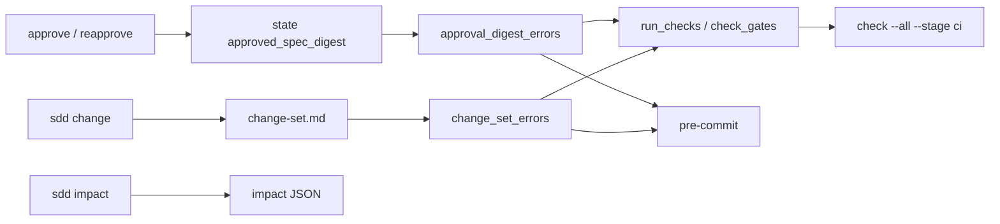

# 审批版本绑定、change-set 与 impact 设计文档（Design）

## 1. 元数据

| 项 | 内容 |
|---|---|
| Spec ID | SPEC-REQ-004 |
| 关联Spec | `docs/specs/SPEC-REQ-004/spec.md` |
| 作者 | SDD Agent |
| 创建日期 | 2026-11-23 |
| 状态 | Draft |
| 评审人 | sdd-kit 平台维护者 |

## 2. 设计目标

- 核心问题：当前 `approve` 只在 `approvals` 中写入一次 `spec.md` 哈希，
  `state.json` 没有可直接比对的审批版本；审批后修改 Spec 只能靠 G1 报告哈希
  间接发现，错误提示也没有 `change-set` / `reapprove` 路径。
- 设计范围：审批摘要绑定、人工 `reapprove`、只读 `impact`、`change-set`
  先行、pre-commit/CI 阻断、旧 Spec 迁移提示和发布同步。
- 非设计范围：全量 commit 审计、`sdd trace`、语义 diff、外部审批台、
  历史 MERGED Spec 重写和第三方依赖。

## 3. 方案概述

- 高层方案：把“审批版本”作为 `state.json` 的一等字段，由 `approve` 和
  `reapprove` 写入；所有后续阶段通过统一函数比对当前 `spec.md` 规范化摘要。
  审批后的范围变化先用 `sdd change` 生成 `change-set.md`，再由人类
  `reapprove` 同时更新审批摘要和 change-set 状态；pre-commit 与 CI 读取同一
  change-set，阻断未批准的代码提交。
- 关键决策：
  1. 复用 `artifact_sha256()`，文本摘要继续做 CRLF/LF 规范化，避免平台差异。
  2. 新增 `G1-08`（审批版本绑定）和 `G1-09`（变更审批先行）两个稳定检查 ID，
     错误文本以 ID 开头，复用现有 `stage_check_results()` 分类。
  3. `change-set.md` 使用结构化 Markdown 列表记录，每个 `CHG-NNN` 是一个
     可解析记录；不引入 JSON 旁路文件或数据库。
  4. `reapprove` 是 CLI 人工动作，强制 `--human`、`--reason`、`--evidence`；
     MCP 不暴露，`Workspace` 方法仍需显式 `human=True`。
  5. `impact` 只读，不写 state、不写 change-set；所有写动作仍由
     `sdd change` / `sdd reapprove` 完成。
  6. MERGED 历史 Spec 跳过新字段强制校验，避免 `check --all` 回归失败；
     活跃 Spec 缺字段必须阻断并输出迁移命令。
- 方案对比：
  - 只依赖 G1 报告哈希：无法表达“已重新审批”，也无法关联 change-set，放弃。
  - 为每次变更创建新 Spec：破坏 Spec ID 稳定性与追溯，放弃。
  - 用 JSON 单独存 change-set：增加人工可读性和审查成本，采用 Markdown。
  - 在 hook 中解析自然语言判断语义变化：不可靠，改为显式 change-set。

## 4. Spec覆盖关系

| FR/AC | 设计章节/模块 | 实现方式 | 验证方式 |
|---|---|---|---|
| FR-001 / AC-001-1 | 审批绑定 | `command_approve()` 写入四个 state 字段；G0/G1 报告增加摘要行 | 审批后 state/报告断言 |
| FR-001 / AC-001-2 | 摘要阻断 | `approval_digest_errors()` 在 design/tasks/verify/ci 与 hook 中返回 `G1-08` | 修改 Spec 后 check 负向测试 |
| FR-001 / AC-001-3 | 人工重审 | `command_reapprove()` 重跑 G0/G1，更新摘要并追加 `approvals` | reapprove 成功路径测试 |
| FR-001 / AC-001-4 | 边界与迁移 | 缺 `--human` 拒绝；缺摘要返回含 Spec ID 的迁移命令 | 负向 CLI 测试 |
| FR-002 / AC-002-1 | 影响视图 | `build_impact()` 汇总 Spec/Tasks/Design 并输出稳定 JSON | `impact --json` 字段断言 |
| FR-002 / AC-002-2 | 引用校验 | `impact_missing_links()` 检查 FEAT/FR/AC/Task；`change` 失败不写文件 | 缺失对象负向测试 |
| FR-002 / AC-002-3 | 审批需求判定 | 摘要不一致或存在 pending change-set 时 `approval_required=true` | 三种状态组合测试 |
| FR-003 / AC-003-1 | change-set 写入 | `render_change_record()` 生成完整字段；`command_change()` 追加 | 文件字段断言 |
| FR-003 / AC-003-2 | 变更批准 | `command_reapprove()` 调用 `approve_pending_changes()` 回写 approved | change-set 状态断言 |
| FR-003 / AC-003-3 | 提交阻断 | `change_set_errors()` + `hook_pre_commit()` 返回 `G1-09` | staged code 的 pre-commit 测试 |
| FR-003 / AC-003-4 | docs-only | `--docs-only` 写 exempt 记录；hook 检测 docs-only + 代码时阻断 | docs-only 成功与代码阻断测试 |
| FR-003 / AC-003-5 | 缺字段失败 | `validate_change_impact()` 在落盘前校验必填字段 | 非法 change 测试 |
| FR-004 / AC-004-1 | 人工边界 | 仅 CLI 注册 reapprove；MCP 工具清单不变 | CLI/MCP 边界测试 |
| FR-004 / AC-004-2 | 历史兼容 | `is_legacy_merged()` 和 MERGED 分支跳过摘要强制 | `check --all` 回归 |
| FR-004 / AC-004-3 | 发布同步 | 版本、manifest、README、契约与 CI 同步 | 全量测试与 CI |

## 5. 系统架构

### 5.1 架构图



### 5.2 模块职责

- `sdd/scripts/sdd.py`：审批字段、摘要比对、change-set 解析/写入、
  impact 构建、hook 与 CLI 子命令。
- `sdd/scripts/sdd_ext.py`：注册 `G1-08`、`G1-09` 与错误关键词。
- `sdd/core.py`：`Workspace.reapprove/change/impact` 通过子进程调用状态机。
- `sdd/cli.py`：暴露三个新命令；`reapprove` 强制 `--human`。
- `docs/specs/<spec>/change-set.md`：审计工件，不参与状态机状态枚举。

## 6. 数据模型

### 6.1 state.json 新增字段

| 字段 | 类型 | 写入者 | 说明 |
|---|---|---|---|
| `approved_spec_digest` | string | approve/reapprove | 规范化 `spec.md` SHA-256 |
| `approved_at` | ISO string | approve/reapprove | 最近一次人类确认时间 |
| `approved_by` | string | approve/reapprove | 审批人身份 |
| `approval_evidence` | string | approve/reapprove | 最近一次确认证据 |

`approvals` 追加记录：

```json
{
  "action": "reapprove_spec",
  "approver": "name <mail>",
  "at": "2026-11-23T21:00:00+08:00",
  "reason": "AC 文案调整",
  "evidence": "需求重新确认",
  "previous_digest": "…",
  "sha256": "…",
  "artifact": "docs/specs/SPEC-REQ-004/spec.md"
}
```

### 6.2 change-set.md 格式

```markdown
# 变更集（Change Set）

## CHG-001
- Status: pending
- Reason: 调整 AC-002-3 的审批判定
- Created-At: 2026-11-23T21:00:00+08:00
- Impact-FEAT: FEAT-006
- Impact-FR: FR-002
- Impact-AC: AC-002-3
- Impact-Task: T-002
- Impact-Tests: `tests.test_governance.ImpactTests#test_impact_lists_links`
- Impact-Code-Paths: `sdd/scripts/sdd.py`
- Risk: medium
- Rollback: 回退本次变更相关 commit
- Approval: pending
- Approved-By: -
- Approved-At: -
- Approved-Spec-Digest: -
```

解析器只读取 `## CHG-NNN` 到下一个二级标题之间的 `- Key: Value` 行；
未知键忽略，缺失必填键由 `validate_change_record()` 报错。

## 7. 接口契约

### 7.1 `sdd impact`

```powershell
python -m sdd impact --spec SPEC-REQ-004 --json
```

返回：

```json
{
  "ok": true,
  "kind": "impact",
  "spec": "SPEC-REQ-004",
  "feat_ids": ["FEAT-006"],
  "fr_ids": ["FR-001"],
  "ac_ids": ["AC-001-1"],
  "task_ids": ["T-001"],
  "test_selectors": ["tests.test_sdd.X#test_y"],
  "code_paths": ["sdd/scripts/sdd.py"],
  "approval_required": false,
  "digest_changed": false,
  "pending_change_ids": [],
  "missing": [],
  "change_set": "docs/specs/SPEC-REQ-004/change-set.md"
}
```

### 7.2 `sdd change`

```powershell
python -m sdd change --spec SPEC-REQ-004 --reason "调整审批判定"
python -m sdd change --spec SPEC-REQ-004 --reason "更新文档" --docs-only
```

成功返回 `kind=change`、`change_id`、`status`、`approval_required` 和
`change_set`。`--docs-only` 记录 `Status: docs-only` 与 `Approval: exempt`。

### 7.3 `sdd reapprove`

```powershell
python -m sdd reapprove --spec SPEC-REQ-004 --human --reason "调整审批判定" --evidence "需求重新确认"
```

仅 CLI；`Workspace.reapprove()` 要求 `human=True`。成功后返回新的
`approved_spec_digest`、`approved_change_ids` 和 `next`。

## 8. 认证、授权、幂等与安全

- `approve`、`reapprove`、`merge`、`unblock`、`rewind`、`waive` 为人工动作；
  CLI 强制 `--human`，MCP 不注册。
- `reapprove` 在修改 state 前先完成 G0/G1 校验；失败不写入任何字段。
- `change` 在写入前完成 impact 与必填字段校验；失败保持原文件不变。
- `impact` 只读，不写 state、events 或 change-set。
- 所有 JSON 输出使用 UTF-8，不包含绝对路径；错误信息不泄露环境变量。

## 9. 关键决策 ADR

| ID | 决策 | 原因 | 后果 |
|---|---|---|---|
| ADR-001 | 审批摘要放在 state 顶层 | 检查函数无需解析 Markdown 报告 | 旧 state 需要迁移提示 |
| ADR-002 | change-set 使用 Markdown 列表 | 人工可读、可评审、无新依赖 | 解析器需保持简单稳定 |
| ADR-003 | 新增 G1-08/G1-09 | 复用现有检查分级和报告 | 注册表与测试需同步 |
| ADR-004 | MERGED 跳过摘要强制 | 历史交付不可重写 | 新 Spec 仍严格阻断 |
| ADR-005 | hook 扫描所有活跃 Spec | 多 Spec 并行时不能漏检 | 单仓库建议一次只保留一个活跃 Spec |

## 10. 非功能需求设计

- 性能：`impact` 只读当前 Spec 目录和 `docs/prd-index.md`，正常仓库小于 1 秒。
- 可靠性：解析器对未知键和空行容错；缺失必填键返回明确错误。
- 可维护性：摘要、change-set、impact 各自单一函数，CLI 薄编排。
- 兼容性：MERGED 历史 Spec 跳过新字段强制；旧 Gate 报告解析不变。

## 11. 依赖与风险

| 风险 | 影响 | 缓解 | 负责人 |
|---|---|---|---|
| 旧活跃 Spec 没有 `approved_spec_digest` | 升级后首次检查阻断 | 输出明确 `reapprove --reason legacy-migration` 命令 | 平台维护者 |
| change-set 手工编辑破坏格式 | 解析失败或误判 | 必填字段校验 + 明确错误行号/变更 ID | 平台维护者 |
| hook 在无 state 的仓库运行 | 误阻断 | 只处理存在 state.json 的 Spec 目录 | 平台维护者 |
| 多活跃 Spec 互相影响 | 无关提交被阻断 | 只对存在 pending 记录或摘要变化的 Spec 阻断 | 平台维护者 |
| 文本摘要受换行影响 | 跨平台误报 | 复用 CRLF/LF 规范化哈希 | 平台维护者 |

## 12. 回滚方案

- 回滚条件：新检查导致历史仓库无法通过 `check --all` 或误阻断正常提交。
- 回滚步骤：回退本 Spec 相关 commit，恢复旧版 `sdd/`；不修改历史 Spec 工件。
- 数据回滚：`approved_spec_digest` 等新增字段可保留，旧代码会忽略。
- 配置回滚：不涉及外部配置或数据库。

## 13. 验收标准

| AC | 验证方式 | 证据 |
|---|---|---|
| AC-001-1 | 审批后 state/报告断言 | 单元测试 |
| AC-001-2 | 修改 Spec 后 check 阻断 | 单元测试 |
| AC-001-3 | reapprove 更新摘要与历史 | 单元测试 |
| AC-001-4 | 缺 human/缺摘要负向 | 单元测试 |
| AC-002-1 | impact JSON 字段 | 单元测试 |
| AC-002-2 | 缺失引用 | 单元测试 |
| AC-002-3 | approval_required 组合 | 单元测试 |
| AC-003-1 | change-set 字段 | 单元测试 |
| AC-003-2 | reapprove 标记 approved | 单元测试 |
| AC-003-3 | pre-commit/CI 阻断 | 单元测试 |
| AC-003-4 | docs-only 豁免与代码阻断 | 单元测试 |
| AC-003-5 | 非法 change 失败 | 单元测试 |
| AC-004-1 | CLI/MCP 边界 | 单元测试 |
| AC-004-2 | MERGED 兼容 | 单元测试 + `check --all` |
| AC-004-3 | 发布校验 | 全量测试 + CI |

## 14. 变更历史

| 日期 | 版本 | 变更内容 | 作者 |
|---|---|---|---|
| 2026-11-23 | 1.0.0 | 初始版本 | SDD Agent |
