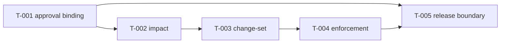

# 审批版本绑定、change-set 与 impact 任务清单（Tasks）

## 1. 元数据

| 项 | 内容 |
|---|---|
| Spec ID | SPEC-REQ-004 |
| 关联Spec | `docs/specs/SPEC-REQ-004/spec.md` |
| 关联Design | `docs/specs/SPEC-REQ-004/design.md` |
| 作者 | SDD Agent |
| 创建日期 | 2026-11-23 |
| 状态 | Draft |

## 2. 任务清单

| Task ID | 任务描述 | 关联FR/AC | 依赖Task | 并行标识 | 验收标准 | 单元测试类/方法 | 单Task测试命令 | 状态 | Commit SHA |
|---|---|---|---|---|---|---|---|---|---|
| T-001 | 审批摘要写入 state/G0-G1 报告，新增人工 reapprove 与 G1-08 阻断 | FR-001；AC-001-1；AC-001-2；AC-001-3；AC-001-4 | None | S | approve 记录四字段；Spec 变化阻断；reapprove 恢复并保留历史；缺 human/缺摘要拒绝 | `ApprovalBindingTests#test_approve_records_digest_and_gate_report` | `python -m unittest tests.test_governance.ApprovalBindingTests -v` | Todo | — |
| T-002 | 新增只读 impact，输出 FEAT/FR/AC/Task/测试/代码路径与审批需求 | FR-002；AC-002-1；AC-002-2；AC-002-3 | T-001 | S | 字段稳定；缺失引用可见；approval_required 判定正确 | `ImpactTests#test_impact_lists_links_and_paths` | `python -m unittest tests.test_governance.ImpactTests -v` | Todo | — |
| T-003 | 新增 change-set 解析/写入、sdd change 与 reapprove 回写 approved | FR-003；AC-003-1；AC-003-2；AC-003-5 | T-002 | S | 记录字段完整；reapprove 标记 approved；非法引用失败不落盘 | `ChangeSetTests#test_change_writes_required_fields` | `python -m unittest tests.test_governance.ChangeSetTests -v` | Todo | — |
| T-004 | pre-commit 与 stage 检查阻断 pending/非法 docs-only 代码提交 | FR-003；AC-003-3；AC-003-4 | T-003 | S | pending 代码提交阻断；docs-only 放行文档、阻断代码；检查报 G1-09 | `ChangeEnforcementTests#test_pending_change_blocks_code_commit` | `python -m unittest tests.test_governance.ChangeEnforcementTests -v` | Todo | — |
| T-005 | CLI/MCP 边界、历史兼容、文档、版本与 manifest 发布同步 | FR-004；AC-004-1；AC-004-2；AC-004-3 | T-001,T-004 | S | reapprove 仅 CLI 人工；MERGED 兼容；全量测试/verify/CI 通过 | `GovernanceBoundaryTests#test_reapprove_is_cli_only_human_action` | `python -m unittest tests.test_governance.GovernanceBoundaryTests -v` | Todo | — |

字段规则：

- Task ID 采用 `T-xxx`，在当前 Spec 内唯一。
- 状态仅允许 `Todo`、`In Progress`、`Done`。
- 并行标识仅允许 `P` 或 `S`；依赖为空时必须填写 `None`。
- 一个 Task 必须能够在一次实现会话中独立完成并验证。
- 一个 Task 必须对应一个最终本地代码 Commit；创建 Commit 后回填真实 Commit SHA。

## 3. AC—Task—单元测试映射

| AC ID | 覆盖Task | 测试类/方法 | 测试命令/选择器 | 预期结果 | Gate 4实际结果 |
|---|---|---|---|---|---|
| AC-001-1 | T-001 | `ApprovalBindingTests#test_approve_records_digest_and_gate_report` | `python -m unittest tests.test_governance.ApprovalBindingTests.test_approve_records_digest_and_gate_report -v` | state 与 G0/G1 报告记录同一摘要 | 未执行 |
| AC-001-2 | T-001 | `ApprovalBindingTests#test_spec_change_blocks_until_reapprove` | `python -m unittest tests.test_governance.ApprovalBindingTests.test_spec_change_blocks_until_reapprove -v` | Spec 变化触发 G1-08，reapprove 后恢复 | 未执行 |
| AC-001-3 | T-001 | `ApprovalBindingTests#test_spec_change_blocks_until_reapprove` | `python -m unittest tests.test_governance.ApprovalBindingTests.test_spec_change_blocks_until_reapprove -v` | reapprove 更新摘要并保留历史 | 未执行 |
| AC-001-4 | T-001 | `ApprovalBindingTests#test_reapprove_requires_human_and_reason` | `python -m unittest tests.test_governance.ApprovalBindingTests.test_reapprove_requires_human_and_reason -v` | 缺 human/空理由拒绝；旧 Spec 给出迁移命令 | 未执行 |
| AC-002-1 | T-002 | `ImpactTests#test_impact_lists_links_and_paths` | `python -m unittest tests.test_governance.ImpactTests.test_impact_lists_links_and_paths -v` | impact 返回完整字段 | 未执行 |
| AC-002-2 | T-002 | `ImpactTests#test_impact_reports_missing_links` | `python -m unittest tests.test_governance.ImpactTests.test_impact_reports_missing_links -v` | 缺失引用进入 missing | 未执行 |
| AC-002-3 | T-002 | `ImpactTests#test_approval_required_combinations` | `python -m unittest tests.test_governance.ImpactTests.test_approval_required_combinations -v` | pending/摘要变化时 approval_required=true | 未执行 |
| AC-003-1 | T-003 | `ChangeSetTests#test_change_writes_required_fields` | `python -m unittest tests.test_governance.ChangeSetTests.test_change_writes_required_fields -v` | change-set 字段完整 | 未执行 |
| AC-003-2 | T-003 | `ChangeSetTests#test_reapprove_marks_change_approved` | `python -m unittest tests.test_governance.ChangeSetTests.test_reapprove_marks_change_approved -v` | change-set 标记 approved | 未执行 |
| AC-003-3 | T-004 | `ChangeEnforcementTests#test_pending_change_blocks_code_commit` | `python -m unittest tests.test_governance.ChangeEnforcementTests.test_pending_change_blocks_code_commit -v` | pending 代码提交被阻断 | 未执行 |
| AC-003-4 | T-004 | `ChangeEnforcementTests#test_docs_only_allows_docs_but_blocks_code` | `python -m unittest tests.test_governance.ChangeEnforcementTests.test_docs_only_allows_docs_but_blocks_code -v` | docs-only 放行文档、阻断代码 | 未执行 |
| AC-003-5 | T-003 | `ChangeSetTests#test_invalid_change_reference_fails` | `python -m unittest tests.test_governance.ChangeSetTests.test_invalid_change_reference_fails -v` | 非法引用失败且不落盘 | 未执行 |
| AC-004-1 | T-005 | `GovernanceBoundaryTests#test_reapprove_is_cli_only_human_action` | `python -m unittest tests.test_governance.GovernanceBoundaryTests.test_reapprove_is_cli_only_human_action -v` | reapprove 仅 CLI 人工动作 | 未执行 |
| AC-004-2 | T-005 | `GovernanceBoundaryTests#test_merged_legacy_spec_is_compatible` | `python -m unittest tests.test_governance.GovernanceBoundaryTests.test_merged_legacy_spec_is_compatible -v` | MERGED 历史 Spec 不被新字段阻断 | 未执行 |
| AC-004-3 | T-005 | `GovernanceBoundaryTests#test_reapprove_is_cli_only_human_action` | `python -m unittest tests.test_governance.GovernanceBoundaryTests -v` | 版本、manifest、文档与全量门禁通过 | 未执行 |

映射规则：

- 必须覆盖 `spec.md` 中的全部适用 AC，不得增加不存在的 AC。
- 每条 AC 至少关联一个 Task 和一个具体测试类/方法。
- 同一测试覆盖多个 AC 时必须逐条登记。
- Gate 4 只有在测试真实存在、已执行且通过时，才能标记为“通过”。

## 4. 依赖图

## 5. 实施与提交顺序

1. T-001：审批字段、G1-08、`reapprove` 与测试。
2. T-002：`impact` 构建与只读 CLI。
3. T-003：change-set 解析/写入、`change` 与 reapprove 回写。
4. T-004：pre-commit / stage 检查的 G1-09 阻断。
5. T-005：CLI/MCP 边界、文档、版本、manifest 与全量门禁。

每个 Task 完成后运行对应测试命令，并用 `sdd submit-task` 记录 Commit。

## 6. 全量单元测试记录

| 命令 | 退出码 | 通过 | 跳过 | 失败 | 错误 | 结果 |
|---|---|---|---|---|---|---|
| `python -m unittest discover -s tests -v` | 待执行 | 待执行 | 待执行 | 0 | 0 | 待执行 |

## 7. 自检清单

- [x] 任务覆盖全部 FR/AC。
- [x] 每个 Task 有可定位测试和单 Task 命令。
- [x] 依赖图无环。
- [x] 未扩大 Spec 范围。
- [x] 人工动作只在 T-001/T-005 中通过 CLI 边界实现。

## 8. 变更历史

| 日期 | 版本 | 变更内容 | 作者 |
|---|---|---|---|
| 2026-11-23 | 1.0.0 | 初始版本 | SDD Agent |
