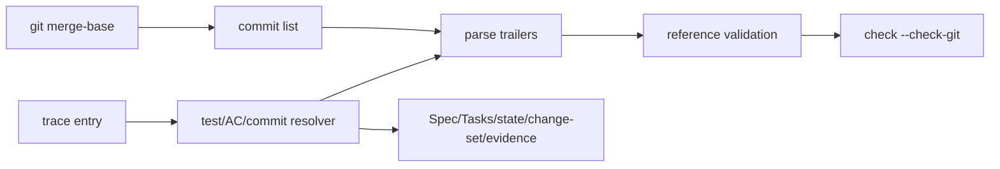

# 全量 commit 审计与 sdd trace 设计文档（Design）

## 1. 元数据

| 项 | 内容 |
|---|---|
| Spec ID | SPEC-REQ-005 |
| 关联Spec | `docs/specs/SPEC-REQ-005/spec.md` |
| 作者 | SDD Agent |
| 创建日期 | 2026-11-23 |
| 状态 | Draft |
| 评审人 | sdd-kit 平台维护者 |

## 2. 设计目标

- 把 `check --check-git` 从最近 20 条 commit 升级为 merge-base 至 HEAD 的全量审计。
- 统一单 commit trailer 规则与全量审计规则，避免 hook 与 CI 口径不一致。
- 提供只读 `sdd trace`，从 test/AC/commit 三入口输出完整交付链路。
- 保持 `sdd/scripts/sdd.py` 唯一状态机、trace 只读、历史 MERGED 兼容。

## 3. 方案概述

- 高层方案：新增 Git 只读解析层（merge-base、commit 列表、单 commit 解析），
  `check_git()` 逐 commit 调用同一校验函数；`trace` 复用该解析层与现有
  `parse_tasks()`、`scan_test_definitions()`、`parse_change_set()`、
  `verification-evidence.jsonl` 读取函数。
- 关键决策：
  1. merge-base 解析顺序为 `origin/main`、`main`、`master`；都失败则明确报错。
  2. 跳过 merge commit（父提交 >= 2）；普通 commit 必须且只能有一个 `Spec-Id`。
  3. 代码类型 `feat/fix/perf/hotfix` 必须有且只有一个 `Task-Id`；`docs` 不得有；
     其他类型允许 0 或 1 个。
  4. 每个 commit 按自身 `Spec-Id` 校验，不按当前检查的 Spec 校验，避免多 Spec 分支误报。
  5. `trace` 只读，不写 state/events/change-set；断链统一进入 `missing` 数组。
  6. 多个 Spec 命中同一 AC 时返回候选并标记 `ambiguous`，不猜测。
- 方案对比：
  - 继续用 `git log -20`：无法发现早期坏 commit，放弃。
  - 只校验当前 Spec：多 Spec 分支会产生错误归属，放弃。
  - trace 写缓存文件：违反只读要求，放弃。

## 4. Spec覆盖关系

| FR/AC | 设计章节/模块 | 实现方式 | 验证方式 |
|---|---|---|---|
| FR-001 / AC-001-1 | Git 范围 | `git_merge_base()` + `git_commits_since()` | 全量范围测试 |
| FR-001 / AC-001-2 | 早期坏 commit | 逐 commit 审计，不只取最近 20 | 25 条 commit 中间坏提交测试 |
| FR-001 / AC-001-3 | merge commit/无主干 | 跳过 merge commit；无 base 返回错误 | 负向测试 |
| FR-002 / AC-002-1 | Trailer 规则 | `parse_commit_trailers()` + 类型规则 | 代码 commit 测试 |
| FR-002 / AC-002-2 | 文档 commit | docs 带 Task-Id 即失败 | 负向测试 |
| FR-002 / AC-002-3 | 引用一致性 | Spec/Task/工作项存在性校验 | 负向测试 |
| FR-003 / AC-003-1 | trace test | 测试定义 -> AC -> Task -> Spec | trace 测试 |
| FR-003 / AC-003-2 | trace AC | AC -> Task -> 测试/commit/证据 | trace 测试 |
| FR-003 / AC-003-3 | trace commit | commit trailer -> Spec/Task/AC | trace 测试 |
| FR-003 / AC-003-4 | 断链 | `missing` 数组 | 缺失对象测试 |
| FR-003 / AC-003-5 | 只读/稳定 schema | 只读函数 + `schema=1` | 文件哈希前后对比 |
| FR-004 / AC-004-1 | 人工边界 | trace 只读，不新增人工动作 | CLI/MCP 边界测试 |
| FR-004 / AC-004-2 | 历史兼容 | MERGED Spec 跳过新审计 | `check --all` 回归 |
| FR-004 / AC-004-3 | 发布同步 | 版本、manifest、文档 | 全量测试与 CI |

## 5. 系统架构



模块职责：

- `sdd/scripts/sdd.py`：Git 解析、审计、trace 构建、CLI。
- `sdd/core.py`：`Workspace.trace()` 子进程调用。
- `sdd/cli.py`：暴露只读 `trace`。
- 现有 `parse_tasks()`、`scan_test_definitions()`、`parse_change_set()`、
  `load_verification_evidence()` 复用，不复制规则。

## 6. 数据模型

trace JSON（`schema=1`）：

```json
{
  "schema": 1,
  "kind": "trace",
  "ok": true,
  "entry": {"type": "test", "value": "..."},
  "spec": "SPEC-REQ-005",
  "task": "T-001",
  "acs": ["AC-001-1"],
  "feat": "FEAT-007",
  "work_item": "SDD-GOV-002",
  "prd": {"path": "docs/prd-index.md", "registered": true},
  "approval": {"approved": true, "digest_bound": true, "approved_by": "..."},
  "change_set": {"path": "...", "records": []},
  "commits": [{"sha": "...", "subject": "...", "spec_id": "...", "task_id": "..."}],
  "evidence": {"path": "...", "records": []},
  "missing": [{"link": "task", "detail": "..."}],
  "chain": [{"link": "test", "value": "..."}]
}
```

## 7. 接口契约

```powershell
python -m sdd trace --test tests.test_status.StatusTest#test_cancel_pending_order --json
python -m sdd trace --ac AC-001-1 --json
python -m sdd trace --commit abc1234 --json
```

只允许一个入口；多个入口同时提供时参数错误。所有入口输出同一 schema。

## 8. 认证、授权、幂等与安全

- trace 是只读命令，不需要 `--human`，也不属于人工动作。
- 不执行 shell 命令，仅调用只读 `git show/rev-list/merge-base`。
- 不允许 trace 写 state/events/change-set/verification。

## 9. 关键决策 ADR

| ID | 决策 | 原因 |
|---|---|---|
| ADR-001 | merge-base 优先 origin/main | CI 与本地都能对齐主干 |
| ADR-002 | 跳过 merge commit | GitHub 合并提交不带业务 trailer |
| ADR-003 | 按 commit 自身 Spec-Id 校验 | 支持一个分支包含多个 Spec |
| ADR-004 | trace 复用现有解析器 | 避免规则分叉 |
| ADR-005 | 多命中返回 ambiguous | 不猜测用户意图 |

## 10. 非功能需求设计

- 性能：一次 `git rev-list` 取全部 SHA，再逐条 `git show -s`；100 条以内可控。
- 可靠性：Git 命令失败返回结构化错误，不静默通过。
- 可维护性：单 commit 校验函数同时服务 `check_git` 与 `trace`。
- 兼容性：MERGED 历史 Spec 跳过新审计。

## 11. 依赖与风险

| 风险 | 影响 | 缓解 | 负责人 |
|---|---|---|---|
| 分支没有 main/master | 无法确定范围 | 明确错误并提示配置主干 | 平台维护者 |
| merge commit 无 trailer | 误报 | 跳过父提交 >= 2 的 commit | 平台维护者 |
| 多 Spec 共享 AC | trace 误归属 | 输出 ambiguous 候选 | 平台维护者 |
| trace 读取大量证据 | 变慢 | 只读单个 Spec 目录 | 平台维护者 |

## 12. 回滚方案

- 回滚条件：全量审计误伤历史分支或 trace 影响正常流程。
- 回滚步骤：回退本 Spec 相关 commit，恢复最近 20 条审计；不修改历史 commit。
- 数据回滚：无持久化数据变更。

## 13. 验收标准

| AC | 验证方式 | 证据 |
|---|---|---|
| AC-001-1..3 | commit 审计测试 | 单元测试 |
| AC-002-1..3 | trailer/引用测试 | 单元测试 |
| AC-003-1..5 | trace 三入口与断链 | 单元测试 |
| AC-004-1..3 | 边界、兼容、发布 | 单元测试 + CI |

## 14. 变更历史

| 日期 | 版本 | 变更内容 | 作者 |
|---|---|---|---|
| 2026-11-23 | 1.0.0 | 初始版本 | SDD Agent |
