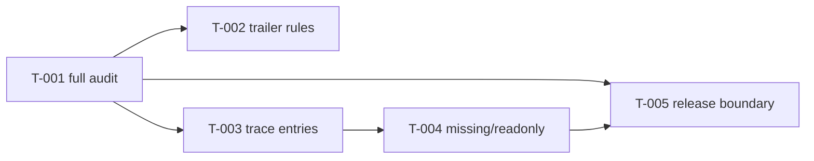

# 全量 commit 审计与 sdd trace 任务清单（Tasks）

## 1. 元数据

| 项 | 内容 |
|---|---|
| Spec ID | SPEC-REQ-005 |
| 关联Spec | `docs/specs/SPEC-REQ-005/spec.md` |
| 关联Design | `docs/specs/SPEC-REQ-005/design.md` |
| 作者 | SDD Agent |
| 创建日期 | 2026-11-23 |
| 状态 | Draft |

## 2. 任务清单

| Task ID | 任务描述 | 关联FR/AC | 依赖Task | 并行标识 | 验收标准 | 单元测试类/方法 | 单Task测试命令 | 状态 | Commit SHA |
|---|---|---|---|---|---|---|---|---|---|
| T-001 | 实现 merge-base 全量 commit 扫描与代码 commit trailer 校验 | FR-001；FR-002；AC-001-1；AC-001-2；AC-002-1 | None | S | 25 条 commit 中间坏提交被定位；代码 commit 缺 Task-Id 阻断 | `CommitAuditTests#test_early_bad_commit_is_found` | `python -m unittest tests.test_trace.CommitAuditTests -v` | Done | cd5c7ff |
| T-002 | 实现 docs/其它类型规则、引用存在性与 merge-base 缺失错误 | FR-001；FR-002；AC-001-3；AC-002-2；AC-002-3 | T-001 | S | docs 带 Task-Id 阻断；无主干明确报错；引用对象可校验 | `CommitAuditTests#test_docs_commit_with_task_id_blocks` | `python -m unittest tests.test_trace.CommitAuditTests -v` | Done | 4645ef6 |
| T-003 | 实现 trace test/AC/commit 三入口与完整链路 JSON | FR-003；AC-003-1；AC-003-2；AC-003-3 | T-001 | S | 三入口输出同一 schema 与完整链路 | `TraceTests#test_trace_by_test_ac_and_commit` | `python -m unittest tests.test_trace.TraceTests -v` | Done | c4b282c |
| T-004 | 实现断链 missing、多命中/只读保护 | FR-003；AC-003-4；AC-003-5 | T-003 | S | 缺失对象进入 missing；文件哈希前后不变 | `TraceTests#test_trace_reports_missing_link` | `python -m unittest tests.test_trace.TraceTests -v` | Done | 46310ed |
| T-005 | 同步 CLI/文档/版本/manifest，兼容历史并修复 PRD 行落点 | FR-004；AC-004-1；AC-004-2；AC-004-3 | T-001,T-004 | S | trace 只读；MERGED 兼容；发布元数据一致 | `PrdIndexPlacementTests#test_new_spec_row_goes_into_main_table` | `python -m unittest tests.test_trace.PrdIndexPlacementTests -v` | Todo | — |

字段规则：

- Task ID 采用 `T-xxx`，在当前 Spec 内唯一。
- 状态仅允许 `Todo`、`In Progress`、`Done`。
- 并行标识仅允许 `P` 或 `S`；依赖为空时必须填写 `None`。
- 一个 Task 必须对应一个最终本地代码 Commit；创建 Commit 后回填真实 Commit SHA。

## 3. AC—Task—单元测试映射

| AC ID | 覆盖Task | 测试类/方法 | 测试命令/选择器 | 预期结果 | Gate 4实际结果 |
|---|---|---|---|---|---|
| AC-001-1 | T-001 | `CommitAuditTests#test_early_bad_commit_is_found` | `python -m unittest tests.test_trace.CommitAuditTests.test_early_bad_commit_is_found -v` | merge-base 后全部 commit 被扫描 | 未执行 |
| AC-001-2 | T-001 | `CommitAuditTests#test_early_bad_commit_is_found` | `python -m unittest tests.test_trace.CommitAuditTests.test_early_bad_commit_is_found -v` | 第 25 条中的早期坏 commit 被定位 | 未执行 |
| AC-001-3 | T-002 | `CommitAuditTests#test_missing_merge_base_reports_error` | `python -m unittest tests.test_trace.CommitAuditTests.test_missing_merge_base_reports_error -v` | merge commit 跳过；无主干报错 | 未执行 |
| AC-002-1 | T-001 | `CommitAuditTests#test_early_bad_commit_is_found` | `python -m unittest tests.test_trace.CommitAuditTests.test_early_bad_commit_is_found -v` | 代码 commit 必须恰好一个 Task-Id | 未执行 |
| AC-002-2 | T-002 | `CommitAuditTests#test_docs_commit_with_task_id_blocks` | `python -m unittest tests.test_trace.CommitAuditTests.test_docs_commit_with_task_id_blocks -v` | docs 带 Task-Id 阻断 | 未执行 |
| AC-002-3 | T-002 | `CommitAuditTests#test_docs_commit_with_task_id_blocks` | `python -m unittest tests.test_trace.CommitAuditTests -v` | Spec/Task/工作项引用可校验 | 未执行 |
| AC-003-1 | T-003 | `TraceTests#test_trace_by_test_ac_and_commit` | `python -m unittest tests.test_trace.TraceTests.test_trace_by_test_ac_and_commit -v` | trace --test 输出完整链路 | 未执行 |
| AC-003-2 | T-003 | `TraceTests#test_trace_by_test_ac_and_commit` | `python -m unittest tests.test_trace.TraceTests.test_trace_by_test_ac_and_commit -v` | trace --ac 输出完整链路 | 未执行 |
| AC-003-3 | T-003 | `TraceTests#test_trace_by_test_ac_and_commit` | `python -m unittest tests.test_trace.TraceTests.test_trace_by_test_ac_and_commit -v` | trace --commit 输出完整链路 | 未执行 |
| AC-003-4 | T-004 | `TraceTests#test_trace_reports_missing_link` | `python -m unittest tests.test_trace.TraceTests.test_trace_reports_missing_link -v` | 断链进入 missing | 未执行 |
| AC-003-5 | T-004 | `TraceTests#test_trace_is_read_only` | `python -m unittest tests.test_trace.TraceTests.test_trace_is_read_only -v` | trace 不修改任何文件 | 未执行 |
| AC-004-1 | T-005 | `TraceTests#test_trace_by_test_ac_and_commit` | `python -m unittest tests.test_trace.TraceTests -v` | trace 只读，不新增人工动作 | 未执行 |
| AC-004-2 | T-005 | `PrdIndexPlacementTests#test_new_spec_row_goes_into_main_table` | `python -m unittest tests.test_trace.PrdIndexPlacementTests -v` | PRD 行落点正确，历史兼容 | 未执行 |
| AC-004-3 | T-005 | `PrdIndexPlacementTests#test_new_spec_row_goes_into_main_table` | `python -m unittest tests.test_trace -v` | 版本、manifest、文档与 CI 一致 | 未执行 |

## 4. 依赖图

## 5. 实施与提交顺序

1. T-001：Git 范围、commit 解析与代码 trailer 校验。
2. T-002：docs/其它类型规则、引用一致性与无 merge-base 错误。
3. T-003：trace 三入口与完整链路。
4. T-004：断链、多命中与只读保护。
5. T-005：CLI/文档/版本/manifest、历史兼容与 PRD 落点修复。

## 6. 全量单元测试记录

| 命令 | 退出码 | 通过 | 跳过 | 失败 | 错误 | 结果 |
|---|---|---|---|---|---|---|
| `python -m unittest discover -s tests -v` | 待执行 | 待执行 | 待执行 | 0 | 0 | 待执行 |

## 7. 自检清单

- [x] 任务覆盖全部 FR/AC。
- [x] 每个 Task 有可定位测试和单 Task 命令。
- [x] 依赖图无环。
- [x] trace 保持只读，不新增人工动作。

## 8. 变更历史

| 日期 | 版本 | 变更内容 | 作者 |
|---|---|---|---|
| 2026-11-23 | 1.0.0 | 初始版本 | SDD Agent |
