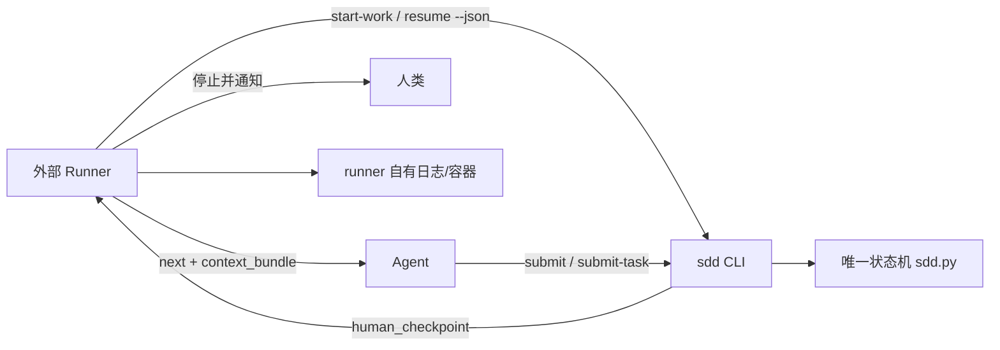

# 外部 runner 接入契约设计文档（Design）

## 1. 元数据

| 项 | 内容 |
|---|---|
| Spec ID | SPEC-REQ-006 |
| 关联Spec | `docs/specs/SPEC-REQ-006/spec.md` |
| 作者 | SDD Agent |
| 创建日期 | 2026-11-24 |
| 状态 | Draft |
| 评审人 | sdd-kit 平台维护者 |

## 2. 设计目标

- 核心问题：外部 runner 只能从 `sdd/agent-contract.md` 推断调用顺序，缺少一份
  面向 harness 的契约，容易自造阶段规则、跳过人工检查点或把容器职责塞进核心。
- 设计范围：新增 `deploy/runner/CONTRACT.md`，定义七阶段生命周期、四类返回语义、
  人工动作禁止清单、runner 自有职责、最小命令序列，并提供入口链接与一致性测试。
- 非设计范围：不实现 runner、不接 CI 厂商、不改状态机、不新增 MCP 工具、
  不修改 `next` JSON schema、不触碰受保护核心文件。

## 3. 方案概述

- 高层方案：契约文档作为唯一入口，按“准备 -> 启动 -> 读取 -> 执行 -> 提交 ->
  检查点 -> 归档”线性组织；每一步只引用现有 CLI 和 `next` 字段，不复制
  Gate 规则，也不定义第二套状态枚举。
- 关键决策：
  1. 契约只描述 runner 如何消费 CLI 输出，阶段名称、`next.action` 和检查点判断
     全部以 `sdd resume --json` 返回值为准。
  2. 用一张“返回类型 -> runner 行为 -> 退出语义”表格覆盖成功、`ok=false`、
     `decision_required`、`awaiting_human_approval` 四类结果。
  3. 人工动作边界以显式清单列出六个命令，并引用 `sdd/agent-block.md` 的托管规则。
  4. Docker、沙箱、网络、密钥、资源限制和日志归档明确归 runner，核心只提供
     Python 标准库 CLI。
  5. 示例使用 `sdd start-work`、`sdd resume`、`sdd submit`、`sdd submit-task`、
     `sdd complete`，不出现内部模块调用。
  6. 文档一致性测试直接读取 Markdown，断言章节、关键词和命令存在，避免契约漂移。
- 方案对比：
  - 把契约写进 `sdd/agent-contract.md`：该文件面向 Agent 且受 manifest 保护，
    每次改文档都要升版本，职责也不匹配，放弃。
  - 生成 HTML 或站点页面：离线不可评审，且与 issue 要求的 Markdown 契约不符，放弃。
  - 只写 README 段落：无法承载失败语义和伪代码，放弃。

## 4. Spec覆盖关系

| FR/AC | 设计章节/模块 | 实现方式 | 验证方式 |
|---|---|---|---|
| FR-001 / AC-001-1 | 契约生命周期 | `deploy/runner/CONTRACT.md` 使用七个二级章节 | `ContractDocumentTests#test_contract_has_required_phases` |
| FR-001 / AC-001-2 | 阶段命令与输出 | 每阶段列出命令、输入、期望输出、失败处理 | `ContractDocumentTests#test_contract_maps_each_phase_to_cli` |
| FR-001 / AC-001-3 | 示例命令 | 提供 PowerShell 命令序列，只使用公开 CLI | `ContractDocumentTests#test_examples_use_public_cli_only` |
| FR-002 / AC-002-1 | 失败语义 | 四类返回表格与退出语义小节 | `ContractDocumentTests#test_contract_covers_result_states` |
| FR-002 / AC-002-2 | 人工边界 | 六个人工命令禁止清单与停机通知要求 | `ContractDocumentTests#test_contract_forbids_human_actions` |
| FR-002 / AC-002-3 | 职责边界 | Runner 职责小节列出容器、沙箱、日志、资源 | `ContractDocumentTests#test_contract_assigns_runtime_to_runner` |
| FR-003 / AC-003-1 | 入口链接 | `README.md` 与 `sdd/README.md` 增加链接 | `EntryPointTests#test_readme_links_runner_contract` |
| FR-003 / AC-003-2 | 边界回归 | 不修改 `sdd/scripts/sdd.py` 与 MCP 工具清单 | `ReleaseBoundaryTests#test_mcp_exposes_no_human_actions` + `verify-core` |
| FR-003 / AC-003-3 | 发布一致性 | 不触碰受保护文件；manifest 与 VERSION 保持有效 | `ReleaseBoundaryTests#test_manifest_and_version_consistent` + `verify-core` |

## 5. 系统架构

### 5.1 架构图



### 5.2 模块职责

- `deploy/runner/CONTRACT.md`：面向 harness 的接入契约，唯一新增运行时文档。
- `README.md`、`sdd/README.md`：文档入口，不复制契约正文。
- `tests/test_runner_contract.py`：读取契约 Markdown 做结构断言，并回归 MCP 边界。
- `sdd/scripts/sdd.py`、`sdd/mcp/`：不修改，继续作为唯一状态机与薄适配器。

## 6. 数据模型

不涉及。契约只消费现有 `next`、`human_checkpoint`、`autopilot`、`inbox` JSON，
不新增字段、数据库或持久化格式。

## 7. 接口契约

### 7.1 文档契约

`deploy/runner/CONTRACT.md` 固定包含：

1. `## 1. 准备隔离工作区`
2. `## 2. 启动或恢复工作项`
3. `## 3. 读取 next`
4. `## 4. 运行 Agent`
5. `## 5. 提交阶段产物与任务证据`
6. `## 6. 处理人工检查点`
7. `## 7. 归档运行证据`
8. `## 8. 返回类型与退出语义`
9. `## 9. Runner 职责与禁止动作`
10. `## 10. 最小命令序列`

### 7.2 命令接口

契约只允许引用：

```powershell
python -m sdd start-work --work-item <id> --issue-url <url> --json
python -m sdd resume --json
python -m sdd submit --artifact <name> --file <path> --json
python -m sdd submit-task --task <T-xxx> --evidence "<text>" --json
python -m sdd complete --evidence "<text>" --json
python -m sdd events --spec <spec> --json
```

## 8. 认证、授权、幂等与安全

- Runner 不持有也不伪造人工身份；`approve`、`reapprove`、`merge`、`unblock`、
  `rewind`、`waive` 只能由人在本地执行。
- `ok=false` 必须回到 Agent 修复，不允许 runner 自行改写 state 或事件。
- 契约明确日志中不得写入密钥、令牌和完整环境变量。
- 重复提交同一产物由 CLI 幂等校验，runner 只负责按错误重试。

## 9. 关键决策 ADR

| ID | 决策 | 原因 | 后果 |
|---|---|---|---|
| ADR-001 | 契约独立于 `sdd/agent-contract.md` | Agent 与 runner 职责不同，且核心文档受 manifest 保护 | 新增文档入口，不改核心 |
| ADR-002 | 退出语义由 runner 定义 | 核心 CLI 只返回 JSON，不绑定进程退出码 | 各 harness 可映射到自身平台 |
| ADR-003 | 用 Markdown 结构测试防漂移 | 无第三方依赖，离线可跑 | 改契约需同步测试 |
| ADR-004 | 不修改受保护核心 | 本需求是文档契约 | 无需升版本或重生成 manifest |

## 10. 非功能需求设计

- 可读性：契约不超过约 200 行，七阶段每段只讲一个动作。
- 一致性：命令与 `sdd --help`、`agent-contract.md` 保持同名同序。
- 可测试性：所有断言基于文本结构，不启动容器、不访问网络。
- 兼容性：不改变任何 CLI 行为，现有仓库升级后无需迁移。

## 11. 依赖与风险

| 风险 | 影响 | 缓解 | 负责人 |
|---|---|---|---|
| 契约与 CLI 后续演进不一致 | runner 按旧顺序调用失败 | 文档测试断言关键命令；改 CLI 时同步契约 | 平台维护者 |
| 读者把契约当第二套状态机 | 出现自造阶段判断 | 每阶段强调以 `next` 为准，禁止硬编码状态 | 平台维护者 |
| 示例复制到 Windows 以外环境 | 命令不可执行 | 注明 PowerShell 与等价 shell 的替换方式 | 平台维护者 |
| 文档膨胀成 runner 实现教程 | 维护成本上升 | 明确非目标，容器细节只列职责不展开 | 平台维护者 |

## 12. 回滚方案

- 回滚条件：契约误导 runner 或与 CLI 冲突。
- 回滚步骤：回退本 Spec 相关 commit，删除 `deploy/runner/CONTRACT.md` 与入口链接。
- 数据回滚：不涉及；无 state、事件或 manifest 变更。
- 配置回滚：不涉及。

## 13. 验收标准

| AC | 验证方式 | 证据 |
|---|---|---|
| AC-001-1 | 七阶段章节断言 | 单元测试 |
| AC-001-2 | 阶段命令映射断言 | 单元测试 |
| AC-001-3 | 公开 CLI 白名单断言 | 单元测试 |
| AC-002-1 | 四类返回语义断言 | 单元测试 |
| AC-002-2 | 人工动作禁止清单断言 | 单元测试 |
| AC-002-3 | runner 职责断言 | 单元测试 |
| AC-003-1 | README 链接断言 | 单元测试 |
| AC-003-2 | MCP 工具清单回归 | 单元测试 + `verify-core` |
| AC-003-3 | manifest/VERSION 一致性 | 单元测试 + `verify-core` |

## 14. 变更历史

| 日期 | 版本 | 变更内容 | 作者 |
|---|---|---|---|
| 2026-11-24 | 1.0.0 | 初始版本 | SDD Agent |
