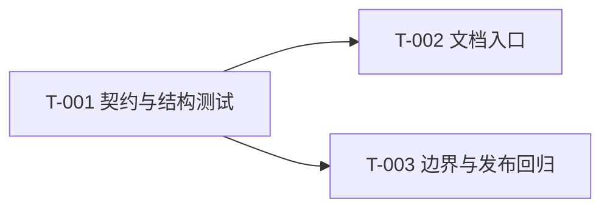

# 外部 runner 接入契约任务清单（Tasks）

## 1. 元数据

| 项 | 内容 |
|---|---|
| Spec ID | SPEC-REQ-006 |
| 关联Spec | `docs/specs/SPEC-REQ-006/spec.md` |
| 关联Design | `docs/specs/SPEC-REQ-006/design.md` |
| 作者 | SDD Agent |
| 创建日期 | 2026-11-24 |
| 状态 | Draft |

## 2. 任务清单

| Task ID | 任务描述 | 关联FR/AC | 依赖Task | 并行标识 | 验收标准 | 单元测试类/方法 | 单Task测试命令 | 状态 | Commit SHA |
|---|---|---|---|---|---|---|---|---|---|
| T-001 | 编写 `deploy/runner/CONTRACT.md` 七阶段契约、失败语义、人工边界、职责与示例，并新增结构测试 | FR-001；FR-002；AC-001-1；AC-001-2；AC-001-3；AC-002-1；AC-002-2；AC-002-3 | None | S | 七阶段齐全；四类返回语义齐全；六个人工命令被禁止；示例只用公开 CLI | `ContractDocumentTests#test_contract_has_required_phases` | `python -m unittest tests.test_runner_contract.ContractDocumentTests -v` | Todo | - |
| T-002 | 在 `README.md` 与 `sdd/README.md` 增加契约入口，并新增入口链接测试 | FR-003；AC-003-1 | T-001 | S | 两处文档都能链接到契约文件 | `EntryPointTests#test_readme_links_runner_contract` | `python -m unittest tests.test_runner_contract.EntryPointTests -v` | Todo | - |
| T-003 | 回归 MCP 人工动作边界与发布元数据一致性，确认未修改受保护核心 | FR-003；AC-003-2；AC-003-3 | T-001 | S | MCP 无人工动作；manifest 与 VERSION 一致；`verify-core` 通过 | `ReleaseBoundaryTests#test_mcp_exposes_no_human_actions` | `python -m unittest tests.test_runner_contract.ReleaseBoundaryTests tests.test_sdd.GateBoundaryTests -v` | Todo | - |

字段规则：

- Task ID 采用 `T-xxx`，在当前 Spec 内唯一。
- 状态仅允许 `Todo`、`In Progress`、`Done`。
- 并行标识仅允许 `P` 或 `S`；依赖为空时必须填写 `None`。
- 一个 Task 必须对应一个最终本地代码 Commit；创建 Commit 后回填真实 Commit SHA。

## 3. AC—Task—单元测试映射

| AC ID | 覆盖Task | 测试类/方法 | 测试命令/选择器 | 预期结果 | Gate 4实际结果 |
|---|---|---|---|---|---|
| AC-001-1 | T-001 | `ContractDocumentTests#test_contract_has_required_phases` | `python -m unittest tests.test_runner_contract.ContractDocumentTests.test_contract_has_required_phases -v` | 七个阶段标题齐全 | 未执行 |
| AC-001-2 | T-001 | `ContractDocumentTests#test_contract_maps_each_phase_to_cli` | `python -m unittest tests.test_runner_contract.ContractDocumentTests.test_contract_maps_each_phase_to_cli -v` | 每阶段都有命令、输入、输出、失败处理 | 未执行 |
| AC-001-3 | T-001 | `ContractDocumentTests#test_examples_use_public_cli_only` | `python -m unittest tests.test_runner_contract.ContractDocumentTests.test_examples_use_public_cli_only -v` | 示例只用公开 CLI | 未执行 |
| AC-002-1 | T-001 | `ContractDocumentTests#test_contract_covers_result_states` | `python -m unittest tests.test_runner_contract.ContractDocumentTests.test_contract_covers_result_states -v` | 四类返回都有处理方式 | 未执行 |
| AC-002-2 | T-001 | `ContractDocumentTests#test_contract_forbids_human_actions` | `python -m unittest tests.test_runner_contract.ContractDocumentTests.test_contract_forbids_human_actions -v` | 六个人工命令被禁止 | 未执行 |
| AC-002-3 | T-001 | `ContractDocumentTests#test_contract_assigns_runtime_to_runner` | `python -m unittest tests.test_runner_contract.ContractDocumentTests.test_contract_assigns_runtime_to_runner -v` | 容器/沙箱/日志归 runner | 未执行 |
| AC-003-1 | T-002 | `EntryPointTests#test_readme_links_runner_contract` | `python -m unittest tests.test_runner_contract.EntryPointTests.test_readme_links_runner_contract -v` | README 与执行手册均有链接 | 未执行 |
| AC-003-2 | T-003 | `ReleaseBoundaryTests#test_mcp_exposes_no_human_actions` | `python -m unittest tests.test_runner_contract.ReleaseBoundaryTests.test_mcp_exposes_no_human_actions -v` | MCP 无人工动作 | 未执行 |
| AC-003-3 | T-003 | `GateBoundaryTests#test_release_metadata_and_ci_contract` | `python -m unittest tests.test_sdd.GateBoundaryTests.test_release_metadata_and_ci_contract -v` | manifest 与 VERSION 一致 | 未执行 |

## 4. 依赖图

## 5. 实施与提交顺序

1. T-001：先写结构测试，再写 `deploy/runner/CONTRACT.md`，跑 `ContractDocumentTests`。
2. T-002：补两处入口链接，跑 `EntryPointTests`。
3. T-003：补 MCP 边界测试并跑发布元数据回归，执行 `verify-core`。
4. 每个 Task 完成后用 `sdd submit-task` 记录证据和 Commit SHA。

## 6. 全量单元测试记录

| 命令 | 作用域 | 退出码 | 时间 | 备注 |
|---|---|---|---|---|
| `python -m unittest tests.test_runner_contract -v` | 契约测试 | 未执行 | - | G4 回填 |
| `python -m unittest discover -s tests -v` | 全量测试 | 未执行 | - | G5 回填 |

## 7. 自检清单

- [x] Task ID 唯一，依赖与并行标识合法。
- [x] 每条 AC 都有 Task 和测试映射。
- [x] 每个 Task 都有可执行的单 Task 测试命令。
- [x] 依赖图 Mermaid 与任务顺序一致。
- [x] 不修改状态机与 MCP 工具实现。

## 8. 变更历史

| 日期 | 版本 | 变更内容 | 作者 |
|---|---|---|---|
| 2026-11-24 | 1.0.0 | 初始版本 | SDD Agent |
