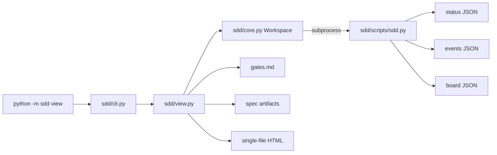

# 只读 sdd view HTML 运行视图设计文档（Design）

## 1. 元数据

| 项 | 内容 |
|---|---|
| Spec ID | SPEC-REQ-007 |
| 关联Spec | `docs/specs/SPEC-REQ-007/spec.md` |
| 作者 | SDD Agent |
| 创建日期 | 2026-11-24 |
| 状态 | Draft |
| 评审人 | sdd-kit 平台维护者 |

## 2. 设计目标

- 核心问题：`sdd board` 只有文本/JSON，缺少可离线分享的运行视图，排查和评审时
  需要在多个命令之间来回切换。
- 设计范围：新增 `sdd view`，把 status、events、board、Gate 记录和 Spec 工件
  汇总成单文件 HTML；只读、无脚本、无外部资源。
- 非设计范围：Web 服务、前端构建、JavaScript、拖拽编辑、审批执行和 MCP 写工具。

## 3. 方案概述

- 高层方案：新增 `sdd/view.py` 渲染模块，`sdd/cli.py` 注册 `view` 子命令。
  渲染器通过 `Workspace` 调用现有 `status`、`events`、`board` JSON，读取
  `gates.md` 表格和 Spec 目录文件列表，拼接 HTML 字符串后写入 `--out`。
- 关键决策：
  1. 数据获取全部复用 `Workspace`（内部子进程调用状态机），不导入 Gate 规则。
  2. `board` JSON 增加只读字段 `commit`、`test`，避免视图重复解析 tasks.md。
  3. Gate 表从 `gates.md` 的固定表头解析，产物哈希来自 `status.state.artifact_hashes`。
  4. HTML 使用一个内联 `<style>`，无 `<script>`、无 `<link>`、无 `src` 外链。
  5. 所有动态文本经 `html.escape()`；工件链接用 `os.path.relpath` 从输出文件计算。
  6. 默认输出 `.sdd/runtime/view/<spec>.html`，父目录不存在时创建。
  7. `sdd/view.py` 加入受保护文件清单，版本升到 0.9.8 并重写 manifest。
- 方案对比：
  - 在 `sdd/scripts/sdd.py` 内直接渲染 HTML：把展示逻辑塞进状态机，放弃。
  - 引入 Jinja2 或前端框架：违反标准库与离线约束，放弃。
  - 用 JavaScript 动态加载 JSON：离线打开受浏览器安全限制，放弃。

## 4. Spec覆盖关系

| FR/AC | 设计章节/模块 | 实现方式 | 验证方式 |
|---|---|---|---|
| FR-001 / AC-001-1 | 视图渲染 | `render_html()` 输出五个区块 | `ViewRenderTests#test_view_contains_all_sections` |
| FR-001 / AC-001-2 | 默认输出 | `write_view()` 计算默认路径并建目录 | `ViewRenderTests#test_view_default_output_path` |
| FR-001 / AC-001-3 | 空态 | 无事件/无 Gate/无 Task 时输出空态段落 | `ViewRenderTests#test_view_empty_spec_renders_empty_states` |
| FR-002 / AC-002-1 | 只读性 | 只写 `--out` 文件 | `ViewReadOnlyTests#test_view_does_not_change_audit_files` |
| FR-002 / AC-002-2 | 时间线 | 遍历 events JSON，渲染 seq/at/event/from/to/evidence | `ViewTimelineTests#test_view_shows_rewind_event` |
| FR-002 / AC-002-3 | 数据来源 | 仅用 Workspace JSON + gates.md | `ViewBoundaryTests#test_view_does_not_import_state_machine_rules` |
| FR-003 / AC-003-1 | 错误处理 | Spec 不存在/非法 out 时抛错，不落盘 | `ViewBoundaryTests#test_view_rejects_missing_spec_and_bad_out` |
| FR-003 / AC-003-2 | 安全转义 | 全部动态文本 `html.escape`，无脚本标签 | `ViewBoundaryTests#test_view_escapes_html_and_has_no_script` |
| FR-003 / AC-003-3 | 发布同步 | 版本、manifest、README、契约同步 | `ReleaseMetadataTests#test_view_release_metadata` + `verify-core` |

## 5. 系统架构

### 5.1 架构图



### 5.2 模块职责

- `sdd/view.py`：数据收集编排、Markdown Gate 表解析、HTML 渲染与文件写入。
- `sdd/cli.py`：注册 `view` 参数并输出结果，不包含渲染逻辑。
- `sdd/core.py`：`Workspace` 继续通过子进程调用状态机；仅新增 `view_data` 所需的
  只读方法（如无必要则复用现有 status/events/board）。
- `sdd/scripts/sdd.py`：只给 `board` JSON 增加 `commit`、`test` 字段，不改状态规则。

## 6. 数据模型

### 6.1 视图输入

| 数据 | 来源 | 用途 |
|---|---|---|
| `state` | `status --json` | 头部：Spec、标题、状态、工作流、风险、PR URL、issue |
| `events` | `events --spec --json` | 时间线 |
| `tasks` | `board --json` | Task 表（id、描述、状态、AC、commit、test） |
| `gates.md` 表 | Spec 目录 | Gate 表（Gate/State/Mode/Result/Evidence/At） |
| `artifact_hashes` | `status.state.artifact_hashes` | Gate 产物哈希 |
| Spec 目录文件 | 文件系统只读列举 | 工件列表 |

### 6.2 输出

- 单个 HTML 文件，UTF-8 编码。
- 默认路径 `.sdd/runtime/view/<spec>.html`；`.sdd/runtime/` 已在 `.gitignore`。
- `--json` 返回：`ok`、`kind=view`、`spec`、`out`、`bytes`、`sections`。

## 7. 接口契约

### 7.1 CLI

```powershell
python -m sdd view --spec SPEC-REQ-007
python -m sdd view --spec SPEC-REQ-007 --out .sdd/runtime/view/spec-007.html
python -m sdd view --spec SPEC-REQ-007 --json
```

### 7.2 HTML 区块

| 区块 | 内容 |
|---|---|
| Header | 标题、Spec、状态、工作流、风险、Issue、PR URL |
| Timeline | 事件序号、时间、事件名、from/to、证据 |
| Gates | Gate、State、Mode、Result、Evidence、产物哈希前 12 位 |
| Tasks | Task、描述、状态、AC、Commit |
| Artifacts | Spec 目录文件名与相对链接 |

## 8. 认证、授权、幂等与安全

- `view` 是只读命令，不接受 `--human`，不执行任何状态迁移。
- 输出路径由用户显式指定；写入前只创建父目录，不删除或覆盖审计目录。
- HTML 转义所有动态值；不使用 `innerHTML`、脚本或事件处理器。
- 不读取环境变量中的密钥；不发起网络请求。
- 重复执行幂等：相同输入生成相同 HTML（生成时间除外）。

## 9. 关键决策 ADR

| ID | 决策 | 原因 | 后果 |
|---|---|---|---|
| ADR-001 | 新增独立 `sdd/view.py` | 保持状态机与展示逻辑分离 | 需加入受保护文件清单 |
| ADR-002 | 扩展 board JSON 的 commit/test | 避免视图重复解析 tasks.md | board 输出向后兼容 |
| ADR-003 | 纯字符串模板 + 内联 CSS | 无依赖、离线可开 | 复杂交互不在范围内 |
| ADR-004 | 默认输出到 `.sdd/runtime/view/` | 运行产物不进入 Spec 审计目录 | 用户仍可指定其他路径 |
| ADR-005 | 只展示，不执行 | 人工动作边界不可绕过 | 页面无按钮和表单 |

## 10. 非功能需求设计

- 性能：单 Spec 读取与渲染在 1 秒内完成；事件全量渲染，不做分页。
- 可靠性：Gate 表解析失败时显示告警行而不是中断；损坏事件行跳过并标注。
- 可维护性：渲染函数纯输入/输出，CLI 只做参数转换。
- 可访问性：语义化 `header/main/section/table`，表格可横向滚动。
- 兼容性：只用标准库；Python 3.9+。

## 11. 依赖与风险

| 风险 | 影响 | 缓解 | 负责人 |
|---|---|---|---|
| Gate 表格式变化 | 页面缺行 | 按表头解析并对缺列给出告警 | 平台维护者 |
| 事件文件很大 | 页面体积过大 | 只渲染文本，不嵌资源；后续可加分页 | 平台维护者 |
| HTML 注入 | XSS 或页面破坏 | 统一转义并测试 `<script>` 输入 | 平台维护者 |
| 输出路径指向审计文件 | 覆盖 state/events | 默认路径限定 `.sdd/runtime`，显式路径由用户负责 | 平台维护者 |
| board 字段变更 | Task 表缺 commit | 加入兼容测试并保持字段可选 | 平台维护者 |

## 12. 回滚方案

- 回滚条件：视图命令影响只读性、破坏审计文件或 CI 失败。
- 回滚步骤：回退本 Spec 相关 commit，删除 `sdd/view.py` 与 CLI 注册。
- 数据回滚：不涉及；视图不写审计数据。
- 配置回滚：版本与 manifest 随 commit 一并回退。

## 13. 验收标准

| AC | 验证方式 | 证据 |
|---|---|---|
| AC-001-1 | 五区块存在断言 | 单元测试 |
| AC-001-2 | 默认路径与目录创建 | 单元测试 |
| AC-001-3 | 空 Spec 空态 | 单元测试 |
| AC-002-1 | 审计文件哈希不变 | 单元测试 |
| AC-002-2 | rewind 事件出现在时间线 | 单元测试 |
| AC-002-3 | 数据来源与 MCP 边界 | 单元测试 + 人工评审 |
| AC-003-1 | 缺失 Spec/非法路径 | 单元测试 |
| AC-003-2 | HTML 转义与无脚本 | 单元测试 |
| AC-003-3 | 版本/manifest/文档 | 单元测试 + `verify-core` |

## 14. 变更历史

| 日期 | 版本 | 变更内容 | 作者 |
|---|---|---|---|
| 2026-11-24 | 1.0.0 | 初始版本 | SDD Agent |
