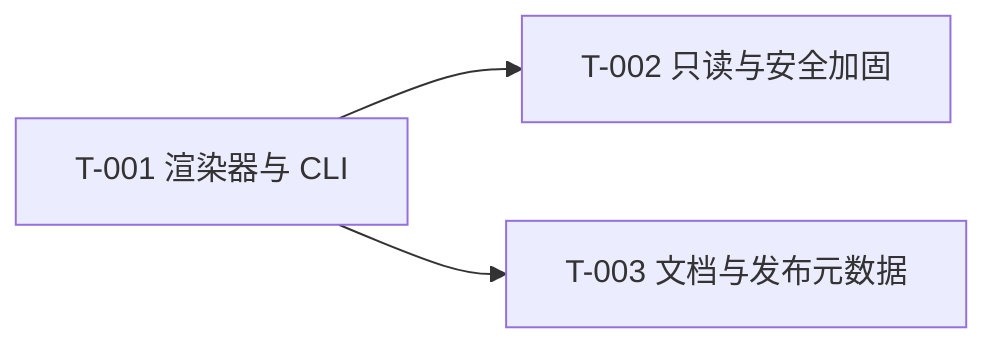

# 只读 sdd view HTML 运行视图任务清单（Tasks）

## 1. 元数据

| 项 | 内容 |
|---|---|
| Spec ID | SPEC-REQ-007 |
| 关联Spec | `docs/specs/SPEC-REQ-007/spec.md` |
| 关联Design | `docs/specs/SPEC-REQ-007/design.md` |
| 作者 | SDD Agent |
| 创建日期 | 2026-11-24 |
| 状态 | Draft |

## 2. 任务清单

| Task ID | 任务描述 | 关联FR/AC | 依赖Task | 并行标识 | 验收标准 | 单元测试类/方法 | 单Task测试命令 | 状态 | Commit SHA |
|---|---|---|---|---|---|---|---|---|---|
| T-001 | 新增 `sdd/view.py` 渲染器、`sdd view` CLI 与 board 的 commit/test 字段 | FR-001；FR-002；AC-001-1；AC-001-2；AC-001-3；AC-002-2 | None | S | 生成五区块 HTML；默认路径可写；空态与 rewind 时间线正确 | `ViewRenderTests#test_view_contains_all_sections` | `python -m unittest tests.test_view.ViewRenderTests tests.test_view.ViewTimelineTests -v` | Todo | - |
| T-002 | 加固只读性、HTML 转义、错误路径与数据来源边界 | FR-002；FR-003；AC-002-1；AC-002-3；AC-003-1；AC-003-2 | T-001 | S | 审计文件不变；脚本被转义；缺失 Spec/非法路径失败且不落盘 | `ViewReadOnlyTests#test_view_does_not_change_audit_files` | `python -m unittest tests.test_view.ViewReadOnlyTests tests.test_view.ViewBoundaryTests -v` | Todo | - |
| T-003 | 同步 README、执行手册、Agent 契约、版本与 manifest | FR-003；AC-003-3 | T-001 | S | 版本 0.9.8；manifest 含 sdd/view.py；文档有三处入口 | `ReleaseMetadataTests#test_view_release_metadata` | `python -m unittest tests.test_view.ReleaseMetadataTests -v` | Todo | - |

字段规则：

- Task ID 采用 `T-xxx`，在当前 Spec 内唯一。
- 状态仅允许 `Todo`、`In Progress`、`Done`。
- 并行标识仅允许 `P` 或 `S`；依赖为空时必须填写 `None`。
- 一个 Task 必须对应一个最终本地代码 Commit；创建 Commit 后回填真实 Commit SHA。

## 3. AC—Task—单元测试映射

| AC ID | 覆盖Task | 测试类/方法 | 测试命令/选择器 | 预期结果 | Gate 4实际结果 |
|---|---|---|---|---|---|
| AC-001-1 | T-001 | `ViewRenderTests#test_view_contains_all_sections` | `python -m unittest tests.test_view.ViewRenderTests.test_view_contains_all_sections -v` | 五个区块齐全 | 未执行 |
| AC-001-2 | T-001 | `ViewRenderTests#test_view_default_output_path` | `python -m unittest tests.test_view.ViewRenderTests.test_view_default_output_path -v` | 默认路径与目录创建 | 未执行 |
| AC-001-3 | T-001 | `ViewRenderTests#test_view_empty_spec_renders_empty_states` | `python -m unittest tests.test_view.ViewRenderTests.test_view_empty_spec_renders_empty_states -v` | 空 Spec 有空态 | 未执行 |
| AC-002-1 | T-002 | `ViewReadOnlyTests#test_view_does_not_change_audit_files` | `python -m unittest tests.test_view.ViewReadOnlyTests.test_view_does_not_change_audit_files -v` | 审计文件哈希不变 | 未执行 |
| AC-002-2 | T-001 | `ViewTimelineTests#test_view_shows_rewind_event` | `python -m unittest tests.test_view.ViewTimelineTests.test_view_shows_rewind_event -v` | rewind 事件可见 | 未执行 |
| AC-002-3 | T-002 | `ViewBoundaryTests#test_view_does_not_import_state_machine_rules` | `python -m unittest tests.test_view.ViewBoundaryTests.test_view_does_not_import_state_machine_rules -v` | 不导入状态机；MCP 无 view 工具 | 未执行 |
| AC-003-1 | T-002 | `ViewBoundaryTests#test_view_rejects_missing_spec_and_bad_out` | `python -m unittest tests.test_view.ViewBoundaryTests.test_view_rejects_missing_spec_and_bad_out -v` | 缺失 Spec/非法路径失败 | 未执行 |
| AC-003-2 | T-002 | `ViewBoundaryTests#test_view_escapes_html_and_has_no_script` | `python -m unittest tests.test_view.ViewBoundaryTests.test_view_escapes_html_and_has_no_script -v` | 转义且无脚本/外链 | 未执行 |
| AC-003-3 | T-003 | `ReleaseMetadataTests#test_view_release_metadata` | `python -m unittest tests.test_view.ReleaseMetadataTests.test_view_release_metadata -v` | 版本/manifest/文档一致 | 未执行 |

## 4. 依赖图

## 5. 实施与提交顺序

1. T-001：先补渲染器、CLI 和 board 字段，跑 `ViewRenderTests` 与 `ViewTimelineTests`。
2. T-002：补只读、转义和错误路径，跑 `ViewReadOnlyTests` 与 `ViewBoundaryTests`。
3. T-003：同步文档、版本和 manifest，跑 `ReleaseMetadataTests` 与 `verify-core`。
4. 每个 Task 完成后用 `sdd submit-task` 记录证据和 Commit SHA。

## 6. 全量单元测试记录

| 命令 | 作用域 | 退出码 | 时间 | 备注 |
|---|---|---|---|---|
| `python -m unittest tests.test_view -v` | 视图测试 | 未执行 | - | G4 回填 |
| `python -m unittest discover -s tests -v` | 全量测试 | 未执行 | - | G5 回填 |

## 7. 自检清单

- [x] Task ID 唯一，依赖与并行标识合法。
- [x] 每条 AC 都有 Task 和测试映射。
- [x] 每个 Task 都有可执行的单 Task 测试命令。
- [x] 依赖图 Mermaid 与任务顺序一致。
- [x] 状态机仍只在 `sdd/scripts/sdd.py`，视图只消费 JSON。

## 8. 变更历史

| 日期 | 版本 | 变更内容 | 作者 |
|---|---|---|---|
| 2026-11-24 | 1.0.0 | 初始版本 | SDD Agent |
