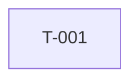

# 只读 sdd view HTML 运行视图任务清单（Tasks）

## 1. 元数据

| 项 | 内容 |
|---|---|
| Spec ID | SPEC-REQ-007 |
| 关联Spec | `docs/specs/SPEC-REQ-007/spec.md` |
| 关联Design | `docs/specs/SPEC-REQ-007/design.md` |
| 作者 | SDD Agent |
| 创建日期 | 2026-11-24T14:33:43+08:00 |
| 状态 | Draft |

## 2. 任务清单

<!-- TODO: 按公司字段填写任务表；每个 Task 必须能独立实现、验证并形成一个 Commit。 -->

| Task ID | 任务描述 | 关联FR/AC | 依赖Task | 并行标识 | 验收标准 | 单元测试类/方法 | 单Task测试命令 | 状态 | Commit SHA |
|---|---|---|---|---|---|---|---|---|---|
| T-001 | 待填写 | FR-001；AC-001-1 | None | S | 待填写 | `TestClass#testMethod` | `待填写` | Todo | — |

字段规则：

- Task ID 采用 `T-xxx`，在当前 Spec 内唯一。
- 状态仅允许 `Todo`、`In Progress`、`Done`。
- 并行标识仅允许 `P` 或 `S`；依赖为空时必须填写 `None`。
- 一个 Task 必须能够在一次实现会话中独立完成并验证。
- 一个 Task 必须对应一个最终本地代码 Commit；创建 Commit 后回填真实 Commit SHA。

## 3. AC—Task—单元测试映射

<!-- TODO: 每个 AC 一行，测试类/方法不得写“补充单测”等占位描述。 -->

| AC ID | 覆盖Task | 测试类/方法 | 测试命令/选择器 | 预期结果 | Gate 4实际结果 |
|---|---|---|---|---|---|
| AC-001-1 | T-001 | `TestClass#testMethod` | `待填写` | 待填写 | 未执行 |

映射规则：

- 必须覆盖 `spec.md` 中的全部适用 AC，不得增加不存在的 AC。
- 每条 AC 至少关联一个 Task 和一个具体测试类/方法。
- 同一测试覆盖多个 AC 时必须逐条登记。
- Gate 4 只有在测试真实存在、已执行且通过时，才能标记为“通过”。

## 4. 依赖图



## 5. 实施与提交顺序

```text
选择一个 Todo Task
→ 状态改为 In Progress
→ 实现代码和单元测试
→ 执行该 Task 的单元测试
→ 测试通过后状态改为 Done
→ 创建本地 Task Commit 并回填 SHA
→ 继续下一个 Task
```

全部 Task 完成后执行全量单元测试、逐 AC 验证和 Gate 5。

## 6. 全量单元测试记录

| 测试命令 | 退出码 | 执行数 | 通过数 | 失败数 | 跳过数 | 结果 |
|---|---:|---:|---:|---:|---:|---|
| `待填写` | 待填写 | 待填写 | 待填写 | 待填写 | 待填写 | 未执行 |

## 7. 自检清单（评审辅助，不作Gate依据）

- [ ] Spec ID 及 Spec/Design 引用有效且一致。
- [ ] Task ID 唯一，字段完整，状态值和并行标识合法。
- [ ] 每个 Task 可独立实现、独立单测并对应一个本地 Commit。
- [ ] 全部 FR/AC 均已映射到 Task，不存在孤儿 AC。
- [ ] 每条 AC 均已映射到具体测试类/方法和可执行命令。
- [ ] 所有依赖 Task 真实存在，依赖图无环，并行标识无冲突。

## 8. 变更历史

| 日期 | 版本 | 变更内容 | 作者 |
|---|---|---|---|
| 2026-11-24T14:33:43+08:00 | 1.0.0 | 初始版本 | SDD Agent |
