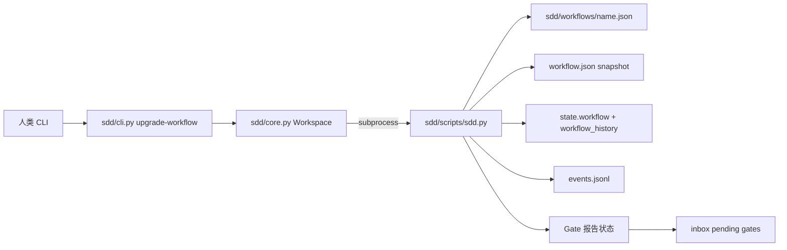

# 固定预设升级 upgrade-workflow 设计文档（Design）

## 1. 元数据

| 项 | 内容 |
|---|---|
| Spec ID | SPEC-REQ-008 |
| 关联Spec | `docs/specs/SPEC-REQ-008/spec.md` |
| 作者 | SDD Agent |
| 创建日期 | 2026-11-24 |
| 状态 | Draft |
| 评审人 | sdd-kit 平台维护者 |

## 2. 设计目标

- 核心问题：Spec 的 `workflow.json` 是创建时快照，仓库预设升级后旧 Spec 无法在
  保留审计的前提下切换；手工改快照会被 `resolve_workflow()` 判为不一致。
- 设计范围：人工升级命令、版本方向规则、原子快照替换、workflow_history、
  Gate 重校验与 inbox 缺口呈现。
- 非设计范围：任意 DAG 编辑、批量升级、MCP 写工具、自动批准 Gate。

## 3. 方案概述

- 高层方案：在 `sdd/scripts/sdd.py` 新增 `command_upgrade_workflow`。它解析
  `--to <name>@<version>`，校验人工身份、reason、版本方向与目标预设，然后
  备份旧快照、原子写入新快照，追加 `state.workflow_history` 与 `history`，
  最后调用 `save_state()` 写入 state 并追加事件；失败时恢复旧快照与旧 state。
- 关键决策：
  1. 目标预设必须已存在于 `sdd/workflows/`，`@version` 与预设 version 严格一致。
  2. 同预设同版本拒绝；降级仅允许 `--allow-downgrade` + `--design-change`。
  3. 跨预设允许，但 reason 必填并记录来源/目标 name。
  4. 升级后用目标预设的 `required_gates[当前状态]` 复核 Gate，未 PASS 的 Gate
     写入 `workflow_history[-1].pending_gates`，不写报告、不推进状态。
  5. `inbox` 动态复核 pending gates：仍缺失则展示，已有 PASS 报告则自动消失。
  6. `Workspace.upgrade_workflow()` 通过子进程调用状态机；CLI 再强制 `--human`。
  7. 旧工件只读；升级仅改 `workflow.json`、`state.json`、`events.jsonl`。
- 方案对比：
  - 直接改 `state.workflow` 不换快照：`resolve_workflow()` 会报 digest 不一致，放弃。
  - 创建新 Spec：丢失原 Spec 的审批、任务和证据链，放弃。
  - 在 MCP 暴露升级：违反人工动作边界，放弃。

## 4. Spec覆盖关系

| FR/AC | 设计章节/模块 | 实现方式 | 验证方式 |
|---|---|---|---|
| FR-001 / AC-001-1 | 升级命令 | 校验后替换快照与 state，返回 from/to | `UpgradeWorkflowTests#test_upgrade_same_preset_version` |
| FR-001 / AC-001-2 | 同版本拒绝 | name+version 相同直接报错 | `UpgradeWorkflowTests#test_reject_same_version` |
| FR-001 / AC-001-3 | 目标校验 | 预设不存在/version 不匹配报错并列出可用项 | `UpgradeWorkflowTests#test_reject_missing_preset_and_version` |
| FR-001 / AC-001-4 | 降级/跨预设 | `--allow-downgrade` + `--design-change` 留痕 | `UpgradeWorkflowTests#test_cross_preset_and_downgrade_rules` |
| FR-001 / AC-001-5 | 人工与状态边界 | 缺 --human/reason、MERGED/BLOCKED 拒绝 | `UpgradeWorkflowTests#test_reject_without_human_and_merged` |
| FR-002 / AC-002-1 | 历史记录 | workflow_history 记录 from/to/审批/原因/时间/pending | `UpgradeAuditTests#test_upgrade_history_fields` |
| FR-002 / AC-002-2 | 工件保护 | 只写 workflow/state/events | `UpgradeAuditTests#test_upgrade_keeps_artifacts` |
| FR-002 / AC-002-3 | 原子性 | 备份旧快照/旧 state，异常恢复 | `UpgradeAuditTests#test_failed_upgrade_keeps_snapshot` |
| FR-003 / AC-003-1 | Gate 重校验 | required_gates + gate_report_status | `UpgradeGateTests#test_upgrade_records_pending_gates` |
| FR-003 / AC-003-2 | inbox 展示 | build_inbox_extras 读取 pending_gates 动态复核 | `UpgradeGateTests#test_inbox_lists_pending_gate` |
| FR-003 / AC-003-3 | 缺口消失 | 报告 PASS 后 inbox item 不再输出 | `UpgradeGateTests#test_pending_gate_disappears_after_pass` |
| FR-004 / AC-004-1 | MCP 边界 | CLI 注册，MCP 无工具 | `UpgradeBoundaryTests#test_mcp_does_not_expose_upgrade` |
| FR-004 / AC-004-2 | 发布同步 | 版本 0.9.9、manifest、三处文档 | `UpgradeBoundaryTests#test_release_metadata` |
| FR-004 / AC-004-3 | 快照一致性 | 升级后 status 正常解析 | `UpgradeWorkflowTests#test_status_after_upgrade` |

## 5. 系统架构

### 5.1 架构图



### 5.2 模块职责

- `sdd/scripts/sdd.py`：目标解析、规则校验、原子写入、历史记录、pending gate 计算。
- `sdd/core.py`：`Workspace.upgrade_workflow()` 子进程封装，要求 `human=True`。
- `sdd/cli.py`：参数注册与 `--human` 强制。
- `inbox`：`build_inbox_extras()` 新增 workflow pending gate 条目。

## 6. 数据模型

### 6.1 state.workflow_history 条目

```json
{
  "from": {"name": "l2-standard", "version": 1, "digest": "…"},
  "to": {"name": "l2-standard", "version": 2, "digest": "…"},
  "approver": "name <mail>",
  "reason": "统一到新门禁",
  "at": "2026-11-24T16:00:00+08:00",
  "design_change": "ADR-002",
  "pending_gates": ["G2"]
}
```

### 6.2 事件

`state.history` 追加一条 `action=workflow_upgraded` 的记录，`save_state()` 生成
对应 `events.jsonl` 事件，保持哈希链连续。

## 7. 接口契约

```powershell
python -m sdd upgrade-workflow --spec SPEC-REQ-008 --to l2-standard@2 --reason "统一到新门禁" --human
python -m sdd upgrade-workflow --spec SPEC-REQ-008 --to l2-standard@1 --reason "回退" --allow-downgrade --design-change "ADR-002" --human
```

成功返回：`ok`、`kind=workflow_upgrade`、`from`、`to`、`pending_gates`、
`gate_errors`、`history` 和 `next`。

## 8. 认证、授权、幂等与安全

- CLI 与状态机双重 `--human`；Agent/MCP 无法调用。
- approver 复用 `resolve_approver()`，不传时取 Git 配置。
- reason 必填；降级必须提供 design-change 引用。
- 写入顺序：备份旧快照与旧 state → 写新快照 → save_state；任一步异常恢复原状。
- 不执行网络请求，不读取密钥。

## 9. 关键决策 ADR

| ID | 决策 | 原因 | 后果 |
|---|---|---|---|
| ADR-001 | 目标版本必须与预设 version 一致 | 防止“文件名 2 但内容 1” | 平台发布需同步 version |
| ADR-002 | 降级需显式 design-change | 避免无声回退门禁 | 参数与历史字段增加 |
| ADR-003 | pending gates 动态复核 | 避免历史记录过期误导 | inbox 每次读取 Gate 状态 |
| ADR-004 | 失败时恢复旧快照与旧 state | 保证无半升级状态 | 实现需备份与异常处理 |
| ADR-005 | 升级不重写旧工件 | 审计不可变 | 仅三个文件变化 |

## 10. 非功能需求设计

- 性能：升级只读一个预设和少量 Gate 报告，正常小于 1 秒。
- 可靠性：异常路径恢复快照与 state；再次 `status` 不报 digest 不一致。
- 可维护性：版本规则集中在单一命令函数，inbox 只读历史。
- 兼容性：历史 Spec 无 `workflow_history` 时按空数组处理。

## 11. 依赖与风险

| 风险 | 影响 | 缓解 | 负责人 |
|---|---|---|---|
| 预设 version 与内容不同步 | 升级后 digest 混乱 | 强制 version 匹配并校验 digest | 平台维护者 |
| 写 state 失败 | 快照与 state 不一致 | 备份+恢复旧快照/state | 平台维护者 |
| pending gate 记录过期 | inbox 误导 | 每次动态复核报告状态 | 平台维护者 |
| 跨预设门禁收紧 | 当前阶段突然阻断 | 升级提示 pending gates，人工补 Gate | 平台维护者 |
| 误用降级 | 门禁被放宽 | 强制 design-change 并写历史 | 平台维护者 |

## 12. 回滚方案

- 回滚条件：升级导致 `status`/`check` 解析失败或门禁异常。
- 回滚步骤：使用 `upgrade-workflow --allow-downgrade --design-change` 回到旧版本，
  或回退本 Spec 相关 commit。
- 数据回滚：恢复旧预设版本后重新升级；历史保留，不删除记录。
- 配置回滚：版本与 manifest 随 commit 回退。

## 13. 验收标准

| AC | 验证方式 | 证据 |
|---|---|---|
| AC-001-1 | 升级成功与快照/state 一致 | 单元测试 |
| AC-001-2 | 同版本拒绝 | 单元测试 |
| AC-001-3 | 预设/版本不存在 | 单元测试 |
| AC-001-4 | 跨预设与降级规则 | 单元测试 |
| AC-001-5 | 人工/状态边界 | 单元测试 |
| AC-002-1 | 历史字段完整 | 单元测试 |
| AC-002-2 | 旧工件哈希不变 | 单元测试 |
| AC-002-3 | 失败回滚 | 单元测试 |
| AC-003-1 | pending gates 记录 | 单元测试 |
| AC-003-2 | inbox 展示 | 单元测试 |
| AC-003-3 | 缺口消失 | 单元测试 |
| AC-004-1 | MCP 边界 | 单元测试 |
| AC-004-2 | 版本/manifest/文档 | 单元测试 + `verify-core` |
| AC-004-3 | 升级后 status | 单元测试 |

## 14. 变更历史

| 日期 | 版本 | 变更内容 | 作者 |
|---|---|---|---|
| 2026-11-24 | 1.0.0 | 初始版本 | SDD Agent |
