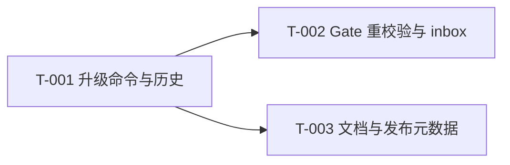

# 固定预设升级 upgrade-workflow 任务清单（Tasks）

## 1. 元数据

| 项 | 内容 |
|---|---|
| Spec ID | SPEC-REQ-008 |
| 关联Spec | `docs/specs/SPEC-REQ-008/spec.md` |
| 关联Design | `docs/specs/SPEC-REQ-008/design.md` |
| 作者 | SDD Agent |
| 创建日期 | 2026-11-24 |
| 状态 | Draft |

## 2. 任务清单

| Task ID | 任务描述 | 关联FR/AC | 依赖Task | 并行标识 | 验收标准 | 单元测试类/方法 | 单Task测试命令 | 状态 | Commit SHA |
|---|---|---|---|---|---|---|---|---|---|
| T-001 | 实现 `upgrade-workflow` 状态机命令、Workspace/CLI 入口、历史与原子写入 | FR-001；FR-002；FR-004；AC-001-1；AC-001-2；AC-001-3；AC-001-4；AC-001-5；AC-002-1；AC-002-2；AC-002-3；AC-004-1；AC-004-3 | None | S | 版本规则、降级例外、历史字段、工件保护与失败恢复正确 | `UpgradeWorkflowTests#test_upgrade_same_preset_version` | `python -m unittest tests.test_upgrade_workflow.UpgradeWorkflowTests tests.test_upgrade_workflow.UpgradeAuditTests -v` | Done | bf00660 |
| T-002 | 实现升级后的 Gate 重校验、pending_gates 与 inbox 展示 | FR-003；AC-003-1；AC-003-2；AC-003-3 | T-001 | S | 缺失 Gate 记录并进入 inbox，PASS 后自动消失 | `UpgradeGateTests#test_upgrade_records_pending_gates` | `python -m unittest tests.test_upgrade_workflow.UpgradeGateTests -v` | Done | c0db4ed |
| T-003 | 同步 README、执行手册、Agent 契约、版本与 manifest | FR-004；AC-004-2 | T-001 | S | 版本 0.9.9；manifest 重写；三处文档有命令 | `UpgradeBoundaryTests#test_release_metadata` | `python -m unittest tests.test_upgrade_workflow.UpgradeBoundaryTests -v` | Done | f544606 |

字段规则：

- Task ID 采用 `T-xxx`，在当前 Spec 内唯一。
- 状态仅允许 `Todo`、`In Progress`、`Done`。
- 并行标识仅允许 `P` 或 `S`；依赖为空时必须填写 `None`。
- 一个 Task 必须对应一个最终本地代码 Commit；创建 Commit 后回填真实 Commit SHA。

## 3. AC—Task—单元测试映射

| AC ID | 覆盖Task | 测试类/方法 | 测试命令/选择器 | 预期结果 | Gate 4实际结果 |
|---|---|---|---|---|---|
| AC-001-1 | T-001 | `UpgradeWorkflowTests#test_upgrade_same_preset_version` | `python -m unittest tests.test_upgrade_workflow.UpgradeWorkflowTests.test_upgrade_same_preset_version -v` | 快照与 state 同步升级 | 未执行 |
| AC-001-2 | T-001 | `UpgradeWorkflowTests#test_reject_same_version` | `python -m unittest tests.test_upgrade_workflow.UpgradeWorkflowTests.test_reject_same_version -v` | 同版本拒绝且状态不变 | 未执行 |
| AC-001-3 | T-001 | `UpgradeWorkflowTests#test_reject_missing_preset_and_version` | `python -m unittest tests.test_upgrade_workflow.UpgradeWorkflowTests.test_reject_missing_preset_and_version -v` | 预设/版本不存在被拒绝 | 未执行 |
| AC-001-4 | T-001 | `UpgradeWorkflowTests#test_cross_preset_and_downgrade_rules` | `python -m unittest tests.test_upgrade_workflow.UpgradeWorkflowTests.test_cross_preset_and_downgrade_rules -v` | 跨预设允许；降级需 design-change | 未执行 |
| AC-001-5 | T-001 | `UpgradeWorkflowTests#test_reject_without_human_and_merged` | `python -m unittest tests.test_upgrade_workflow.UpgradeWorkflowTests.test_reject_without_human_and_merged -v` | 缺 human/BLOCKED 被拒绝 | 未执行 |
| AC-002-1 | T-001 | `UpgradeAuditTests#test_upgrade_history_fields` | `python -m unittest tests.test_upgrade_workflow.UpgradeAuditTests.test_upgrade_history_fields -v` | 历史字段完整 | 未执行 |
| AC-002-2 | T-001 | `UpgradeAuditTests#test_upgrade_keeps_artifacts` | `python -m unittest tests.test_upgrade_workflow.UpgradeAuditTests.test_upgrade_keeps_artifacts -v` | 旧工件字节不变 | 未执行 |
| AC-002-3 | T-001 | `UpgradeAuditTests#test_failed_upgrade_keeps_snapshot` | `python -m unittest tests.test_upgrade_workflow.UpgradeAuditTests.test_failed_upgrade_keeps_snapshot -v` | 失败无半升级状态 | 未执行 |
| AC-003-1 | T-002 | `UpgradeGateTests#test_upgrade_records_pending_gates` | `python -m unittest tests.test_upgrade_workflow.UpgradeGateTests.test_upgrade_records_pending_gates -v` | 缺失 Gate 写入 pending | 未执行 |
| AC-003-2 | T-002 | `UpgradeGateTests#test_inbox_lists_pending_gate` | `python -m unittest tests.test_upgrade_workflow.UpgradeGateTests.test_inbox_lists_pending_gate -v` | inbox 展示缺口 | 未执行 |
| AC-003-3 | T-002 | `UpgradeGateTests#test_pending_gate_disappears_after_pass` | `python -m unittest tests.test_upgrade_workflow.UpgradeGateTests.test_pending_gate_disappears_after_pass -v` | PASS 后 item 消失 | 未执行 |
| AC-004-1 | T-001 | `UpgradeBoundaryTests#test_mcp_does_not_expose_upgrade` | `python -m unittest tests.test_upgrade_workflow.UpgradeBoundaryTests.test_mcp_does_not_expose_upgrade -v` | MCP 无升级工具 | 未执行 |
| AC-004-2 | T-003 | `UpgradeBoundaryTests#test_release_metadata` | `python -m unittest tests.test_upgrade_workflow.UpgradeBoundaryTests.test_release_metadata -v` | 版本/manifest/文档一致 | 未执行 |
| AC-004-3 | T-001 | `UpgradeWorkflowTests#test_status_after_upgrade` | `python -m unittest tests.test_upgrade_workflow.UpgradeWorkflowTests.test_status_after_upgrade -v` | 升级后 status/next 正常 | 未执行 |

## 4. 依赖图

## 5. 实施与提交顺序

1. T-001：实现状态机命令、core/CLI、历史与原子写入，跑 `UpgradeWorkflowTests` 与 `UpgradeAuditTests`。
2. T-002：实现 Gate 重校验与 inbox，跑 `UpgradeGateTests`。
3. T-003：同步文档、版本和 manifest，跑 `UpgradeBoundaryTests` 与 `verify-core`。
4. 每个 Task 完成后用 `sdd submit-task` 记录证据和 Commit SHA。

## 6. 全量单元测试记录

| 命令 | 作用域 | 退出码 | 时间 | 备注 |
|---|---|---|---|---|
| `python -m unittest tests.test_upgrade_workflow -v` | 升级测试 | 未执行 | - | G4 回填 |
| `python -m unittest discover -s tests -v` | 全量测试 | 未执行 | - | G5 回填 |

## 7. 自检清单

- [x] Task ID 唯一，依赖与并行标识合法。
- [x] 每条 AC 都有 Task 和测试映射。
- [x] 每个 Task 都有可执行的单 Task 测试命令。
- [x] 依赖图 Mermaid 与任务顺序一致。
- [x] 人工动作边界与 MCP 基线不变。

## 8. 变更历史

| 日期 | 版本 | 变更内容 | 作者 |
|---|---|---|---|
| 2026-11-24 | 1.0.0 | 初始版本 | SDD Agent |
